# 1. Jak czytać kompilator Borka

## Książka przypięta do kodu

Ten podręcznik wyjaśnia budowę kompilatora Borka na podstawie gałęzi `main`, pobranej 2 listopada 2026 roku. Punktem odniesienia jest commit `56f4910a24b689087fe2dee30247651b7b432268`, zapisany 30 października 2026 roku. Odsyłacze do źródeł prowadzą do tej konkretnej wersji. Dzięki temu opis można zestawić z kodem także wtedy, gdy projekt pójdzie dalej.

Zakładamy znajomość programowania: funkcji, struktur danych, stosu wywołań oraz podstaw wskaźników. Znajomość Rusta pomaga przy czytaniu implementacji, ale nie jest warunkiem rozumienia koncepcji. Terminy takie jak unifikacja, SSA czy monomorfizacja są wprowadzane przy pierwszym użyciu. Po przeczytaniu książki powinieneś umieć prześledzić program przez kompilator, uzasadnić jego diagnozę i wskazać miejsca, które trzeba zmienić, dodając nową cechę.

Ważne rozróżnienie dotyczy trzech rodzajów materiału. Programy podpisane ścieżką `programs/...` pochodzą z korpusu projektu. Fragmenty pokazują wybraną część programu i mogą wymagać otaczających deklaracji. Schematy HIR, LLVM i algorytmów służą wyjaśnieniu; są oznaczone jako schemat lub pseudokod, jeżeli nie stanowią dosłownego wydruku narzędzia. Nie należy kopiować schematu LLVM jako gotowego modułu.

## Dwa sposoby korzystania

Przy pierwszej lekturze czytaj kolejno rozdziały 1–8, żeby poznać reprezentacje programu i język. Rozdziały 9–14 wyjaśniają model pamięci, który najmocniej wyróżnia Borka. Rozdziały 15–20 prowadzą przez backend i narzędzia. Rozdział 21 składa te wiadomości w jeden przebieg. Ćwiczenia z rozdziału 22 pomagają utrwalić intuicję.

Przy pracy nad konkretnym problemem zacznij od indeksu tematycznego albo rozdziału 23. Jeżeli zastanawiasz się, dlaczego `Ref<Node>` wymaga guarda, przejdź do rozdziału 12. Jeżeli typ jest poprawny, ale nie powstaje binarka, sprawdź rozdziały 15 i 18. Jeżeli po dodaniu nowego wariantu HIR rozjeżdża się plan regionów, potrzebne będą rozdziały 10, 17 i 20. Spis treści, zakładki czytnika PDF oraz indeks mają wspierać te różne sposoby czytania.

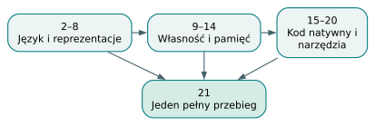

*Mapa lektury. Numery wskazują rozdziały. Studium przypadku łączy wszystkie warstwy.*

## Kompilator jako ciąg zobowiązań

Kompilator przekształca program w kolejne reprezentacje i przy okazji uzasadnia coraz więcej jego własności. Parser odpowiada, czy tekst ma dozwoloną strukturę. Rozwiązywanie nazw ustala, do której deklaracji należy użycie identyfikatora. Kontrola typów sprawdza, jakie operacje mają sens. Analiza własności ustala, czy używana wartość nadal jest dostępna i czy pożyczka nie przeżywa właściciela. Plan pamięci wybiera sposób przechowywania obiektów. Backend produkuje instrukcje, które realizują te ustalenia.

Weźmy wyrażenie `p.x + 1`. Dla parsera jest to dodawanie odczytu pola i literału. Kontrola typów musi wiedzieć, czym jest `p`, czy ma pole `x` i jaki typ przyjąć dla `1`. Analiza własności sprawdza, czy `p` nie zostało wcześniej przeniesione. Backend potrzebuje indeksu pola w strukturze oraz instrukcji dodawania zgodnej z jego typem. Ten sam krótki zapis uruchamia więc kilka różnych rodzajów rozumowania.

Podział na fazy ogranicza liczbę pytań rozwiązywanych jednocześnie. Generator kodu nie powinien ponownie zgadywać, którą funkcję autor miał na myśli. Gdy dostaje typowany HIR, część informacji jest już utrwalona. Kompilator może jednak zachować dodatkowe reprezentacje: w Borku analiza własności nadal odwiedza AST, otrzymując typy i rozstrzygnięcia członków z kontroli typów. Dlatego rzeczywisty przepływ danych ma rozgałęzienia; nie jest jedynie prostą kolejką drzew.

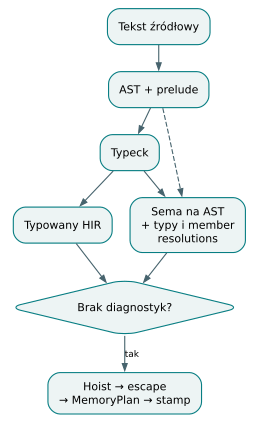

*Przepływ danych w aktualnym frontendzie. Analiza własności odwiedza AST, korzystając z informacji wyprowadzonych przez typeck.*

## Język, implementacja i granica backendu

Bork ma ekspresyjną składnię zbliżoną do Kotlina, ale własny model pamięci. Bloki uczestniczą w organizowaniu regionów. Wartości posiadające zasoby podlegają regułom własności; dane mogą wymagać skopiowania do innego regionu albo wybrania docelowej areny już w chwili konstrukcji. Runtime obsługuje areny i zarządzane odwołania, bez śledzącego garbage collectora.

Z tego opisu nie wynika, że każdy blok zawsze wywołuje alokator ani że każde zwolnienie jest pojedynczą instrukcją o stałym koszcie. Kompilator może pominąć niepotrzebną arenę. Zwolnienie stron i obsługa zapisanych odwołań mają własny koszt. Rysunki regionów przedstawiają zależności czasu życia, a dopiero rozdziały o implementacji pokazują, kiedy stają się one konkretnymi strukturami runtime'u.

W projekcie istnieje też różnica między akceptacją frontendu a obsługą natywną. `bork plik.bork` sprawdza program. `bork build plik.bork` dodatkowo wymaga obsługi przez backend, funkcji wejściowej i działającego toolchainu. Przykładem świadomego ograniczenia są trailing closures: ich składnia jest rozpoznawana, ale kod natywny tej wersji ich nie obsługuje. Traity i wywołania statyczne są natomiast już zaimplementowane, choć niektóre starsze opisy projektu mówią inaczej.

## Jak oceniać decyzję projektową

Każdą decyzję warto rozpatrywać na trzech poziomach. Pierwszy to semantyka: co ma znaczyć program? Drugi to reprezentacja: jak zapisać potrzebną informację w AST, HIR i strukturach analizy? Trzeci to realizacja: jakie instrukcje oraz wywołania runtime'u mają powstać? Na przykład brak wartości może być pojęciem językowym, wariantem enumu i konkretnym tagiem w pamięci. Te poziomy są powiązane, ale nie muszą mieć identycznej postaci.

W książce szczególnie pilnujemy różnicy między uzasadnieniem ogólnym a własnością aktualnego Borka. Rozdział o unifikacji wyjaśnia uniwersalny algorytm, a potem wskazuje ograniczenia konkretnego solvera. Rozdział o referencjach wyjaśnia silne i słabe krawędzie, ale nie przypisuje Borkowi dowolnego systemu `shared_ptr`. Zrozumienie implementacji wymaga obu perspektyw: pojęcia tłumaczą cel, kod ujawnia rzeczywiste granice.

Ćwiczenie: błąd „unknown field” pojawił się przed emisją LLVM. Która informacja była niezbędna do jego wykrycia? Odpowiedź: typ odbiorcy i lista jego pól. Sama poprawność składni `p.x` nie wystarcza; naturalnym miejscem diagnozy jest kontrola typów i rozwiązywanie dostępu do członka.

Źródła: [frontend::check](https://github.com/andrzejwitkowski/Bork/blob/56f4910a24b689087fe2dee30247651b7b432268/src/frontend.rs), [CheckResult i reprezentacje](https://github.com/andrzejwitkowski/Bork/blob/56f4910a24b689087fe2dee30247651b7b432268/src/hir/mod.rs), [bramka backendu](https://github.com/andrzejwitkowski/Bork/blob/56f4910a24b689087fe2dee30247651b7b432268/src/codegen_gate.rs), [CLI](https://github.com/andrzejwitkowski/Bork/blob/56f4910a24b689087fe2dee30247651b7b432268/src/main.rs).

# 2. Anatomia języka: składnia, wartości i sterowanie

## Najpierw program, potem jego reprezentacja

Bork łączy niewielką składnię języka imperatywnego z jawnymi decyzjami
dotyczącymi własności i pamięci. Jednostką wejścia frontendu jest tekst
zawierający deklaracje funkcji, klas, enumów, stałych, traitów i implementacji
traitów. Nie ma instrukcji wykonywanych bezpośrednio na poziomie pliku.
Punktem wejścia programu wykonywalnego jest funkcja `main`. Klamry wyznaczają
bloki, natomiast instrukcje rozdziela nowa linia. Średnik nie jest zwyczajowym
separatorem instrukcji; pojawia się wewnątrz zapisu typu tablicy `[T; N]`.
Komentarz `//` trwa do końca wiersza.

Rozdział warto zacząć od kompletnego, istniejącego programu. Jest zarazem
małym przykładem języka i materiałem do późniejszego śledzenia pracy
kompilatora.

```bork
// exit: 7
class Point {
    x: i32
    y: i32

    fun sum(): i32 {
        return x + y
    }
}

fun main(): i32 {
    val p = Point(3, 4)
    return p.sum()
}
```

Źródło: [programs/build/methods/basic.bork](https://github.com/andrzejwitkowski/Bork/blob/56f4910a24b689087fe2dee30247651b7b432268/programs/build/methods/basic.bork).
Dyrektywa `exit` opisuje oczekiwanie korpusu testowego; jest komentarzem dla kompilatora. Weryfikację korpusu opisuje dodatek A.

Konstruktor `Point(3, 4)` przypisuje argumenty polom w kolejności deklaracji.
Metody nie są argumentami konstruktora. Wiązanie `p` otrzymuje typ `Point`,
a wywołanie `p.sum()` pożycza odbiorcę na czas wywołania. Wewnątrz `sum`
nazwy `x` i `y` oznaczają pola tego odbiorcy. Dodawanie daje `i32`, zgodny
z jawnym typem wyniku metody, a następnie funkcji `main`. To przejście
pokazuje trzy osobne zagadnienia: zbudowanie wartości, znalezienie członka
klasy i zgodność typu wyniku.

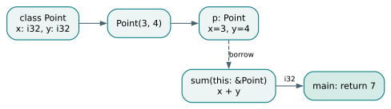

*Od deklaracji do wyniku. Przerywana strzałka oznacza pożyczenie odbiorcy; wynik metody jest liczbą.*

## Wiązanie nie jest obiektem

`val` zabrania ponownego przypisania do nazwy, a `var` na nie pozwala.
Nie wynika z tego głęboka niemutowalność obiektu. Pola klasy są zapisywalne
także przez wiązanie `val`; osobne reguły mają między innymi operacje
modyfikujące `Vec`. Parametr bez słowa `val` lub `var` jest domyślnie `val`.
Adnotację typu lokalnego można pominąć, jeżeli kompilator potrafi ustalić
typ inicjalizatora oraz rozwiązać powstałe ograniczenia.

Typy całkowite mają konkretne szerokości i znak: od `i8` do `i64` oraz od
`u8` do `u64`. Dostępne są `f32`, `f64`, `bool` i `unit`. Nazwy takie jak
`Int` czy `Long` są aliasami odpowiednio `i32` i `i64`. Nie tworzą nowych
typów nominalnych. Literał całkowity może przyjąć oczekiwany typ całkowity,
ale nie oznacza to dowolnych niejawnych konwersji liczb. Wartość już ustalona
jako `u8` nie staje się automatycznie `i64` przy kolejnym użyciu.

Typy prymitywne są kopiowalne; klasy, `String`, enumy i tablice wymagają
uwzględnienia własności. `String` udostępnia długość
i indeksowanie bajtów, zatem `s[i]` zwraca `u8`, a nie znak Unicode.
Tablica `[T; N]` ma długość będącą częścią typu. Wektor `Vec<T>` jest
osobną konstrukcją wbudowaną. Różnica między tablicą długości trzy i cztery
jest dla checkera różnicą typów, nie tylko wartością sprawdzaną przy wykonaniu.

Warto też od razu rozdzielić trzy zapisy: `T` oznacza zwykłą wartość,
`&T` pożyczony widok, a `Ref<T>` zarządzany uchwyt z możliwością nieobecności
celu. Żaden z tych zapisów nie oznacza po prostu „tego samego wskaźnika”.
Zapis `T?` jest natomiast skrótem `Option<T>`. Operacje `move` i `promote`
są elementami modelu własności i regionów; ich poprawności nie rozstrzyga
samo porównanie typów.

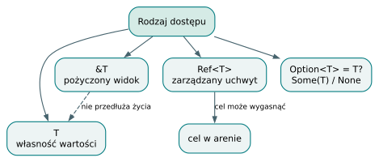

*Cztery różne rodzaje dostępu. Wartość, pożyczka, zarządzany uchwyt i opcja mają różne obowiązki.*

## Wyrażenia i przepływ sterowania

Funkcja bez adnotacji wyniku zwraca `unit`. Jawny `return` kończy funkcję,
a funkcja deklarująca inny typ wyniku musi zwracać odpowiednią wartość na
wszystkich ścieżkach rozpoznawanych przez analizator. Ostatnie wyrażenie
bloku może dostarczać wartość gałęzi `if` lub ramienia `when`; nie należy
przenosić tego zwyczaju na domniemany, niejawny zwrot z całej funkcji.

Warunek zwykłego `if` i pętli `while` ma typ `bool`. `if` może być
wyrażeniem, gdy gałęzie dają odpowiedni wynik. `when` dopasowuje wzorce
i sprawdza pokrycie przypadków. Pętla `for (i in 0..10)` korzysta z zakresu;
obecna implementacja wymaga w tej pętli elementów typu `i32`. `break`
i `continue` mają sens wyłącznie wewnątrz pętli. Operatory `&&` i `||`
mają semantykę krótkiego spięcia, istotną wtedy, gdy prawa strona wykonuje
wywołanie z efektem ubocznym.

Metoda widzi `this` jako pożyczone `&Self`. Można odczytywać i zmieniać
pola, ale nie przypisać nowej wartości do `this` ani przenieść odbiorcy
przez `move this`. Lokalna nazwa lub parametr przesłania pole; zapis
`this.x` pozwala je wtedy wskazać jawnie. Klasy nie mają dziedziczenia,
przeciążania metod, metod statycznych ani kontroli widoczności. Wspólne
zachowanie wyraża się traitami.

## Pułapka i ćwiczenie

Pułapką jest oczekiwanie, że każde składniowo poprawne wyrażenie ma już
pełną obsługę wykonania. Parser przyjmuje więcej konstrukcji niż generator
LLVM: przykładem są niektóre postacie domknięć. Także `Point(3, 4).sum()`
nie jest zamiennikiem pokazanego programu: odbiorca metody musi być
adresowalnym miejscem, na przykład nazwanym wiązaniem. Najpierw należy
przypisać obiekt do `val`.

**Ćwiczenie.** Czy zmiana `val p` na `var p` jest konieczna, aby metoda
mogła zmodyfikować pole `x`? **Odpowiedź.** Nie. Zmienność wiązania
i zmienność pól klasy to osobne reguły. `var` byłoby potrzebne do
ponownego przypisania całego wiązania `p`.

Do lektury kodu: [gramatyka języka](https://github.com/andrzejwitkowski/Bork/blob/56f4910a24b689087fe2dee30247651b7b432268/src/parser.lalrpop),
[instrukcje i kontrola zwrotów](https://github.com/andrzejwitkowski/Bork/blob/56f4910a24b689087fe2dee30247651b7b432268/src/typeck/stmt/mod.rs),
[sprawdzanie odbiorcy metody](https://github.com/andrzejwitkowski/Bork/blob/56f4910a24b689087fe2dee30247651b7b432268/src/typeck/expr/method.rs)
oraz [referencja składni](https://github.com/andrzejwitkowski/Bork/blob/56f4910a24b689087fe2dee30247651b7b432268/docs/language.md).


# 3. Od tekstu do AST: lexer, LALRPOP i tożsamość węzłów

## Parser jest pierwszą umową między fazami

Analiza składniowa zamienia ciąg bajtów w drzewo konstrukcji języka.
Nie ustala jeszcze, czy nazwa istnieje, czy dodawane wartości są liczbami
ani czy obiekt żyje wystarczająco długo. Jej umowa brzmi: rozpoznać
strukturę zgodną z gramatyką oraz zachować informacje potrzebne do
późniejszego wskazania błędu. Bork zapisuje gramatykę w pliku
`src/parser.lalrpop`, a `build.rs` wywołuje `lalrpop::process_src()`.
Kod parsera powstaje podczas budowania kompilatora; użytkownik języka
nie uruchamia osobnego generatora parserów dla każdego programu.

Lexer jest opisany w tej samej gramatyce. Pomija zwykłe białe znaki
i komentarze, ale zachowuje znaczenie nowej linii jako tokenu `NL`.
Słowa kluczowe mają własne tokeny, więc `trait` nie może zostać nazwą
zmiennej. Podobna nazwa, na przykład `traitValue`, pozostaje identyfikatorem.
Jest to różnica leksykalna, niezależna od tego, czy w tablicy symboli
istniałaby deklaracja o takim napisie.

## Nowa linia zależy od otoczenia

W języku bez średników wielowierszowe wywołanie wymaga ustalenia, które
nowe linie kończą instrukcję. Przed uruchomieniem parsera funkcja
`normalize_parenthesized_newlines` zastępuje niektóre bajty `\n` bajtem
`\r`. Lexer pomija `\r`, więc podział wierszy wewnątrz nawiasów okrągłych
może być traktowany jak odstęp. Zastąpienie jednego bajtu jednym bajtem
zachowuje wszystkie przesunięcia w oryginalnym tekście.

Algorytm nie usuwa nowych linii bezwarunkowo. Pamięta głębokość klamer
przy otwieraniu nawiasów okrągłych. Nowe linie w bloku zagnieżdżonym
wewnątrz tych nawiasów nadal rozdzielają instrukcje. Pomija również
zawartość napisów i komentarzy, aby znajdujący się w nich nawias nie
zmienił stanu skanowania. To niewielki etap normalizacji układu tekstu,
a nie drugi parser całego języka.

Osobna reguła leksykalna włącza opcjonalne nowe linie i komentarze
poprzedzające `else` do rozpoznania tego słowa. Dzięki temu `else`
umieszczone w kolejnym wierszu nadal należy do poprzedniego `if`.
Z kolei nowa linia przed otwierającym nawiasem wywołania kończy instrukcję;
nie wolno zakładać, że dowolne łamanie wierszy jest obojętne. Testy parsera
utrwalają obie sytuacje, łącznie z pozycją błędu po normalizacji.

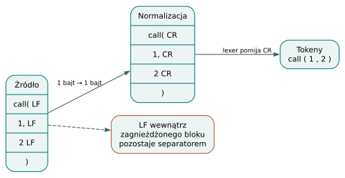

*Tekst zachowujący pozycje. Zamiana LF na CR ma długość jednego bajtu i zachowuje offsety w oryginalnym tekście.*

## Priorytety zapisane jako warstwy gramatyki

Rozważmy fragment dydaktyczny, niebędący nowym uruchomionym programem:

```bork
val n = 1 + 2 * 3
```

Parser najpierw rozpoznaje literały. Poziom mnożenia może połączyć `2`
i `3`, zanim poziom dodawania złoży całość z `1`. W AST powstaje zatem
`Add(Int(1), Mul(Int(2), Int(3)))`. Drzewo nie przechowuje „płaskiego”
ciągu operatorów wymagającego późniejszej korekty priorytetów. Reguła
`ExprAdd` odwołuje się do `ExprMul`, co bezpośrednio wymusza strukturę.

Wspólna reguła `BinTier<Op, Next>` buduje operatory binarne danego
poziomu. Jej lewa rekurencja daje lewostronne wiązanie: odejmowanie
`a - b - c` grupuje się jako `(a - b) - c`. Od najsłabszego poziomu
gramatyka prowadzi przez `?:`, `||`, `&&`, zakres, porównania, dodawanie,
mnożenie, operatory prefiksowe i sufiksy. Elvis `?:` ma własną prawą
rekurencję, zatem nie należy wywodzić jego łączności z `BinTier`.

Wywołania, indeksowanie i dostęp do pól są sufiksami. Powtarzanie tej
warstwy pozwala zbudować łańcuch dostępu bez mnożenia specjalnych
reguł dla każdej jego długości. W zapisie wywołania funkcji generycznej
`id::<i32>(7)` separator `::` rozdziela argumenty typowe od zwykłych
porównań `<` i `>`. Parser zapisuje podane typy w AST; dopiero checker
sprawdzi, czy wskazana funkcja rzeczywiście jest generyczna.

## Pozycja i tożsamość to różne informacje

`Span` zawiera `start` i `end`, czyli przesunięcia bajtowe w źródle.
Przedział pozwala zaznaczyć fragment tekstu, ale nie jest identyfikatorem
węzła. Dwie konstrukcje syntetyczne mogą odnosić się do tego samego
fragmentu, a późniejsze instancje generyczne mogą współdzielić pozycję.
Przy UTF-8 liczba bajtów nie musi być liczbą znaków widocznych
w edytorze. Konwersja do pozycji interfejsu użytkownika jest odrębną pracą.

Gramatyka pozostawia `AstId::DUMMY`. Publiczne `parse` korzysta
z `parse_indexed`, które po analizie składniowej numeruje odpowiednie
węzły AST i zwraca indeks par `(Span, AstId)`. Identyfikatory są gęste
i unikatowe w obrębie danego drzewa. Typowanie zapisuje pod nimi
ustalone typy i rozstrzygnięcia członków. Metoda `numbered()` celowo
przerywa wykonanie przy próbie użycia `DUMMY` jako klucza faktu:
ciche kolizje oznaczałyby przypisywanie informacji niewłaściwym węzłom.

Późniejszy `hir::NodeId` należy do innej przestrzeni tożsamości.
Numeruje wyrażenia HIR po przekształceniach takich jak hoisting.
Nie jest kontynuacją numeracji AST i nie należy zamieniać tych typów.
Korpus sprawdza oddzielnie gęstość `AstId` oraz unikatowość identyfikatorów
wyrażeń HIR. Takie rozdzielenie ułatwia zmianę reprezentacji bez udawania,
że transformacja zachowała każdy węzeł w relacji jeden do jednego.

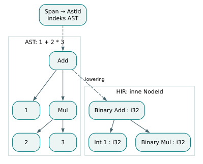

*Dwie przestrzenie tożsamości. Dwa drzewa mają odrębne przestrzenie identyfikatorów. Mnożenie wiąże mocniej niż dodawanie.*

## Pułapka i ćwiczenie

Pułapką dla autora narzędzi jest bezpośrednie wywołanie wygenerowanego
`ProgramParser` i przekazanie wyniku do typowania. Sam parser nie wykonuje
publicznej umowy numerowania. Dla zwykłego użycia należy wybrać `parse`
lub `parse_indexed`; ręcznie zbudowany AST trzeba ponumerować osobno.

**Ćwiczenie.** Dlaczego normalizacja nie usuwa znaków nowej linii,
lecz zmienia je na `\r`? **Odpowiedź.** Usunięcie przesunęłoby wszystkie
dalsze pozycje bajtowe. Zamiana pozwala lexerowi pominąć separator,
a diagnostyce nadal wskazać właściwy fragment oryginalnego źródła.

Do lektury kodu: [reguły i priorytety parsera](https://github.com/andrzejwitkowski/Bork/blob/56f4910a24b689087fe2dee30247651b7b432268/src/parser.lalrpop),
[normalizacja układu](https://github.com/andrzejwitkowski/Bork/blob/56f4910a24b689087fe2dee30247651b7b432268/src/layout.rs),
[`parse_indexed`](https://github.com/andrzejwitkowski/Bork/blob/56f4910a24b689087fe2dee30247651b7b432268/src/lib.rs),
[`Span` i `AstId`](https://github.com/andrzejwitkowski/Bork/blob/56f4910a24b689087fe2dee30247651b7b432268/src/span.rs)
oraz [numerowanie AST](https://github.com/andrzejwitkowski/Bork/blob/56f4910a24b689087fe2dee30247651b7b432268/src/ast_number.rs).


# 4. Nazwy, DefId i HIR: od napisu do znaczenia

## Wspólny napis nie oznacza wspólnej deklaracji

Parser zapisuje wystąpienie nazwy jako tekst oraz pozycję. Kompilator musi
następnie odpowiedzieć, co ten tekst oznacza. Pole `x`, parametr `x`
i lokalne wiązanie `x` mogą współistnieć, ale dotyczą różnych miejsc.
Z kolei dwie deklaracje klas nie mogą stać się jednym typem tylko dlatego,
że ich pola mają identyczne kształty. Rozwiązywanie nazw łączy więc
reguły zasięgu z tożsamością deklaracji oraz kontrolą konfliktów.

`DefTable` buduje tablicę definicji dla całego programu. Każda otrzymuje
`DefId`, będący niewielkim indeksem. Tabela obejmuje klasy, enumy, warianty,
funkcje, metody, stałe, intrinsics, traity i implementacje traitów.
Pole `owner` łączy na przykład metodę z klasą, a wariant z enumem.
Definicja ma również rodzaj i informacje o konfliktach. Znalezienie
nazwy jest dzięki temu osobnym działaniem od zgłoszenia właściwej
diagnostyki w kolejności oczekiwanej przez checker.

„Stabilny identyfikator” oznacza tu trwałość podczas pojedynczej analizy
programu. `DefId` nie jest globalnym identyfikatorem projektu ani obietnicą,
że dopisanie wcześniejszej deklaracji nie zmieni numerów. Lokalne wiązania
nie dostają automatycznie `DefId`: środowisko funkcji przechowuje je
w stosie zasięgów. To ważne ograniczenie obecnej architektury, gdy
porównujemy ją z dużymi kompilatorami, które mają także identyfikatory
wszystkich lokalnych deklaracji.

## Konkretne rozstrzygnięcie: pole w metodzie

Wróćmy do dokładnego fragmentu programu z poprzedniego rozdziału:

```bork
fun sum(): i32 {
    return x + y
}
```

Jest to fragment klasy `Point` z
[programs/build/methods/basic.bork](https://github.com/andrzejwitkowski/Bork/blob/56f4910a24b689087fe2dee30247651b7b432268/programs/build/methods/basic.bork).
Samodzielnie nie definiuje otoczenia pól; znaczenie nazw wynika z jego
położenia wewnątrz tej klasy.

Checker najpierw zna sygnaturę metody i klasę właściciela. Do środowiska
wprowadza `this` o typie pożyczonego odbiorcy. Dla wystąpienia `x`
sprawdza lokalne wiązania, a następnie możliwość odwołania do pola
właściciela. Znajduje pole o konkretnym indeksie i typie `i32`.
Analogicznie rozstrzyga `y`. Tablica `MemberResolutions`, indeksowana
przez `AstId`, zachowuje informację, że dane wystąpienie jest polem,
z nazwą klasy, indeksem i typem.

Gdyby metoda miała parametr `x: i32`, pierwsze wystąpienie oznaczałoby
parametr. Jawne `this.x` nadal wskazywałoby pole. Dla wywołania
`p.sum()` checker ustala klasę odbiorcy, wyszukuje jej metodę i dodaje
niejawnie pożyczonego odbiorcę jako pierwszy argument reprezentacji
wywołania. Nazwa funkcji w HIR przyjmuje kwalifikowaną postać
`Point.sum`. Nie trzeba później ponownie odgadywać z tekstu, do której
klasy należało `sum`.

Ten mechanizm nie oznacza całkowicie jednolitego resolvera dla każdej
postaci nazwy. Bork rozstrzyga wiele nazw w trakcie typowania, ponieważ
dostęp do członka zależy od typu odbiorcy. Rozstrzygnięcia zapisuje
w tablicach pomocniczych, aby analiza własności pracująca na AST
otrzymała tę samą interpretację pól i metod. Czytelnik powinien śledzić
konkretną ścieżkę checkera zamiast zakładać istnienie jednej samodzielnej
fazy, która wcześniej zastąpiła wszystkie napisy identyfikatorami.

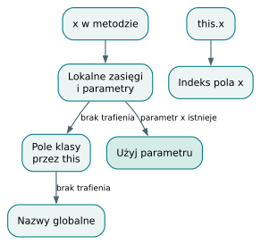

*Rozstrzyganie x w metodzie. Pierwsze trafienie kończy wyszukiwanie zwykłego x. Zapis this.x jawnie wskazuje pole.*

## HIR utrwala rozstrzygnięcia semantyczne

AST odzwierciedla konstrukcje składniowe; HIR zawiera wynik ich
sprawdzenia. `HirExpr` niesie `TyId`, opcjonalny `Span`, `NodeId` oraz
rodzaj wyrażenia. Konstruktor klasy ma postać `ObjectConstruct`,
konstruktor wariantu `EnumConstruct`, a zwykłe pole obiektu
`ObjectField` zawierające między innymi indeks pola. W takim miejscu
generator kodu nie musi szukać pola po napisie w deklaracji źródłowej.

Nie każda informacja została jednak zastąpiona `DefId`. HIR przechowuje
również nazwy funkcji, klas i wariantów jako napisy. `HirProgram` ma
osobne kolekcje funkcji, klas, enumów, traitów i implów. Typy nominalne
odnoszą się do `DefId` poprzez interner typów, ale nazwy węzłów służą
między innymi do późniejszego kierowania wywołań i monomorfizacji.
Opisując architekturę, należy zachować tę mieszankę zamiast przypisywać
projektowi pełne obniżanie wszystkich odniesień do identyfikatorów.

Warto rozróżniać cztery pytania. `Span` odpowiada „gdzie w tekście?”,
`AstId` — „które wystąpienie w AST?”, `DefId` — „która deklaracja?”,
a `TyId` — „jaki zainternowany typ?”. `NodeId` dodaje jeszcze tożsamość
wyrażenia po obniżeniu do HIR. Równość dwóch typów nie oznacza równości
dwóch wystąpień, a wspólna pozycja źródłowa nie oznacza jednej deklaracji.
To rozdzielenie jest podstawą poprawnych tablic faktów i diagnostyki.

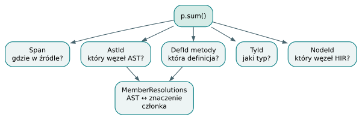

*Pięć pytań o jeden fragment. Każdy identyfikator odpowiada na inne pytanie; MemberResolutions przenosi rozstrzygnięcie członka do analiz AST.*

## Orkiestracja i granice reprezentacji

`frontend::check` parsuje program, dołącza prelude, przeprowadza typowanie,
a następnie analizę własności. Ta ostatnia otrzymuje typy węzłów
i rozstrzygnięcia członków. Po pomyślnym sprawdzeniu następują dalsze
etapy, w tym kontrola instancji generycznych, adnotacje hoistingu,
numerowanie HIR, kontrola ucieczek i planowanie pamięci. Nazwa funkcji
`check` obejmuje zatem więcej pracy niż sam sprawdzacz zgodności typów.

HIR celowo nie zawiera tożsamości regionów. Zagnieżdżenie aren
i odpowiednie decyzje znajdują się w `ArenaReport` oraz planie pamięci.
`CheckResult` zachowuje raport nawet przy części błędów semantycznych,
lecz publiczne `hir` udostępnia dopiero przy pustej liście diagnostyki.
Nie wolno z obecności częściowego raportu wyciągać wniosku, że program
nadaje się do generowania kodu.

**Pułapka.** Ręczne kluczowanie faktów wyłącznie przez zakres źródłowy
przestaje działać dla węzłów syntetycznych i instancji generycznych.
Należy użyć identyfikatora właściwego dla danej reprezentacji.

**Ćwiczenie.** Dwie metody różnych klas nazywają się `sum`. Czy powinny
mieć jeden `DefId`? **Odpowiedź.** Nie. Właściciel jest częścią
tożsamości deklaracji; wspólny napis nie łączy metod.

Do lektury kodu: [`DefTable` i `DefKind`](https://github.com/andrzejwitkowski/Bork/blob/56f4910a24b689087fe2dee30247651b7b432268/src/defs.rs),
[środowisko nazw i tablice faktów](https://github.com/andrzejwitkowski/Bork/blob/56f4910a24b689087fe2dee30247651b7b432268/src/typeck/env.rs),
[`HirProgram` i `HirExpr`](https://github.com/andrzejwitkowski/Bork/blob/56f4910a24b689087fe2dee30247651b7b432268/src/hir/mod.rs)
oraz [`frontend::check`](https://github.com/andrzejwitkowski/Bork/blob/56f4910a24b689087fe2dee30247651b7b432268/src/frontend.rs).


# 5. System typów i inferencja: rzeczywisty solver Borka

## Typ jako zainternowana struktura

Bork ma nominalne klasy i enumy, bez podtypowania przez dziedziczenie.
Dwie klasy z jednakowymi polami pozostają różnymi typami. Zgodność
większości zwykłych wartości sprowadza się do równości typów po
rozwiązaniu zmiennych i podstawieniach. Nie ma ogólnej drabiny niejawnych
konwersji liczbowych. Oczekiwany typ pomaga zinterpretować literał,
ale nie zmienia dowolnej istniejącej wartości w nowy typ.

`TyCtx` jest internerem: zapisuje strukturę `TyData` i wydaje odpowiadający
jej `TyId`. Dwa takie same opisy w jednym kontekście dostają ten sam
identyfikator. Dzieci typu są identyfikatorami, więc tablica, funkcja
lub instancja klasy nie powiela całych poddrzew. `Class` i `Enum`
zawierają `DefId` oraz argumenty typowe; `Array` zawiera element
i długość; `Func` parametry oraz wynik. `Param` oznacza sztywny parametr
generyczny, `Infer` — niewiadomą analizy, a `Error` — miejsce błędu,
który został już zgłoszony.

Identyfikator typu ma sens wyłącznie w kontekście, który go wydał.
Nie wolno przenosić surowego `TyId` do innego, niezależnie zbudowanego
`TyCtx` i porównywać samych liczb. Kontekst przechowuje także nazwy
definicji potrzebne drukarce diagnostycznej. Oddzielenie zwartej
reprezentacji od czytelnego wydruku pozwala zachować nominalność
bez wstawiania pełnych nazw do każdego wyrażenia.

## Informacja płynie w obu kierunkach

Checker wyrażeń działa dwukierunkowo. Synteza ustala typ na podstawie
samego wyrażenia; tryb sprawdzania otrzymuje dodatkowo typ oczekiwany.
Napis ma znany typ `String`, natomiast liczba, pusta tablica albo `None`
często wymagają kontekstu. Typ wyniku funkcji dostarcza oczekiwania
instrukcji `return`, a sygnatura wywoływanej funkcji dostarcza go
argumentom. Ostateczne porównanie wykonuje wspólne `Env::mismatch`,
co ogranicza liczbę rozbieżnych formatów komunikatów.

Oto kompletny przykład z korpusu:

```bork
fun takes_u8(a: u8) {}
fun takes_f32(a: f32) {}
fun main() {
    val x = 1
    takes_u8(x)
    var f = 1.5
    f = f + 2.0
    takes_f32(f)
}
```

Źródło: [programs/check/inference/literal_fixed_by_use.bork](https://github.com/andrzejwitkowski/Bork/blob/56f4910a24b689087fe2dee30247651b7b432268/programs/check/inference/literal_fixed_by_use.bork).
Przykład należy do testów akceptacji frontendu; nie podajemy tu wyniku
osobnego wykonania.

Przy `val x = 1` checker nie zamyka od razu decyzji na `i32`. Tworzy
zmienną inferencyjną rodzaju `Int`. Użycie `takes_u8(x)` wymaga równości
tej niewiadomej z `u8`, więc ją ustala. Dla `f` powstaje zmienna rodzaju
`Float`. Przypisanie i dodawanie wiążą użycia wspólnym typem, a ostatnie
wywołanie ustala `f32`. Brak adnotacji przy deklaracji nie oznacza więc
braku kontroli typu ani możliwości zmiany typu w czasie wykonania.

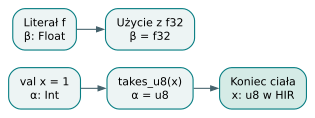

*Literał rozstrzygany przez późniejsze użycie. Późniejsze użycie dostarcza ograniczenia, zanim zostanie wybrany typ domyślny.*

## Unifikacja, ograniczenia i transakcje

`InferCtxt` przechowuje zmienne w strukturze union-find z rodzicami
i rangami. Korzeń klasy równoważności ma opcjonalną ustaloną wartość
oraz rodzaj `General`, `Int` albo `Float`. Łączenie `General` z `Int`
zachowuje ograniczenie całkowitoliczbowe. `Int` nie może połączyć się
z `Float`, a całkowitoliczbowy literał nie może zostać rozwiązany do
`String` ani `f32`. Rodzaje zmiennych są ograniczeniami, nie gotowymi
typami użytkownika.

Unifikacja schodzi po strukturze. Tablice wymagają jednakowej długości,
funkcje jednakowej liczby parametrów, a klasy i enumy tego samego
`DefId`. Następnie porównywane są odpowiednie dzieci. Dla zmiennej
wiązanej z typem złożonym wykonywany jest occurs check: niewiadoma
nie może pojawiać się we własnym rozwiązaniu. Równanie w rodzaju
„α jest tablicą elementów α” wymagałoby nieskończonego typu i zostaje
odrzucone.

Każde publiczne `unify` otwiera snapshot. Sukces zatwierdza zmiany,
a niepowodzenie odtwarza wcześniejszy stan zmiennych. Jest to ważne,
gdy pierwsze dzieci dwóch funkcji udało się połączyć, lecz ostatnie
okazały się sprzeczne. Nie wolno pozostawić częściowego rozwiązania
i pozwolić mu zatruć następnych prób. Snapshoty obejmują także
długość kolejki zobowiązań traitów i nowo utworzone zmienne; sam
interner typów nie jest kopią całego solvera.

Na końcu ciała funkcji `settle_body` nadaje nierozstrzygniętym literałom
wartości domyślne: `i32` oraz `f64`. Dopiero potem dopina możliwe
zobowiązania traitów, raportuje brakujące argumenty typowe i zastępuje
niewiadome w HIR oraz tablicy typów. Ogólna zmienna generycznego
wywołania nie dostaje dowolnego typu domyślnego. Jeżeli nic jej nie
ustali, użytkownik musi podać adnotację albo jawne argumenty funkcji.

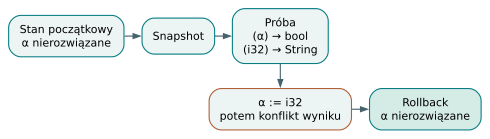

*Nieudana unifikacja bez śladów. Transakcja unifikacji nie pozostawia częściowego związania po odrzuceniu kandydata.*

## Sprzeczność jest błędem, nie przeciążeniem

Jeżeli po `takes_u8(x)` pojawi się `takes_i64(x)`, drugie użycie
spotka już `u8`. Korpus oczekuje komunikatu o argumencie typu `u8`
zamiast `i64`. Kompilator nie klonuje wiązania w dwóch typach i nie
szuka wspólnego, szerszego typu liczbowego. Także `1` i `1.0` należą
do różnych rodzin literałów. Ta przewidywalność upraszcza solver,
lecz wymaga świadomego zapisu wartości przez autora programu.

`TyData::Error` ogranicza kaskadowanie błędów: zgodność z typem już
błędnym nie produkuje kolejnego komunikatu o każdym rodzicu drzewa.
Nie jest to typ poprawnego programu. Warstwa diagnostyczna dołącza
pozycję wywołania lub operatora, ponieważ sam błąd unifikacji opisuje
relację typów, a nie miejsce w tekście. Historyczny wariant błędu
`NestedNullable` pozostaje historyczną pozostałością. Typy `Option<i32>?`
oraz `Option<Option<i32>>` tworzą dwie warstwy opcji. Skrót `i32??`
nie jest przyjmowany przez obecną gramatykę, która dopuszcza tylko
jeden sufiks `?` w danej pozycji typu.

**Ćwiczenie.** Co ustali typ `val x = 1`, jeśli dalej występuje jedynie
`return x` w funkcji zwracającej `i64`? **Odpowiedź.** Oczekiwany typ
zwrotu rozwiąże zmienną jako `i64`, zanim zadziała domyślne `i32`.

Do lektury kodu: [`TyData` i `TyCtx`](https://github.com/andrzejwitkowski/Bork/blob/56f4910a24b689087fe2dee30247651b7b432268/src/ty/mod.rs),
[`InferCtxt` i defaulting](https://github.com/andrzejwitkowski/Bork/blob/56f4910a24b689087fe2dee30247651b7b432268/src/infer/mod.rs),
[transakcyjna unifikacja](https://github.com/andrzejwitkowski/Bork/blob/56f4910a24b689087fe2dee30247651b7b432268/src/infer/unify.rs)
oraz [`settle_body`](https://github.com/andrzejwitkowski/Bork/blob/56f4910a24b689087fe2dee30247651b7b432268/src/typeck/mod.rs).


# 6. Enum, Option, Result i wyczerpujące when

## Suma wariantów jest zwykłym typem nominalnym

Klasa opisuje zestaw pól obecnych razem. Enum opisuje wybór jednego
z wariantów, z których każdy może mieć własne pola. W deklaracji
`enum Shape { Circle(r: f64), Empty }` wartość jest kołem z promieniem
albo pustym kształtem. `Shape.Circle(1.0)` buduje pierwszy przypadek,
a `Shape.Empty` drugi. Typem obu jest `Shape`; nie powstaje osobny
typ użytkownika dla każdego konstruktora. Kolejność wariantów wyznacza
ich indeksy używane później jako znaczniki reprezentacji.

Enumy mogą być generyczne, a argumenty konstruktora oraz oczekiwany
typ ustalają parametry. Wariant bez danych, taki jak `Tree.Leaf`, może
wymagać adnotacji, bo nie niesie argumentu pozwalającego odgadnąć `T`.
Jawne argumenty typowe przy wariancie nie są jeszcze obsługiwane.
Rekurencja bezpośrednio przez posiadane pola jest odrzucana jako cykl
układu; zamierzona postać odsyłacza używa `Ref<Tree<T>>`. Przy ocenie
wsparcia wykonania trzeba jednak oddzielić akceptację takiego typu
przez frontend od ograniczeń generatora kodu.

## Option i Result nie są magicznymi klasami

Prelude zawiera zwykłe deklaracje zapisane w Borku:

```bork
enum Option<T> {
    Some(value: T),
    None,
}
```

To dokładna treść `src/prelude/option.bork`. Analogiczny `Result<T, E>`
z `src/prelude/result.bork` ma warianty `Ok(value: T)` oraz
`Err(error: E)`. Zapis `T?` jest obniżany do `Option<T>`, więc oba
zapisy oznaczają ten sam typ. Nie ma osobnego wewnętrznego konstruktora
typu nullable. Zagnieżdżenie opcji zachowuje informację: `None`
i `Some(None)` są różnymi wartościami `Option<Option<T>>`.

`Result` przenosi informację o powodzeniu jako zwykłe dane. Funkcja
zwracająca `Result<i32, String>` musi zbudować `Ok` z liczbą albo
`Err` z tekstem; wywołujący otrzymuje całą wartość i może rozdzielić
obie sytuacje przez `when`. Typowanie ramienia `Err(e)` zna typ
`String`, a ramienia `Ok(v)` typ `i32`. W tym stanie języka nie ma
jeszcze operatora automatycznej propagacji błędu `?`; znak zapytania
w typie dotyczy skrótu `Option`, a nie wyjścia z funkcji.

Prelude jest dołączane po parsowaniu kodu użytkownika. `Option` jest
potrzebne także dla samego skrótu `T?`, natomiast pozostałe fragmenty
są dobierane według użytych nazw. Własna definicja użytkownika
przesłania odpowiedni fragment biblioteki. Nie można zakładać, że
każdy enum nazwany `Option` nadaje się do obsługi `T?`: tabela definicji
rozpoznaje wymagany kształt, a inna deklaracja blokuje zwykłe prelude.
`Some` i `None` są zwykłymi nazwami; istniejące funkcje lub wiązania
mogą zmienić interpretację ich użycia.

Ważną granicą pozostaje `Ref<T>`. Uchwyt ma własną nieobecność,
nie jest enumem `Option<T>` i nie konwertuje się do niego automatycznie.
`Option<Ref<T>>` może reprezentować zewnętrzne `None`, ale też
`Some` zawierające nieobecny uchwyt. Jawne funkcje `optionFromRef`
i `optionToRef` pozwalają wykonać potrzebną konwersję. Nie należy
usuwać tego rozróżnienia tylko dlatego, że oba mechanizmy korzystają
ze znajomych nazw `Some` i `None`.

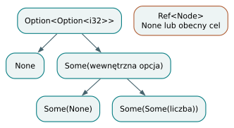

*Dwa poziomy nieobecności. Zagnieżdżona opcja ma trzy różne kategorie wartości. Nieobecność Ref należy do innego protokołu.*

## Dopasowanie sprawdza strukturę i sposób dostępu

Poniżej dokładne funkcje z istniejącego programu:

```bork
fun half(n: i32): Option<i32> {
    if (n > 5) {
        return Some(n / 2)
    }
    return None
}

fun show(o: &Option<i32>): i32 {
    return when o {
        None => { 0 }
        Some(v) => { v }
    }
}
```

Źródło fragmentu: [programs/build/option/option_result.bork](https://github.com/andrzejwitkowski/Bork/blob/56f4910a24b689087fe2dee30247651b7b432268/programs/build/option/option_result.bork).
Plik zawiera również dopasowania do `Result`; tutaj śledzimy tylko
ścieżkę opcjonalnej liczby.

`half(10)` konstruuje wariant `Some` z ładunkiem `i32`. Parametr
`show` jest pożyczonym widokiem opcji. Checker rozpoznaje warianty
na podstawie typu dopasowywanej wartości, ustala typ `v` jako `i32`
i porównuje wyniki obu ramion z oczekiwanym wynikiem funkcji.
Liczba jest kopiowalna, więc `v` wiąże wartość, mimo pożyczonego
dostępu do całej opcji. Dla ładunku `String` podobne dopasowanie
do nazwanego właściciela utworzyłoby pożyczony widok tekstu.

Ogólnie wzorzec może być symbolem `_`, wiązaniem, literałem albo
konstruktorem z rekurencyjnymi podwzorcami. Dopasowanie do miejsca,
takiego jak zmienna czy pole, nie przenosi posiadanego ładunku.
Kopiowalne skalary są wyjątkiem, a pola `Ref` tworzą liczoną kopię
uchwytu. Dla tymczasowej wartości reguła typowania dopuszcza tryb
wiązania przez przeniesienie. Generator dopasowania nadal dba o to,
aby ładunek nie uzyskał drugiego niezależnego właściciela zwalniania.

## Pokrycie to analiza macierzy wzorców

Sprawdzanie wyczerpujące korzysta z algorytmu użyteczności wzorców
w stylu Marangeta. Własny, uproszczony zapis `Pat` oddziela analizę
pokrycia od `TyCtx`. Wiersze macierzy oznaczają wcześniejsze ramiona,
a kolumny odpowiadają kolejnym częściom dopasowywanej struktury.
Specjalizacja dla konstruktora odrzuca niepasujące wiersze i rozwija
jego pola na dalsze kolumny. `_` pasuje do każdego konstruktora.

W przykładzie `show` sygnatura kolumny zawiera `None` oraz `Some`
z jednym polem. Po pierwszym ramieniu istnieje świadek braku
pokrycia `Some(_)`. Po drugim nie ma już świadka. Dla
`Some(true)` i `None` nadal brakowałoby `Some(false)`, jeśli ładunek
miałby typ `bool`. Samo wymienienie nazwy wariantu z danymi nie
zastępuje kontroli jego podwzorców. Kolejne ramię jest osiągalne
tylko wtedy, gdy wnosi przypadek niepokryty wcześniej.

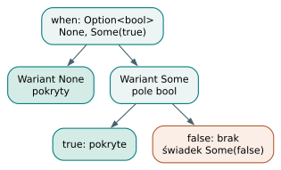

*Specjalizacja macierzy when. Ramiona None i Some(true) nie pokrywają wartości Some(false).*

Liczby całkowite i napisy są modelowane jako sygnatura nieskończona:
lista literałów wymaga ramienia `_` albo wiązania. Nie ma analizy
zakresów wyczerpującej małe typy liczbowe. Literówka w bezargumentowym
wariancie może zostać odczytana jako nowe wiązanie i pokryć wszystkie
przypadki; następne ramię ujawni wtedy błąd nieosiągalności. Kwalifikowane
nazwy wariantów i lektura diagnostyki pomagają uniknąć tej pułapki.

**Ćwiczenie.** Czy `Some(_)` przed `Some(1)` jest poprawnym zestawem
ramion? **Odpowiedź.** Nie: drugi wzorzec niczego już nie dodaje.
Przestawienie szczególnego przypadku przed ogólny może być poprawne,
ale nadal trzeba osobno obsłużyć `None`.

Do lektury kodu: [dołączanie prelude](https://github.com/andrzejwitkowski/Bork/blob/56f4910a24b689087fe2dee30247651b7b432268/src/prelude.rs),
[deklaracja Option](https://github.com/andrzejwitkowski/Bork/blob/56f4910a24b689087fe2dee30247651b7b432268/src/prelude/option.bork),
[typowanie wzorców](https://github.com/andrzejwitkowski/Bork/blob/56f4910a24b689087fe2dee30247651b7b432268/src/typeck/expr/pat.rs)
oraz [`useful`, `specialize` i `witnesses`](https://github.com/andrzejwitkowski/Bork/blob/56f4910a24b689087fe2dee30247651b7b432268/src/typeck/exhaustive.rs).


# 7. Generyki i monomorfizacja: od Param do konkretnego programu

## Parametr typu jest niewiedzą kontrolowaną

Deklaracja generyczna opisuje rodzinę funkcji lub typów. `fun id<T>(x: T): T`
nie wybiera `T` raz na cały program: każde wywołanie otrzymuje własne
argumenty typowe. W ciele funkcji `T` ma jednak inne znaczenie niż
nierozwiązana zmienna inferencyjna. Jest sztywnym parametrem
`TyData::Param(ParamIdx(...))`, o którym wolno założyć tylko to,
co wynika z deklaracji i jej ograniczeń. Checker nie wybiera wygodnego
typu liczbowego, aby zalegalizować `x + x` dla dowolnego `T`.

Zakres parametrów metody obejmuje najpierw parametry klasy,
a następnie własne parametry metody. Podstawienie musi zachować tę
kolejność indeksów. Walidator wykrywa powtórzone nazwy, przesłanianie
parametru właściciela i konflikty z istniejącymi nazwami typów.
Ten etap chroni późniejsze podstawienie przed sytuacją, w której
`Param(0)` mógłby znaczyć dwie różne rzeczy w jednej sygnaturze.

## Jedna funkcja źródłowa, trzy instancje

Istniejący program pokazuje wykorzystanie identyczności dla liczby,
napisu i klasy:

```bork
// exit: 0
// stdout: 7\nhello\n3\n
class Point {
    x: i32
    y: i32
}

fun id<T>(x: T): T {
    return x
}

fun main(): i32 {
    val n = id(7)
    val s = id("hello")
    val p = Point(1, 2)
    val q = id(p)
    println(n)
    println(s)
    println(q.x + q.y)
    return 0
}
```

Źródło: [programs/build/generics/identity.bork](https://github.com/andrzejwitkowski/Bork/blob/56f4910a24b689087fe2dee30247651b7b432268/programs/build/generics/identity.bork).
Komentarze są oczekiwaniami istniejącego testu. Weryfikację całego korpusu
opisuje dodatek A.

Dla każdego wywołania checker pobiera generyczną sygnaturę i tworzy
świeżą zmienną ogólną zastępującą `T`. Argument `7` ustala pierwszą
instancję liczbową, napis drugą jako `String`, a `p` trzecią jako
`Point`. Powiązanie wyniku z tym samym parametrem daje odpowiednie
typy `n`, `s` i `q`. Ciało `id` zostało sprawdzone jako operacja
na nieprzezroczystym parametrze, nie jako trzy niezależnie napisane
funkcje użytkownika.

Funkcje dopuszczają również jawny zapis `id::<i64>(7)`. Checker
porównuje liczbę argumentów typowych oraz zgodność z wartościami.
Konstruktory klas i warianty enumów wymagają obecnie inferencji
lub adnotacji wiązania zamiast analogicznego jawnego wywołania.
Typ wyniku i późniejsze użycie mogą pomóc inferencji, ale parametr
nieustalony przez żaden dostępny kontekst kończy się diagnostyką.

## Kolejka osiągalnych specjalizacji

Monomorfizacja zamienia generyczny HIR w konkretny HIR dla generatora
kodu. Zwykły punkt startu to `main`. `Collector` prowadzi kolejkę
pracy i mapę kluczy `(indeks funkcji, argumenty typowe)`. Pierwsze
żądanie danej instancji dopisuje ją do kolejki, a kolejne wykorzystuje
już istniejący wpis. Dzięki temu wielokrotne wywołanie `id<i32>`
nie wymaga wielokrotnego kopiowania ciała.

Argumenty instancji są odtwarzane przez dopasowanie generycznej
sygnatury do konkretnego typu funkcji zapisanego przy wywołaniu.
Następnie ciało jest klonowane, typy poddawane podstawieniu,
a wywołania przekierowywane do nazw takich jak `id<i32>`.
Jest to nazwa wewnętrzna oparta na wydruku typów, a nie dodatkowa
składnia wywołania w źródle. Przegląd nowego ciała może ujawnić
dalsze instancje, które trafiają do tej samej kolejki.

Dla programu identyczności kolejka zaczyna od `main`, a następnie
zbiera `id<i32>`, `id<String>` i `id<Point>`. Instancja klasy `Point`
nie wymaga argumentów typowych, więc pozostaje zwykłą deklaracją.
W programie z `Pair<i32, String>` analogicznie specjalizowane są pola
klasy i używane metody. Golden `mono_instances.txt` utrwala listę
instancji dla korpusu, co pozwala wykrywać zarówno brakujące
specjalizacje, jak i niezamierzony nadmiar.

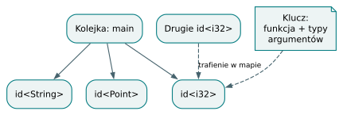

*Kolejka monomorfizacji. Mapa instancji współdzieli powtórne żądanie tego samego klucza funkcja–argumenty typowe.*

## Własność i plan pamięci muszą widzieć konkretne typy

Podstawienie `T = i32` może być proste, lecz `T = String` lub klasa
wymaga innych operacji własności i zwalniania. Dlatego generyczny
checker nie może zakładać, że każdy parametr jest kopiowalny.
Testy własności porównują zachowanie zaakceptowanych ciał generycznych
z reprezentatywnymi podstawieniami. Typowo poprawna sygnatura nie
unieważnia zakazu użycia po przeniesieniu ani zasad ucieczki z regionu.

Pełna monomorfizacja przepisuje raport aren tak, aby każda instancja
funkcji miała własny korzeń raportu. Numeruje ponownie wyrażenia HIR,
sprawdza ucieczki i tworzy plan pamięci dla konkretnego programu.
W wyniku nie powinien zostać `Param`. Frontend uruchamia także
lżejsze `check_instances` na kopii kontekstu typów: dzięki temu
polecenie sprawdzania oraz LSP wykrywają problemy specjalizacji,
a HIR przeznaczony do podpowiedzi nadal zachowuje generyczną postać.

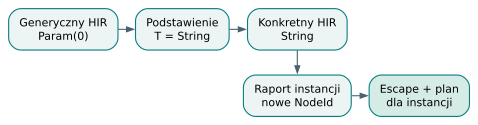

*Specjalizacja zachowująca plan pamięci. Specjalizacja wymaga odświeżenia metadanych, ponieważ konkretny typ zmienia potrzeby pamięciowe.*

Istnieje ograniczenie związane z odtwarzaniem argumentów: parametr
występujący wyłącznie w ograniczeniu, bez śladu w typie argumentów
ani wyniku, nie daje monomorfizatorowi potrzebnej informacji.
Samo podanie go jawnie w źródle nie naprawia obecnego sposobu
przenoszenia danych do HIR. Jest to ograniczenie implementacji,
a nie ogólna własność wszystkich języków generycznych.

Drugą pułapką jest rekurencja polimorficzna powiększająca typ:
wywołanie kolejno dla `T`, `Vec<T>`, `Vec<Vec<T>>` tworzyłoby
nieskończoną rodzinę instancji. Bork ogranicza głębokość argumentów
do 32 i ich rozwinięty rozmiar do 4096 węzłów. Sam limit głębokości
nie wystarczałby dla drzewa powielającego ten sam parametr w parach.

**Ćwiczenie.** Czy dwa wywołania `id` dla `i32` potrzebują dwóch
instancji? **Odpowiedź.** Nie. Klucz instancji jest wspólny, więc
oba zostają skierowane do tej samej specjalizacji.

Do lektury kodu: [zakresy i walidacja generyków](https://github.com/andrzejwitkowski/Bork/blob/56f4910a24b689087fe2dee30247651b7b432268/src/typeck/generics.rs),
[instancjowanie sygnatur przy wywołaniu](https://github.com/andrzejwitkowski/Bork/blob/56f4910a24b689087fe2dee30247651b7b432268/src/typeck/expr/call.rs),
[`Collector` i `monomorphize`](https://github.com/andrzejwitkowski/Bork/blob/56f4910a24b689087fe2dee30247651b7b432268/src/mono.rs)
oraz [golden instancji](https://github.com/andrzejwitkowski/Bork/blob/56f4910a24b689087fe2dee30247651b7b432268/tests/golden/mono_instances.txt).


# 8. Traity, bounds, coherence i wywołania statyczne

## Kontrakt zachowania bez dziedziczenia

Trait deklaruje zestaw sygnatur metod. Implementacja `impl Trait for Type`
łączy ten kontrakt z konkretną klasą lub enumem i dostarcza jego metody.
Bork nie używa traitów jako hierarchii klas. W analizowanym `main`
nie ma obiektów traitowych, tablic wirtualnych, domyślnych ciał metod
ani associated types. Parametry traitu, takie jak `Conv<U>`, są
zwykłymi argumentami typowymi; nie należy mylić ich z typem
skojarzonym wybieranym osobno przez każdą implementację.

Metoda traitu ma niejawnego odbiorcę pożyczonego jako `&Self`.
Podczas sprawdzania implementacji `Self` jest zastępowane typem
z jej nagłówka, a argumenty traitu są podstawiane w sygnaturach.
Implementacja musi zawierać dokładnie wymagane metody o zgodnych
typach i liczbach parametrów. Brakujący członek, dodatkowa metoda,
duplikat albo inny typ wyniku są błędami deklaracji implu.
Ciało implu klasy może używać jej pól przez `this`, również
przez niekwalifikowane nazwy tak jak zwykła metoda klasy.

## Przejście przez przykład z ograniczeniem

Poniższy zestaw deklaracji jest dokładnym fragmentem istniejącego
programu, z pominięciem drugiej klasy i funkcji `main`:

```bork
trait Show {
    fun show(): String
}
class Circle {
    r: f64
}
```

```bork
impl Show for Circle {
    fun show(): String { return "circle" }
}
```

```bork
fun say<T: Show>(t: &T) {
    println(t.show())
}
```

Źródło fragmentów: [programs/build/traits/dispatch_bound.bork](https://github.com/andrzejwitkowski/Bork/blob/56f4910a24b689087fe2dee30247651b7b432268/programs/build/traits/dispatch_bound.bork).
W kompletnym pliku `main` tworzy `Circle` oraz `Square` i przekazuje
ich pożyczone widoki do `say`.

Najpierw checker zapamiętuje trait `Show` i zgodną implementację
dla `Circle`. W sygnaturze `say` ograniczenie `T: Show` staje się
predykatem środowiska parametrów. W ciele funkcji `T` nadal jest
nieprzezroczyste, lecz lookup znajduje `show` w zadeklarowanym
ograniczeniu. Typem wyniku jest `String`, więc wywołanie `println`
otrzymuje znany typ argumentu. Nie trzeba znać pola `r`, aby
sprawdzić poprawność samego ciała `say`.

Wywołanie `say(&c)` ustala `T = Circle` i rejestruje zobowiązanie
`Circle: Show`. Solver znajduje pasujący impl. Przy monomorfizacji
wywołanie zapisane wewnętrznie jako metoda traitu zostaje skierowane
do metody konkretnej implementacji. Powstaje zwykłe bezpośrednie
wywołanie. Analogiczna specjalizacja dla `Square` wybiera inną
funkcję, ale wykonanie programu nie przeszukuje tablicy implementacji.

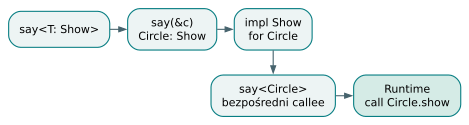

*Od bound do bezpośredniego wywołania. Wybór implementacji odbywa się podczas kompilacji. W wykonaniu pozostaje bezpośrednie wywołanie.*

## Solver zobowiązań pracuje do zatrzymania postępu

Predykat ma postać `Self: Trait<args>`. Wywołania funkcji, metod
i instancjowanie implów mogą wprowadzać takie wymagania do kolejki
w `InferCtxt`. `select_where_possible` rozpatruje je do chwili,
gdy kolejne przejście niczego już nie rozwiązuje. Wymaganie zależne
od nieustalonej zmiennej czeka. Pod koniec funkcji defaulting
literałów i końcowa kontrola zobowiązań odróżniają rzeczywisty brak
implementacji od niedostatecznej informacji typowej.

Dla sztywnego parametru typu solver korzysta z ograniczeń dostępnych
w bieżącej funkcji. Dla klasy lub enumu dopasowuje nagłówki implów
przez świeże zmienne i unifikację. Próbne dopasowanie odbywa się
ze snapshotem, aby odrzucony kandydat nie zmienił rozwiązania.
Jedyny wybrany impl może wprowadzić kolejne wymagania: na przykład
impl `Show for Box<T>` z ograniczeniem `T: Show` wymaga dodatkowo
udowodnienia ograniczenia dla konkretnego elementu pudełka.

Nie jest to dowolny system dowodzenia z negacją. Solver nie zakłada,
że brak znalezionej implementacji dowodzi jej wiecznej niemożliwości,
i nie wykonuje specjalizacji bardziej szczegółowego implu.
Rekurencyjne podążanie za ograniczeniami ma limit głębokości 32.
Obecnie implementować traity mogą tylko klasy i enumy; `i32`,
`String` czy wbudowany `Vec` nie spełniają ich przez dopisanie
zwykłego implu użytkownika.

## Coherence zapewnia jednoznaczność deklaracji

Przed sprawdzaniem użyć Bork odrzuca nakładające się implementacje
tego samego traitu. Nie wystarcza porównanie napisów. Nagłówki
`impl<T> Show for Box<T>` oraz `impl Show for Box<Circle>`
nakładają się, bo istnieje podstawienie `T = Circle`. Unifikator
sprawdza również argumenty traitu. `Conv<i32>` i `Conv<bool>`
mogą być rozłączne, nawet gdy typ odbiorcy jest taki sam.

Powtórzone parametry zachowują swoje równania. `Pair<T, T>` nie
pasuje do `Pair<Circle, Square>`, jeśli `Circle` i `Square` są
różnymi typami nominalnymi. To dobry przykład, dlaczego porównanie
samych zewnętrznych nazw klas nie rozwiązuje problemu nakładania.
Checker tworzy świeże zmienne obu implów, unifikuje nagłówki,
sprawdza wynik, a potem wycofuje wszystkie próbne związania.

Ograniczenia implów nie rozdzielają zbiorów podczas coherence.
Dwa ogólne impl-y dla `Box<T>`, jeden wymagający `T: A`, drugi
`T: B`, pozostają konfliktem. Kompilator nie dowodzi rozłączności
`A` i `B`. Błąd wskazuje późniejszy impl i nazywa wcześniejszy;
kolejność diagnostyki jest porządkowana zgodnie ze źródłem.
Odrzucony impl nie powinien następnie powodować lawiny dodatkowych
błędów w każdym miejscu użycia.

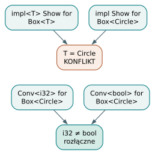

*Nakładanie nagłówków implementacji. Unifikujące się nagłówki konfliktują. Różne, nieunifikujące się argumenty traitu mogą je rozdzielać.*

## Rozstrzyganie metody ma osobne pułapki

Metoda zdefiniowana bezpośrednio w klasie ma pierwszeństwo przed
metodą traitu o tej samej nazwie. Jeśli dwa różne traity dostarczają
pasujące `show`, wybór może być niejednoznaczny mimo braku
nakładających się implów jednego traitu. Są to dwie różne kontrole.
Składnia kwalifikowanego wywołania `Trait.method(x)` nie jest
jeszcze publicznym sposobem rozstrzygnięcia takiej sytuacji.

Bounds można deklarować przy funkcjach, zwykłych metodach i implach,
także przez `where` wskazujące własne parametry elementu.
Parametry klas, enumów i traitów nie przyjmują jeszcze bounds;
ograniczenia parametrów metod traitu również są odrzucane.
Ograniczenie daje parametrowi dostęp do metod, nie do pól ani
przeciążenia operatora `+`. Przenoszenie przykładów z Rustowego
systemu traitów wymaga więc sprawdzenia każdej takiej możliwości.

**Ćwiczenie.** Czy ograniczenia `T: A` oraz `T: B` wystarczą,
aby dopuścić dwa impl-y tego samego traitu dla `Box<T>`?
**Odpowiedź.** Nie. Coherence w tym `main` ignoruje bounds przy
ustalaniu nakładania, więc nagłówki nadal się unifikują.

Do lektury kodu: [sygnatury traitów i walidacja implów](https://github.com/andrzejwitkowski/Bork/blob/56f4910a24b689087fe2dee30247651b7b432268/src/typeck/traits.rs),
[solver zobowiązań](https://github.com/andrzejwitkowski/Bork/blob/56f4910a24b689087fe2dee30247651b7b432268/src/typeck/solve.rs),
[wykrywanie nakładania](https://github.com/andrzejwitkowski/Bork/blob/56f4910a24b689087fe2dee30247651b7b432268/src/typeck/coherence.rs)
oraz [wybór metody](https://github.com/andrzejwitkowski/Bork/blob/56f4910a24b689087fe2dee30247651b7b432268/src/typeck/expr/method.rs).


# 9. Własność, pożyczki, move i analiza rozgałęzień

## Własność jest informacją o użyciu

W Borku trzeba oddzielić trzy pytania: jaki typ ma wartość, gdzie żyją jej dane oraz czy dana nazwa nadal może jej używać. Dwa identyczne typy `String` mogą mieć inny region przechowywania bajtów i inną historię przeniesień. Dlatego samo sprawdzenie zgodności typów nie wystarcza. Analizator semantyczny utrzymuje środowisko nazw, a dla każdego wiązania zapisuje identyfikator i etykietę areny, typ, rodzaj `val` albo `var`, flagę `moved` i pochodzenie wiązania.

Pochodzenie ma trzy warianty: zwykłą deklarację, przechwycenie przez blok `move` oraz widok uzyskany przez pożyczkę. To niewielka maszyna stanów, ale jej rozróżnienia wpływają na diagnostykę. Pożyczki nie można potraktować jak właściciela, a nazwa przechwycona przez blok została już przeniesiona do jego regionu. Drugie `move` tej samej nazwy do tego samego regionu nie stanowi nowego transferu.

Polityka zwykłego użycia najpierw sprawdza flagę przeniesienia. Dopiero potem uwzględnia granicę regionów. W tym samym regionie odnotowuje użycie lokalne. Między regionami wartość `Copy` odczytuje jako kopię, zewnętrzne niemutowalne `val` jako współdzielenie, a także specjalnie dopuszcza uchwyty `Ref`. Pozostały zewnętrzny `var` typu niekopiowalnego wymaga jawnego transferu. `Copy` oznacza tu typy prymitywne; nie należy automatycznie rozciągać tej własności na tablice, klasy ani wartości nullable.

Wynik analizy nie sprowadza się do listy błędów. Raport przechowuje wiązania i obserwacje oznaczone jako lokalne, kopiowane, współdzielone, pożyczane lub przeniesione. Te etykiety pomagają wyjaśnić decyzję, ale nie są oddzielnymi typami użytkownika. Przy wejściu do regionu środowisko może przesłonić wcześniejsze wiązanie, a przy wyjściu przywraca poprzednią wersję. Dlatego analizator potrzebuje stosu przesłonięć, mimo że podstawowe wyszukiwanie nazw realizuje mapa. Dopiero po odtworzeniu zewnętrznych wiązań zaznacza przeniesienia przechwyconych właścicieli. Kolejność ma znaczenie: zmiana lokalnego cienia zamiast jego poprzednika ukryłaby rzeczywiste zużycie źródła.

## Dwa znaczenia słowa „referencja”

Pożyczka `&T` jest widokiem związanym ze strukturą programu. Zarządzany `Ref<T>` jest uchwytem obsługiwanym także przez runtime; poznamy go w rozdziale 12. Samo podobieństwo nazw nie uprawnia do zamiany tych konstrukcji. Parametr `&T` wymaga jawnego `&` przy wywołaniu, a pożyczony argument nie może wypełnić parametru oczekującego własności. Parametry referencyjne muszą być `val`. Operator `&` pożycza nazwę, nie dowolne wyrażenie, i nie służy do opakowywania wartości `Copy`.

Przykład z `programs/check/borrow/reference_nested_call.bork`:

```bork
fun inner(buf: &[i32; 2]) {
    buf[0] = 1
}

fun outer(p: &[i32; 2]) {
    inner(&p)
}

fun main() {
    var a: [i32; 2] = [1, 2]
    outer(&a)
}
```

Przebieg jest następujący. `main` pozostaje właścicielem danych tablicy. Wywołanie `outer(&a)` tworzy widok obowiązujący w ciele funkcji. `inner(&p)` wykonuje ponowną pożyczkę na czas następnego wywołania; sprawdzanie typów nie produkuje niezamierzonego `&&[i32; 2]`. Zapis `buf[0] = 1` pokazuje ważną różnicę względem intuicji z Rusta: Bork nie przedstawia tutaj dwóch publicznych typów `&T` oraz `&mut T`. `val` chroni samo wiązanie widoku, lecz akceptowany parametr tablicowy umożliwia zapis elementu. Nie wolno opisywać tego mechanizmu jako pełnego rustowego borrow checkera z wyłącznością mutowalnego dostępu.

## Co dokładnie robi move

Wyrażenie `move x` dla wartości niekopiowalnej oznacza zużycie źródłowego wiązania. Dla wartości `Copy` analizator pozostawia źródło używalne. Osobna postać `move (x) { ... }` przechwytuje nazwę do regionu bloku; lista może też zostać wywnioskowana z wolnych zmiennych. Domyślne przechwycenia pomijają wartości kopiowalne i już przeniesione. Pole użyte bezpośrednio w metodzie prowadzi do przechwycenia `this`, zamiast tworzyć niezależnego właściciela pola.

Nie należy utożsamiać zużycia nazwy z konkretną instrukcją maszynową. Dla `String`, tablic i `Vec` backend może skopiować dane do areny odbiorcy. Statyczny zakaz dalszego używania źródła pozostaje prawdziwy, mimo że stary bufor fizycznie istnieje aż do zakończenia regionu. Ta różnica pozwala rozumieć język bez obiecywania optymalizacji, których backend nie wykonuje.

## Łączenie stanów po if

Rozgałęzienie wymaga analizy przepływu sterowania, a nie liniowego zaznaczania nazw. Przed wejściem do ramion analizator zapamiętuje zbiór przeniesionych nazw. Każde ramię bada od tego samego stanu początkowego. Na końcu zbiera dwa fakty: czy sterowanie może dojść dalej oraz które zewnętrzne wiązania zostały przeniesione. Uwzględnia przy tym przesłanianie nazw, aby lokalne `val x` nie zmieniło stanu innego, zewnętrznego `x`.

Złączenie przyjmuje regułę „być może przeniesione”: nazwa pozostaje zużyta, jeżeli przenosi ją dowolna gałąź dochodząca do dalszego kodu. Gałąź kończąca się `return`, `break` albo `continue` nie wnosi stanu do tego miejsca. Gdy brak `else`, istnieje dodatkowa ścieżka zachowująca stan wejściowy. Gdy wszystkie ramiona kończą przepływ, kod po nich jest nieosiągalny. Mechanizm obejmuje również ramiona `when` i guardy obecności.

Przykład z `programs/build/move_and_promote/then_return_move_not_taken.bork`:

```bork
fun run(flag: bool): i32 {
    val s: String = "hi"
    if (flag) {
        move (s) { return 7 }
    }
    println(s)
    return 1
}

fun main(): i32 {
    return run(false)
}
```

Ścieżka prawdziwa zużywa `s`, ale opuszcza funkcję. Do `println` dochodzi tylko ścieżka fałszywa, na której przeniesienia nie było. Wniosek wynika z implementacji złączenia, a nie z wiedzy, że konkretne wywołanie przekazuje `false`. Odwrotną sytuację utrwala negatywny program `programs/check_fail/conditionals/if_one_path_move_then_use.bork`: przeniesienie w jednym ramieniu bez wyjścia wystarcza do odrzucenia późniejszego użycia.

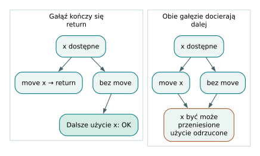

*Złączenie stanu własności. Do stanu po if wchodzą tylko ścieżki, które do niego docierają.*

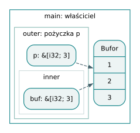

*Właściciel i dwie pożyczki. Obie pożyczki wskazują ten sam bufor. Ich zakresy mieszczą się w życiu właściciela.*

## Pułapki i ćwiczenie

Analizator zabrania przenoszenia zewnętrznego właściciela w pętli, bo następny obrót próbowałby użyć zużytej wartości. Przesłonięcie nazwy nie naprawia starego właściciela. Samo `val` nie oznacza również wiecznego czasu życia danych. Pożyczonych referencji nie można przechowywać w polach klas ani payloadach enumów; obecne sprawdzanie nie śledzi tam dowolnych zależności czasów życia.

Ćwiczenie: pierwsze ramię `if` wykonuje `move s` i `return`, drugie wykonuje `move s` i dochodzi do końca. Czy po `if` można odczytać `s`? **Odpowiedź:** nie. Druga ścieżka dociera do odczytu ze zużytym źródłem. To wystarcza niezależnie od zachowania pierwszej.

## Miejsca w implementacji

- [Polityka `classify_use` i transferów](https://github.com/andrzejwitkowski/Bork/blob/56f4910a24b689087fe2dee30247651b7b432268/src/sema/policy.rs).
- [Środowisko i `join_branch_moves`](https://github.com/andrzejwitkowski/Bork/blob/56f4910a24b689087fe2dee30247651b7b432268/src/sema/env.rs).
- [Analiza ramion i ich zakończeń](https://github.com/andrzejwitkowski/Bork/blob/56f4910a24b689087fe2dee30247651b7b432268/src/sema/walk/branches.rs).
- [Tworzenie pożyczki w typeck](https://github.com/andrzejwitkowski/Bork/blob/56f4910a24b689087fe2dee30247651b7b432268/src/typeck/expr/borrow.rs).
- [Testy przeniesień wyrażeń](https://github.com/andrzejwitkowski/Bork/blob/56f4910a24b689087fe2dee30247651b7b432268/src/sema/tests/expr_move.rs).

# 10. Regiony, outlives, escape, hoist i plan pamięci

## Dłuższe życie jest relacją

Jeżeli deskryptor pozostaje dostępny po zniszczeniu bufora, otrzymujemy wiszące odwołanie. Podstawowy warunek bezpieczeństwa brzmi zatem: pamięć wskazywana przez wartość musi istnieć przez cały czas jej legalnego używania. Termin *outlives* nazywa tę relację. W tym snapshotcie nie jest to osobny ogólny solver nazwanych czasów życia. Część warunków wynika z drzewa regionów, część sprawdza przebieg `escape`, a część realizują plan pamięci oraz runtime zarządzanych aren.

Region to jednostka analizy i sprzątania związana z funkcją, blokiem, ramieniem albo iteracją. Nie każda para klamer produkuje odrębną arenę runtime. Kod usuwa pojedyncze opakowania bloków zgodnie z regułą `peel_blocks`, a raport zapisuje liczbę takich skompaktowanych klamer. Harmonogram regionów i przejście po HIR muszą uzgodnić te same miejsca. Zmiana sposobu odwiedzania ramion tylko po jednej stronie prowadziłaby do błędnego dopasowania regionu do kodu.

Warto odróżnić też numer regionu w raporcie od tożsamości areny runtime. Pierwszy identyfikuje miejsce struktury programu. Drugi oznacza konkretną generację życia podczas wykonania. Pętla wielokrotnie wykonuje ten sam kod regionu, ale reset tworzy nową tożsamość kontrolną. Ten szczegół okaże się niezbędny dla słabych uchwytów.

## Arena odbiorcy jako parametr kontekstu

Backend używa pojęcia *sink*, czyli areny, w której odbiorca chce umieścić dane. Zwykle jest nią bieżący region. Przypisanie do zewnętrznego wiązania może wskazać arenę tego wiązania, a zwracanie obsługiwanego wyniku może korzystać z areny przekazanej przez wywołującego. Dzięki temu nowy obiekt może od razu powstać tam, gdzie ma przeżyć, bez późniejszego przemieszczania swojej tożsamości.

`hoist` dodaje do HIR adnotację `alloc_in_binding`. W prostym lokalnym wzorcu rozpoznaje deklarację inicjalizowaną literałem tekstowym lub wywołaniem, po której bezpośrednio występuje przypisanie `outer = move inner`. Dla inicjalizatora wymagającego alokacji wskazuje od razu arenę `outer`. Sam literał tekstowy korzysta jednak ze stałych bajtów programu, więc adnotacja nie oznacza dodatkowej alokacji jego zawartości. Osobny mechanizm oznacza symbole uczestniczące w konstrukcji zwracanego obiektu specjalnym celem `$result` i propaguje potrzebę przez zagnieżdżone konstruktory.

Przykład z `programs/build/move_and_promote/assign_up_move.bork`:

```bork
fun main() {
    var outer = "x"
    {
        var inner = "inner"
        outer = move inner
    }
    println(outer)
}
```

Najpierw powstaje wiązanie `outer`. Analiza HIR widzi, że inicjalizacja `inner` i następny zapis tworzą rozpoznawany wzorzec. Oznacza deklarację celem `outer`. Generowanie inicjalizatora otrzymuje ten kontekst alokacji. W tym konkretnym przykładzie bajty literału są stałą globalną; dopiero `move inner` kopiuje je do celu przypisania i zużywa nazwę `inner`. Po zamknięciu bloku odbiorca nadal wskazuje dane umieszczone w odpowiednim regionie. Nie należy zatem przypisywać samej adnotacji `hoist` wykonania kopii, którą realizuje transfer. Jest to ślad decyzji kompilatora; programu nie uruchamiano podczas przygotowania tego rozdziału.

Warto czytać tę konstrukcję jako przekazywanie ograniczenia w dół drzewa wyrażeń: odbiorca podaje miejsce na wynik, a operacja alokująca może je wykorzystać. Jest to przeciwieństwo późniejszego zgadywania na podstawie samego adresu, skąd pochodzi pamięć. Nie każda operacja honoruje jednak każdy cel, a odczyt istniejącej wartości nie staje się automatycznie nową alokacją. Dlatego jawny transfer, adnotacja miejsca inicjalizacji oraz kontrola ucieczki pozostają osobnymi mechanizmami. Rozdzielenie obowiązków upraszcza też diagnostykę: komunikat może wskazać albo nielegalne użycie właściciela, albo za krótki czas życia bajtów, zamiast mieszać oba problemy w jeden błąd typu.

## Escape sprawdza to, czego hoist nie rozwiązał

Przejście `escape` prowadzi głębokość deklaracji i głębokość pamięci wartości. Większa głębokość oznacza bardziej wewnętrzny region. Zwykły odczyt nazwy zachowuje zapamiętaną głębokość danych, a `move`, `promote` i operacje tworzące bufor mogą wybrać cel odbiorcy. Slice zachowuje głębokość źródła, bo sam nie tworzy bufora. Przypisanie jest błędne, gdy dane miałyby umrzeć przed regionem odbiorcy.

Pass kontroluje też lokalne obiekty wkładane do zwracanego agregatu. Jeśli `hoist` nie umie zapewnić im dłuższego życia, odrzuca program i sugeruje konstrukcję bezpośrednio w docelowym obiekcie albo odpowiednią deklarację. Szczególne ograniczenie dotyczy obiektów deklarowanych wewnątrz pętli: podnoszenie każdej iteracyjnej alokacji do areny wywołującego powodowałoby kumulację pamięci. Takie deklaracje są pomijane przez `hoist`, a niebezpieczne wyjścia wykrywa `escape`.

Negatywny przykład z `programs/build_fail/escape_inner_return_string.bork`:

```bork
fun mk(): String {
    var s = "esc"
    {
        val x = move s
        return x
    }
}
```

`move s` bez odpowiedniego trwałego odbiorcy umieszcza kopię w wewnętrznym regionie. Odczyt `x` nie wykonuje automatycznej promocji. Sam zgodny typ wyniku nie wystarcza więc do zaakceptowania zwrotu.

## Planowanie obiektów dostępnych przez Ref

`MemoryPlan` odpowiada na inne pytanie: jaki rodzaj areny otrzyma konkretna alokacja klasy lub enuma? Kluczem jest `NodeId` wyrażenia HIR, a pozycja w źródle służy porządkowaniu i prezentacji. Plan rozdziela dwie osie: `Lexical` lub `Dynamic` oraz `LexicalScope(id)` lub `Program`. Dynamiczność nie oznacza automatycznie życia do końca programu. Domena `Program` pozwala uniezależnić arenę od lokalnego rodzica; jej faktyczny koniec nadal zależy od właścicieli i silnych odwołań.

Planista śledzi zbiory pochodzeń: z których konstruktorów może pochodzić wartość nazwy lub wyrażenia. Utworzenie `Ref` oznacza cele jako dynamiczne. Pole `Ref` dodaje krawędź właściciel–cel. Zwrot obiektu wymaga dotarcia także do odwołań ukrytych w zagnieżdżonych obiektach. Propagacja działa do punktu stałego: powtarza podnoszenie domen celów, dopóki żadna zależność nie wymaga kolejnej zmiany.

Nie jest to analiza maksymalnie precyzyjna. Przypisania zachowują sumę możliwych pochodzeń. Wywołania nie mają pełnych podsumowań ucieczek, a cele `Ref` wkładane do tablic i `Vec` otrzymują zachowawczą domenę `Program`. Takie uproszczenia zwiększają potencjalny czas zatrzymania pamięci, ale nie są obietnicą automatycznego kopiowania całego grafu.

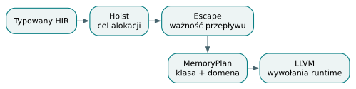

*Trzy decyzje o życiu wartości. Wybór miejsca, sprawdzenie bezpieczeństwa i klasyfikacja obiektu są odrębnymi krokami.*

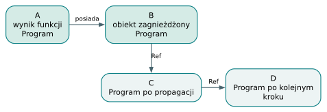

*Propagacja domeny przez graf. Domena propaguje się przez zależności do punktu stałego; zwykłe zagnieżdżenie i Ref są różnymi krawędziami.*

## Granice i ćwiczenie

Słowo `promote` nie oznacza GC ani wyszukiwania nieosiągalnych obiektów. Oznacza jawny transfer do ściśle zewnętrznego wiązania. Ponadto obecny `escape` jawnie odrzuca bezpośrednie zwracanie nowego wyniku `concat` lub `stringFromUtf8` oraz zwracanie przeniesionego albo promowanego `String`. Rozpoznawanie bezpiecznych form jest węższe od wszystkich programów, które teoretycznie można skompilować bezpiecznie.

Ćwiczenie: czy przypisanie deskryptora slice z wewnętrznego bloku do zewnętrznej zmiennej wystarczy, jeżeli elementy są liczbami? **Odpowiedź:** nie. Kopiowalność elementu nie przedłuża życia samego bufora. Trzeba zapewnić trwałe przechowywanie danych, a nie tylko poprawny deskryptor.

## Miejsca w implementacji

- [Adnotacje `hoist` i cel `$result`](https://github.com/andrzejwitkowski/Bork/blob/56f4910a24b689087fe2dee30247651b7b432268/src/hoist.rs).
- [Głębokości i ograniczenia w `escape`](https://github.com/andrzejwitkowski/Bork/blob/56f4910a24b689087fe2dee30247651b7b432268/src/escape.rs).
- [Pochodzenia i propagacja `MemoryPlan`](https://github.com/andrzejwitkowski/Bork/blob/56f4910a24b689087fe2dee30247651b7b432268/src/memory.rs).
- [Harmonogram regionów](https://github.com/andrzejwitkowski/Bork/blob/56f4910a24b689087fe2dee30247651b7b432268/src/codegen/regions.rs).
- [Zastosowanie planu przy konstruktorach](https://github.com/andrzejwitkowski/Bork/blob/56f4910a24b689087fe2dee30247651b7b432268/src/codegen/llvm/managed_ref.rs).

# 11. Areny stronicowane i runtime alokacji

## Dwie implementacje, jeden właściwy punkt odniesienia

W repozytorium istnieje mała demonstracyjna arena `src/arena.rs` o stałej pojemności. Nie należy na tej podstawie opisywać pamięci programów generowanych przez aktualny backend. Właściwy runtime znajduje się w `crates/bork_runtime/src/arena.rs`: obsługuje wiele stron, duże bloki, ponowne używanie pamięci, wzrost buforów oraz kontrolę życia aren zarządzanych. Rozróżnienie przykładu dydaktycznego od kodu wywoływanego przez LLVM jest podstawową umiejętnością czytania dojrzałego repozytorium.

Arena łączy tutaj dwie warstwy. Pierwsza zarządza bajtami: stronami i blokami. Druga przechowuje tożsamość, rodzica, głębokość, liczniki, stan i listę czynności sprzątania. Można zwrócić strony do puli, zachowując jeszcze metadane potrzebne słabym odwołaniom. Adres pamięci i tożsamość czasu życia przestają więc być tym samym pojęciem.

## Strony, wyrównanie i klasy rozmiaru

Podstawowa strona ma 4096 bajtów. Mały przydział pobiera fragment strony, przesuwając jej `offset`; algorytm nazywa się bump allocation. Wyrównanie oblicza się od rzeczywistego adresu bufora, nie tylko od względnego przesunięcia. Rozmiar bloku stronicowego jest co najmniej równy 16 bajtom, aby po zwolnieniu zmieścił się w nim wskaźnik następnego wolnego elementu. Nie oznacza to, że każdy obiekt języka ma rozmiar 16 bajtów: jest to reguła zarządzania przydzielonym miejscem.

Żądania większe niż połowa strony, czyli 2048 bajtów, otrzymują osobny blok systemowy. Również wyrównanie niemożliwe do spełnienia w stronie może skierować żądanie na tę ścieżkę. Rozmiar dużej alokacji jest zaokrąglany do wielokrotności strony. Runtime zapamiętuje dokładny `Layout`, aby późniejsze zwolnienie i realokacja użyły zgodnych parametrów.

Przed przesunięciem wskaźnika arena próbuje odzyskać blok z listy odpowiedniej klasy rozmiaru. Klasy mają granice 16, 32, aż do 2048 bajtów. Lista wykorzystuje pierwsze bajty zwolnionego bloku jako łącze. Wyszukiwanie uwzględnia wymagane wyrównanie; nie każdy blok o wystarczającej wielkości spełnia każde żądanie. Nadmiar miejsca w pobranym bloku nie jest osobno śledzony, co upraszcza implementację kosztem możliwej fragmentacji wewnętrznej.

## Ślad przydziału i zwrotu

Poniższy zapis jest pseudokodem operacji runtime, a nie programem Borka ani wynikiem uruchomienia:

```text
a = arena.alloc(24, 8)
b = arena.alloc(40, 8)
arena.free(a, 24)
c = arena.alloc(16, 8)
arena.free(b, 40)
```

Pierwsze dwa przydziały przesuwają koniec zajętego obszaru strony. Zwolnienie `a` nie może cofnąć tego końca, ponieważ za nim nadal leży `b`. Blok trafia więc na listę wolnych bloków. Żądanie `c` może skorzystać z odpowiedniej dostępnej klasy i wyrównania. Zwolnienie `b`, jeśli nadal kończy się dokładnie na bieżącym końcu strony, cofa `offset`. To odzyskuje końcówkę jako ciągłe miejsce dla kolejnych przydziałów. Nie trzeba przeszukiwać i scalać dowolnych sąsiednich dziur.

Gdy najnowsza strona nie mieści żądania, runtime może sprawdzić wolne końcówki starszych stron. Pole `older_max_tail` pozwala pominąć skan, jeżeli żadna z nich nie może pomóc. Dopiero potem dochodzi nowa albo odzyskana strona. Jest to praktyczny kompromis: prosta szybka ścieżka plus ograniczona próba wykorzystania pozostawionych ogonów.

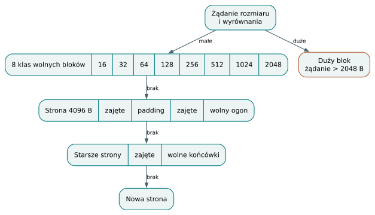

*Małe i duże przydziały. Schemat ilustruje klasy alokacji i kolejność poszukiwania miejsca; nie pokazuje rzeczywistej skali zajętości.*

Granica ABI jest kontraktem dla wygenerowanego kodu. Wywołanie zwalniające blok musi podać jego rzeczywisty rozmiar z ostatniej alokacji albo powiększenia. Nie może zgadywać go z długości używanej części bufora: wektor o długości 5 może mieć pojemność 8, a zwalniany przydział odpowiada tej drugiej wielkości. Podobnie wymagane wyrównanie musi być potęgą dwójki. Rustowy kod runtime używa operacji `unsafe`, ponieważ tych warunków nie potrafi wyprowadzić z samego surowego wskaźnika. Bezpieczeństwo powstaje ze współpracy klienta i alokatora, nie z nazwania pamięci areną.

## Wzrost nie gwarantuje stałego adresu

`grow` próbuje rozszerzyć ostatni blok strony w miejscu. Warunkiem jest zgodność starego końca bloku z `offset` oraz zmieszczenie nowego końca w stronie. Gdy to niemożliwe, przydziela nowy blok, kopiuje stare bajty i zwalnia poprzedni. Duży blok korzysta z systemowego `realloc`, które również może zmienić adres. Klient musi zatem zastąpić swój wskaźnik wynikiem `grow`.

Zwykłe alokacje same nie przesuwają wcześniejszych bloków. Relokacja następuje na żądanie klienta, co ma kluczowe znaczenie dla `Vec`: nagłówek pozostaje miejscem odniesienia, a wskaźnik bufora jest aktualizowany. Nie wolno wyciągać z tego wniosku, że wszystkie wskaźniki do elementów miałyby pozostać prawidłowe po powiększeniu.

## Reset, pula i generacje

Reset danych zachowuje pierwszą stronę, zeruje jej przesunięcie, czyści listy wolne i zwalnia duże bloki. Dodatkowe strony mogą zostać zachowane do ponownego użycia, lecz limit zapasowych stron wynosi osiem. Pula może więc ograniczyć część kosztów ponownych alokacji bez przypinania dowolnej liczby stron osiągniętych przy chwilowym szczycie obciążenia.

Publiczna operacja `bork_arena_reset` nie jest jednak samym ustawieniem `offset = 0`. Niszczy bieżącą kontrolę areny leksykalnej i tworzy nową pod tym samym rodzicem. Stary uchwyt i nowy uchwyt oznaczają inne życia, nawet jeżeli pula przydzieli identyczne adresy stron. Identyfikatory rosną i są niezerowe; runtime traktuje ich wskaźnikową reprezentację jako nieprzezroczysty token, którego nie dereferencjonuje.

Zakończenie życia przebiega przez stany `Alive`, `Destroying`, `Dead`. Najpierw uruchamiane są zarejestrowane funkcje sprzątające w odwrotnej kolejności. Potem payload wraca do puli. Metadane mogą pozostać, jeżeli istnieją słabe dzierżawy. Dopiero ich zwolnienie usuwa martwą kontrolę. Dzięki temu słaby uchwyt potrafi stwierdzić wygaśnięcie celu, zamiast przypadkowo obserwować nowy obiekt w odzyskanej pamięci.

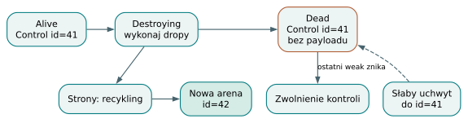

*Tożsamość przeżywa payload. Po śmierci payloadu kontrola zachowuje tożsamość potrzebną słabym uchwytom.*

## Integracja i ćwiczenie

Backend odzwierciedla otwarte regiony stosem uchwytów. Wcześniejszy `return` sprząta je od środka na zewnątrz; wyjścia z pętli potrzebują właściwej głębokości rozwijania. Ponieważ reset zmienia uchwyt, generowanie pętli używa w LLVM węzła phi, aby wyjście odwoływało się do aktualnej generacji. Jest to przykład sytuacji, gdy projekt zarządzania pamięcią bezpośrednio kształtuje graf przepływu sterowania.

Runtime korzysta z lokalnego dla wątku stanu. Sam fakt istnienia liczników nie stanowi obietnicy współdzielenia uchwytów między wątkami. Również stała 4096 nie jest granicą wielkości obiektu: duże żądania mają osobną ścieżkę. Przy analizie wydajności należy liczyć zarówno payload, zachowane strony, jak i metadane utrzymywane przez słabe odwołania.

Ćwiczenie: czy reset może zwrócić stronę o tym samym adresie i jednocześnie uniemożliwić słabemu uchwytowi zobaczenie nowego obiektu? **Odpowiedź:** tak. Uchwyty sprawdzają tożsamość i stan kontroli, a odzyskanie adresu nie przywraca starej generacji do `Alive`.

## Miejsca w implementacji

- [Strony, `Arena::alloc`, `grow`, `reset` i kontrola życia](https://github.com/andrzejwitkowski/Bork/blob/56f4910a24b689087fe2dee30247651b7b432268/crates/bork_runtime/src/arena.rs).
- [Wywołania aren oraz phi generacji pętli](https://github.com/andrzejwitkowski/Bork/blob/56f4910a24b689087fe2dee30247651b7b432268/src/codegen/llvm/arena.rs).
- [Przykład wektora przekraczającego stronę](https://github.com/andrzejwitkowski/Bork/blob/56f4910a24b689087fe2dee30247651b7b432268/programs/build/vec/grow_past_page.bork).
- [Pomocnicza arena o stałej pojemności](https://github.com/andrzejwitkowski/Bork/blob/56f4910a24b689087fe2dee30247651b7b432268/src/arena.rs).

# 12. Zarządzane Ref, guardy obecności i cykle

## Ref nie jest pożyczką &T

`Ref<T>` pozwala przechowywać odwołanie, którego obecność i wpływ na życie celu rozstrzyga także runtime. W aktualnym modelu celem może być nienullowalna klasa albo enum. Pusty uchwyt ma wartość `None`; nie trzeba otaczać go dodatkowym `Option`, aby wyrazić brak obiektu. Pożyczka `&T` pozostaje natomiast widokiem o ograniczonym zakresie, a nie zamiennikiem zarządzanego uchwytu.

Runtime reprezentuje `Ref` strukturą `RefHandle`: token kontroli areny, adres obiektu i rodzaj krawędzi. Tożsamość celu obejmuje więc zarówno konkretne życie areny, jak i obiekt w jej pamięci. Sama równość adresów obiektów nie wystarcza. Wygasłe słabe uchwyty zachowują metadane pozwalające rozpoznać śmierć, lecz porównania traktują je jak brak wartości. Rodzaj krawędzi jest informacją wykonawczą i nie musi być taki sam dla dwóch uchwytów do tego samego obiektu.

## Rodzaj zależy od właściciela uchwytu

Właścicielem uchwytu nazywamy arenę przechowującą jego slot. Nie jest nim automatycznie region, w którym programista po raz pierwszy napisał nazwę celu. Klasyfikacja otrzymuje arenę źródłową i docelową i stosuje ustaloną kolejność reguł:

| Relacja aren | Rodzaj |
|---|---|
| Ta sama arena | `Arena` |
| Cel jest przodkiem źródła | `Borrow` |
| Pozostałe: źródło ma mniejsze ID | `Strong` |
| Pozostałe: źródło ma większe ID | `Weak` |

`Arena` i runtime'owe `Borrow` nie zwiększają silnego licznika. Ich poprawność wynika z organizacji życia aren. `Strong` podtrzymuje payload celu. `Weak` zachowuje możliwość sprawdzenia stanu, lecz pozwala payloadowi umrzeć. Nazwa wariantu `Borrow` nie oznacza, że wartość źródłowa ma językowy typ `&T`: nadal analizujemy `Ref<T>`.

Identyfikatory tworzenia aren rosną. Wśród krawędzi liczonych jako silne kierunek prowadzi od niższego numeru do wyższego. Taki graf nie może mieć cyklu złożonego wyłącznie z silnych krawędzi. Odwołanie zwrotne między niezależnymi arenami staje się słabe. Odwołania wewnątrz jednej areny nie podtrzymują jej dodatkowym licznikiem. Jest to strategia orientowania krawędzi, a nie wykrywanie cykli przez śledzący garbage collector.

## Ślad: dziecko przeżywa rodzica

Program z `programs/build/managed_refs/expired_weak_back_edge.bork`:

```bork
class Node {
    id: i32
    parent: Ref<Node>
}

fun main(): i32 {
    var saved: Ref<Node> = None

    {
        val parent = Node(1, None)
        val child = Node(2, parent)
        saved = child
    }

    if val live_child = saved {
        if val live_parent = live_child.parent {
            return live_parent.id
        }
    }
    return 0
}
```

Planista musi umożliwić celowi `saved` życie poza blokiem. Konstrukcja `child` powstaje po `parent`, zatem jej pole wskazujące wcześniejszą niezależną arenę klasyfikuje się jako słabe. Zapis do starszego `saved` podtrzymuje dziecko silną krawędzią. Po wyjściu z bloku kończą się początkowe dzierżawy właścicieli konstrukcji. Dziecko ma nadal silnego właściciela; rodzic może utracić ostatnie podtrzymanie i przejść do `Dead`. Pierwszy guard widzi dziecko, drugi nie widzi rodzica. Metadane rodzica istnieją tak długo, jak wymaga tego słaby uchwyt. Komentarz fixture wskazuje oczekiwany kod wyjścia 0; nie jest to raport uruchomienia wykonanego tutaj.

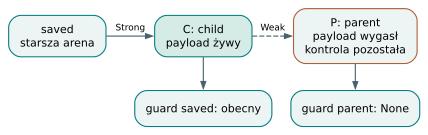

*Rodzina z wygasłym odwołaniem zwrotnym. Zachowany child może żyć po utracie parent. Słaba krawędź nie odtwarza życia payloadu rodzica.*

## Guard obserwuje i przypina

Nie wystarczy sprawdzić, że uchwyt nie jest `None`, a następnie bezwarunkowo dereferencjonować jego dawny adres. `if val live = reference` tworzy obserwację. Dla słabej krawędzi runtime próbuje chwilowo zwiększyć silny licznik żywego celu. Dla silnej robi niezależne przypięcie. To drugie jest istotne: ciało może nadpisać slot źródłowego uchwytu, ale obiekt widoczny przez `live` musi pozostać dostępny aż do końca obserwacji.

Udana obserwacja udostępnia adres obiektu oraz token guarda. Warianty `Arena` i `Borrow` nie potrzebują dodatkowego silnego przypięcia. Zakończenie zakresu zwalnia obserwację. Backend musi zapewnić sprzątanie również przy `return`, `break` i `continue`, nie tylko przy dojściu do końcowej klamry. Nazwa związana przez guard jest ograniczoną pożyczką: nie można wynieść jej z zakresu ani zachować w polu obiektu.

Łańcuch `if val (a = r, b = a.next)` ocenia źródła od lewej do prawej. Kolejne źródło może użyć wcześniejszego wiązania. Jeśli drugie zawiedzie, wcześniej zdobyte obserwacje trzeba zwolnić przed wykonaniem `else`. Jeśli wszystkie się powiodą, zwalnia się je po ciele, w odpowiedniej kolejności. Program `chained_partial_cleanup.bork` sprawdza szczególnie trudny przypadek: obliczanie późniejszego źródła usuwa wcześniejszego silnego właściciela. Guard musi utrzymać cel przez obliczenia i następnie poprawnie oddać dzierżawę.

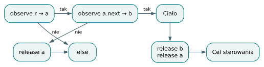

*Łańcuch guardów i sprzątanie częściowe. Niepowodzenie kolejnego guarda zwalnia wcześniej zdobyte obserwacje.*

Guard pokazuje także, dlaczego czas życia metadanych i czas życia obiektu trzeba rozpatrywać oddzielnie. Słaby uchwyt może legalnie istnieć po śmierci payloadu, lecz nie daje wtedy dostępu do dawnych pól. Udana obserwacja słabego celu wymaga równocześnie stanu `Alive` i dodatniego silnego licznika. Zachowane metadane same nie spełniają tego warunku. Przypięcie jest zatem krótką dzierżawą żywego celu, a nie próbą odtworzenia obiektu na podstawie historycznego adresu. Z tej perspektywy `if val` łączy sprawdzenie warunku, nabycie uprawnienia do dostępu i obowiązek jego oddania. Implementowanie go jako samego porównania wskaźnika z zerem zgubiłoby dwie ostatnie czynności.

## Pętle, przeniesienia i granice

W tym commicie nie ma składni `while val`. Poprawnym opisem aktualnego języka jest zwykła pętla `while`, wewnątrz której występuje `if val`. Fixture `chained_loop_cleanup.bork` powtarza obserwacje i wykonuje `continue` oraz `break`. Pokazuje wymagane sprzątanie per iteracja, bez dopisywania niezaimplementowanego nagłówka pętli. Ewentualne `while val` w projekcie przyszłego języka należałoby opisać jako propozycję, nie dostępną konstrukcję.

Skopiowanie uchwytu w tym samym właścicielu zachowuje jego rodzaj i aktualizuje odpowiedni licznik. Przeniesienie uchwytu może wyzerować źródłowy slot. Zapis do nowego właściciela wymaga jednak `rehome`: ponownej klasyfikacji zależności. Runtime najpierw utrzymuje nową wartość, dopiero potem zwalnia starą. Zapobiega to zniszczeniu celu przy samoprzypisaniu albo nadpisaniu ostatniego właściciela. Rehoming wygasłego słabego odwołania daje `None`; nie wskrzesza martwego payloadu.

Ćwiczenie: ciało `if val x = r` ustawia `r = None`. Czy można jeszcze odczytać pole `x` w tym samym ciele? **Odpowiedź:** obserwacja silnego lub skutecznie podniesionego słabego celu ma niezależne przypięcie. Nadpisanie slotu `r` go nie usuwa; zwolnienie następuje przy zakończeniu guarda.

## Miejsca w implementacji

- [ABI `RefHandle`, obserwacje i `rehome`](https://github.com/andrzejwitkowski/Bork/blob/56f4910a24b689087fe2dee30247651b7b432268/crates/bork_runtime/src/refs.rs).
- [Klasyfikacja krawędzi i liczniki aren](https://github.com/andrzejwitkowski/Bork/blob/56f4910a24b689087fe2dee30247651b7b432268/crates/bork_runtime/src/arena.rs).
- [Emisja guardów i wyników ich ramion](https://github.com/andrzejwitkowski/Bork/blob/56f4910a24b689087fe2dee30247651b7b432268/src/codegen/llvm/region_emit.rs).
- [Wygaśnięcie odwołania zwrotnego](https://github.com/andrzejwitkowski/Bork/blob/56f4910a24b689087fe2dee30247651b7b432268/programs/build/managed_refs/expired_weak_back_edge.bork).
- [Sprzątanie łańcuchów w pętli](https://github.com/andrzejwitkowski/Bork/blob/56f4910a24b689087fe2dee30247651b7b432268/programs/build/managed_refs/chained_loop_cleanup.bork).

# 13. String, bufory bajtowe, UTF-8, tablice i slice

## Deskryptor nie jest buforem

`String` jest w runtime zakresem bajtów opisanym parą wskaźnik–długość. Funkcje pomocnicze otrzymują oba składniki i nie poszukują końcowego zera. Wewnętrzny bajt NUL może być zwykłą częścią danych. Dla pustego zakresu wskaźnik może być zerowy; helpery obsługują ten przypadek bez budowania nieprawidłowego rustowego slice z pustego adresu. Długość jest liczbą bajtów, a nie liczbą znaków Unicode widzianych przez czytelnika.

Bieżący snapshot nie udostępnia wbudowanego nazwanego typu `Bytes`. Bufor bajtowy zapisuje się jako tablicę, na przykład `[u8; 4]`, a pożyczkę jako `&[u8; 4]`. „Bytes” może być użyteczne jako pojęcie w projekcie API, lecz nie należy prezentować go w przykładzie jako działającego typu tej wersji. Dzięki temu rozdział odróżnia reprezentację surowych bajtów od gwarancji związanych z tekstem.

Tablice również mają deskryptor wskaźnik–długość, lecz liczba elementów należy dodatkowo do typu: `[i32; 3]` różni się od `[i32; 2]`. Bufor zawiera ciąg elementów o znanym kroku i wyrównaniu. Tablica liczb nie jest więc pojedynczym dużym prymitywem `Copy`. Jej dane nadal mają właściciela i czas życia regionu. Skopiowanie deskryptora nie kopiuje automatycznie wszystkich wskazywanych bajtów.

Literały tekstowe mają szczególny początek życia: backend umieszcza ich bajty w prywatnej stałej globalnej LLVM, a deskryptor wskazuje tę stałą. Zwykłe związanie nazwy z literałem nie wymaga skopiowania jego zawartości do lokalnej areny. Późniejsze operacje, takie jak jawne `move` albo zapis tekstu jako elementu właściciela, mogą już tworzyć kopię regionalną. Pozwala to zrozumieć, dlaczego dwa wyrażenia o identycznym typie i identycznym tekście mogą zachowywać się inaczej przy zwracaniu z funkcji. Różnica leży w pochodzeniu bajtów i wykonanych operacjach, a nie w widocznej treści napisu.

## Bajt tekstu to nie znak

Indeksowanie `String` oraz `&String` daje `u8`. Tekst `"ą"` ma dwa bajty: 196 i 133. Indeksy 0 i 1 wybierają osobne bajty kodowania UTF-8, a `.length` zwraca 2. To API nadaje się do rozpoznawania protokołów opartych na ASCII i inspekcji kodowania. Nie realizuje iteracji po znakach, punktach kodowych ani grafemach. Również porównanie tekstów działa na bajtach i długościach; nie normalizuje Unicode.

Funkcja runtime `bork_string_equal` porównuje zawartość, nie adresy buforów. Dwie kopie napisu mogą być równe mimo innych miejsc alokacji. Wewnętrzny helper haszujący stosuje FNV-1a 64, ale komentarz implementacji określa go jako ABI dla przyszłych map. Nie stanowi dostępnego w języku builtinu `hash`. To dobry przykład różnicy między istniejącą funkcją pomocniczą a publiczną funkcjonalnością języka.

## Od bajtów do tekstu

`stringFromUtf8(&bytes, start, count)` przyjmuje pożyczoną tablicę bajtów oraz dwa argumenty `i32`. Rozdziela błędy zakresu od niepoprawnego kodowania. Ujemny początek, ujemna liczba bajtów albo zakres poza buforem prowadzą do przerwania wykonania. Poprawny zakres zawierający błędne UTF-8 daje `None`. Poprawne UTF-8 jest kopiowane do areny odbiorcy i opakowywane jako obecny wynik `String?`.

Przykład z `programs/build/text/utf8_copy_independent.bork`:

```bork
fun main(): i32 {
    var bytes: [u8; 3] = [71, 69, 84]
    val method = stringFromUtf8(&bytes, 0, 3) ?: "none"
    bytes[0] = 80
    if (method == "GET") {
        return 3
    }
    return 0
}
```

Najpierw tablica przechowuje kodowanie `GET`. Backend sprawdza zakres, a runtime waliduje trzy bajty. Dopiero po sukcesie powstaje nowy bufor tekstu i kopia zawartości. Późniejszy zapis 80 zmienia pierwszy bajt tablicy na `P`, lecz nie zmienia `method`. Operator `?:` dostarcza wartość zastępczą wyłącznie dla braku wyniku. Komentarz programu oczekuje kodu 3; tutaj analizujemy jego źródło, bez uruchamiania.

Walidacja dotyczy wybranego zakresu, nie całego otaczającego bufora. Można zatem wybrać poprawny tekst ze środka danych binarnych. Można też przeciąć wielobajtową sekwencję na pół i otrzymać `None`. Zakres o długości zero jest poprawnym UTF-8 i daje obecny pusty tekst, co różni się od braku wartości. Rozróżnienie pusty–nieobecny jest ważne dla parserów protokołów.

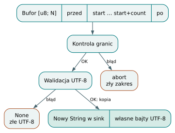

*Walidacja i kopia UTF-8. Poprawne UTF-8 zostaje skopiowane do niezależnego String. Błąd zakresu i błąd kodowania mają różne wyniki.*

## Tablica i widok slice

Literał tablicowy ustala wspólny typ elementu i liczbę elementów. Oczekiwana adnotacja może dostarczyć typ, zwłaszcza dla pustego `[]`, które bez wskazówki jest odrzucane. Obsługiwane elementy to wartości `Copy`, nienullowalne `String` i `Ref<T>`. Wstawienie dowolnej klasy bezpośrednio do tablicy nie jest ogólnym mechanizmem przechowywania obiektów; do tego służy odpowiednio zarządzany uchwyt.

Przykład z `programs/build/borrow/array_slice.bork`:

```bork
fun main(): i32 {
    val a = [10, 20, 30]
    val b = a[0..2]
    return b[1]
}
```

Slice nie przydziela drugiego bufora. Backend przesuwa wskaźnik o `lo * stride` i wpisuje długość wynikającą z typu. `b[1]` wskazuje więc ten sam element co `a[1]`. W aktualnej składni granice slice muszą być literałami całkowitymi, aby typ wyniku nadal miał postać `[T; N]`. Nie jest to oddzielny publiczny typ dynamicznego slice z dowolnymi granicami wyliczanymi w runtime.

Typeck sprawdza kolejność i statyczny zakres granic. Zwykłe indeksowanie otrzymuje kontrolę granic w wygenerowanym kodzie. Indeksy mają typ `i32`, a ujemna wartość nie może oznaczać dostępu od końca. Własność bufora pozostaje oddzielnym warunkiem: test `rejects_slice_escaping_inner_region` w `tests/arrays.rs` utrwala odrzucenie slice wynoszonego do zewnętrznego wiązania. Poprawne indeksy nie naprawiają zbyt krótkiego życia danych.

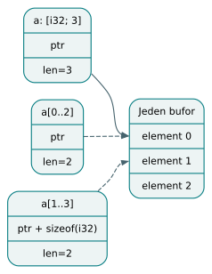

*Deskryptory tablicy i slice. Slice zmienia adres i długość deskryptora, ale nadal korzysta z pamięci tego samego właściciela.*

## Kopiowanie i ćwiczenie

Przeniesienie całej tablicy do innej areny może skopiować jej bufor. Dla elementów liczbowych wystarcza kopiowanie bajtów. Dla `String` backend kopiuje także zawartość każdego tekstu. Wewnętrzna materializacja tablicy `Ref`, na przykład w polu obiektu, klonuje i umieszcza uchwyty u właściwego właściciela; jawne `move` i `promote` tablic zarządzanych referencji odrzuca jednak bramka backendu. Odczyt jednego elementu `String` jest współdzielonym odczytem, nie automatycznym głębokim klonowaniem. Także wynik walidacji UTF-8 podlega ograniczeniom `escape`: bezpośredni `return stringFromUtf8(...)` nie jest w tej wersji ogólną bezpieczną drogą zwracania świeżych bajtów.

Ćwiczenie: bufor zawiera `[206, 187]`, czyli literę lambda. Co da konwersja zakresu `start = 0`, `count = 1`? **Odpowiedź:** zakres jest legalny, ale pojedynczy bajt rozpoczynający dwubajtową sekwencję nie jest poprawnym UTF-8. Wynikiem jest `None`, a nie przerwanie z powodu granic.

## Miejsca w implementacji

- [Porównywanie i walidacja tekstu w runtime](https://github.com/andrzejwitkowski/Bork/blob/56f4910a24b689087fe2dee30247651b7b432268/crates/bork_runtime/src/text.rs).
- [Sprawdzanie zakresu i kopia `stringFromUtf8`](https://github.com/andrzejwitkowski/Bork/blob/56f4910a24b689087fe2dee30247651b7b432268/src/codegen/llvm/text.rs).
- [Typy tablic, indeksy i statyczne slice](https://github.com/andrzejwitkowski/Bork/blob/56f4910a24b689087fe2dee30247651b7b432268/src/typeck/expr/array.rs).
- [Deskryptory i dostęp do elementów](https://github.com/andrzejwitkowski/Bork/blob/56f4910a24b689087fe2dee30247651b7b432268/src/codegen/llvm/array/access.rs).
- [Stałe literały i kopie tekstu](https://github.com/andrzejwitkowski/Bork/blob/56f4910a24b689087fe2dee30247651b7b432268/src/codegen/llvm/expr.rs).

# 14. Vec: wzrost, elementy oraz relokacja i promocja

## Nagłówek zarządza zmiennym buforem

`Vec<T>` jest wbudowanym kontenerem o długości zmienianej podczas wykonania. Nie jest po prostu tablicą, której pominięto rozmiar w typie. Jego reprezentacja ma stabilny nagłówek zawierający wskaźnik bufora, długość, pojemność i arenę właściciela. W aktualnym backendzie nagłówek ma cztery pola po osiem bajtów. Wartość kontenera przekazuje wskaźnik nagłówka, a adres samego bufora może zmieniać się po wzroście.

Konstruktor `Vec<T>()` tworzy pusty nagłówek, bez początkowego bufora. `Vec<T>(capacity)` może od razu zarezerwować bufor na wskazaną liczbę elementów. Argument jest typu `i32`; ujemna pojemność powoduje przerwanie wykonania. Pojemność określa dostępne miejsce, nie liczbę istniejących elementów. Nawet duża rezerwacja pozostawia `len()` równe zero i nie pozwala odczytywać niezainicjalizowanych slotów.

Reguła elementów jest celowo ograniczona: dozwolone są typy `Copy`, nienullowalny `String` oraz `Ref<T>`. `Vec<Node>` dla zwykłej klasy nie jest odpowiednikiem kolekcji właścicieli obiektów. Należy rozważyć `Vec<Ref<Node>>` zgodnie z modelem zarządzanych odwołań. Także nullable `String?`, zagnieżdżony `Vec` czy dowolny agregat nie stają się automatycznie poprawnymi elementami tylko dlatego, że LLVM umiałby zapisać ich adres.

## Operacje i ich warunki

Wbudowane metody obejmują `push`, `pop`, `get`, `set`, `len`, `capacity` i `clear`. `get(i)` oraz `v[i]` wykonują kontrolę granic i zwracają element; `get` nie jest wariantem „może się udać” z opcjonalnym wynikiem. `set` i zapis indeksowy również wymagają istniejącego elementu. Dopiero `push` zwiększa długość. `pop` dla zwykłego elementu daje wartość nullable, a dla `Ref<T>` bezpośrednio uchwyt, który sam potrafi reprezentować `None`.

Metody odbierają pożyczony kontener. Typeck dopuszcza odczyty przez `val`, ale operacje mutujące odrzuca dla niemutowalnego korzenia, również gdy wektor osiągnięto przez pole obiektu `val`. Implementacja rozróżnia przy tym `this`, pożyczki i uchwyty `Ref`, których semantyka nie sprowadza się do zakazu zapisu wynikającego z lokalnego `val`. Nie należy przedstawiać tej kontroli jako głębokiej, tranzytywnej niemutowalności całego grafu.

Przykład z `programs/build/vec/push_grow_sum.bork`:

```bork
fun main(): i32 {
    var v = Vec<i32>()
    var i = 0
    while (i < 10) {
        v.push(i)
        i = i + 1
    }
    var total = 0
    var j = 0
    while (j < v.len()) {
        total = total + v[j]
        j = j + 1
    }
    return total
}
```

Fixture opisuje oczekiwaną sumę 45. Czytając kod, można prześledzić także pamięć. Pierwszy `push` zwiększa pojemność z 0 do 4. Piąty wymaga 8 slotów, dziewiąty 16. Długość po dziesiątym wynosi 10, choć sześć dalszych slotów pozostaje tylko rezerwą. Pętla odczytu ograniczona przez `len()` dotyka wyłącznie żywych elementów. Nie uruchamiano tego programu przy przygotowywaniu tekstu.

## Dwa różne powody kopiowania

Wzrost bufora i przeniesienie kontenera do innej areny mają inne znaczenie. Przy wzroście właściciel pozostaje ten sam. Backend wylicza nową pojemność przez podwojenie, a następnie wywołuje alokację albo `bork_arena_grow`. Runtime może rozszerzyć ostatni blok w miejscu lub przenieść bajty do nowego. Nagłówek otrzymuje nowy wskaźnik i pojemność. Ponieważ właściciel slotów się nie zmienił, uchwyty `Ref` nie wymagają same z siebie ponownej klasyfikacji krawędzi.

Przy `move` albo `promote` wektora backend tworzy natomiast nowy nagłówek i bufor w arenie odbiorcy. Rezerwuje miejsce według liczby żywych elementów, niekoniecznie zachowując wcześniejszą nadmiarową pojemność. Następnie odwiedza elementy. Liczby zapisuje bezpośrednio, teksty materializuje w nowej arenie, a zarządzane odwołania klonuje i rehome'uje. Semantyka języka zużywa źródłowe wiązanie, choć backend pozostawia źródłową reprezentację poprawną do późniejszego sprzątnięcia.

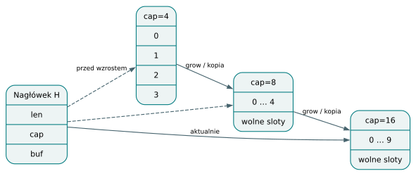

*Wzrost pojemności Vec. Nagłówek utrzymuje bieżący bufor. Wzrost może udać się w miejscu albo wymagać nowego przydziału.*

## Elementy wymagają własnych reguł życia

`push` i `set` kopiują bajty `String` do areny wektora. Późniejsze powiększenie przenosi tylko deskryptory tych tekstów; ich osobne bajty nadal żyją w tej samej arenie. `clear` ustawia długość na zero i zachowuje pojemność. Dla `Ref` musi dodatkowo zwolnić wszystkie żywe uchwyty. Dla tekstów nie oznacza natychmiastowego odzyskania każdego poprzedniego zakresu bajtów: region nadal zarządza ich pamięcią.

Dla `Ref` nadpisanie slotu utrzymuje nowy cel przed zwolnieniem starego. Odczyt klonuje uchwyt. `pop` przenosi ostatni uchwyt ze slotu, zerując go i zmniejszając długość, aby sprzątanie nie zwolniło go ponownie. Destructor `Vec<Ref<T>>` rejestruje się dla nagłówka, a nie każdego adresu slotu. Przy wzroście sloty mogłyby zmienić adresy, przez co wcześniejsze rejestracje stałyby się wiszącymi wskaźnikami. Destructor nagłówka czyta aktualny bufor i aktualną długość.

## Promocja może zmienić słabe odwołanie w silne

Fixture `programs/build/vec/ref_promote_strong.bork` tworzy sześć węzłów w starszym bloku X, a następnie wektor w nowszym bloku Y. Sloty tego wektora wskazują wcześniejsze niezależne areny węzłów, zatem zaczynają jako słabe krawędzie. Następnie `saved = promote tmp` kopiuje kontener do jeszcze starszej areny `saved`. Tam kierunek względem celów jest inny: ponowna klasyfikacja tworzy silne uchwyty. Węzły mogą dzięki nim przeżyć wyjście z X i Y.

Samo skopiowanie bitów starego rodzaju `Weak` byłoby błędem. Po zamknięciu bloków węzły wygasłyby mimo obecności kontenera. Dlatego `copy_vec_into_arena` przechodzi po elementach zamiast wykonywać bezwarunkowy `memcpy`. Podobny przypadek bez promocji utrwala `ref_weak_expires.bork`: słaba krawędź ma prawo przestać widzieć obiekt. Promocja kontenera nie oznacza śledzącego GC ani głębokiego kopiowania wszystkich obiektów grafu; zmienia miejsce kontenera i relacje przechowywanych uchwytów.

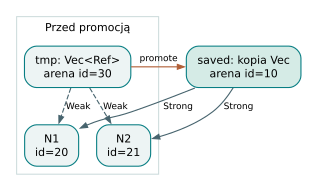

*Rehome elementów przy promocji. Promocja kontenera ponownie klasyfikuje krawędzie względem nowej areny; obiekty docelowe nie zmieniają miejsca.*

Pojemność jest więc własnością konkretnej reprezentacji kontenera, a nie częścią jego logicznej zawartości. Dwa wektory z tymi samymi elementami mogą mieć różną rezerwę. Promocja zachowuje elementy i ich kolejność, ale odbiorca może otrzymać pojemność równą długości. Następny `push` będzie wtedy wymagał wzrostu wcześniej, niż sugerowałaby historyczna pojemność źródła.

## Koszt i ćwiczenie

Podwajanie daje klasyczny amortyzowany stały koszt liczby operacji przenoszenia slotów dla serii `push`, lecz rzeczywisty koszt zależy też od elementów. Wstawienie tekstu kopiuje jego długość w bajtach, a kopiowanie całego wektora jest liniowe względem liczby elementów i ich wymaganej materializacji. Aktualna ścieżka wzrostu operuje na iloczynach pojemności i kroku bez osobnego sprawdzania przepełnienia tych mnożeń; nie należy dopisywać jej gwarancji wykraczających poza widoczną implementację.

Ćwiczenie: czy po wzroście `Vec<Ref<Node>>` z 4 do 8 trzeba ponownie wyznaczyć rodzaje wszystkich odwołań? **Odpowiedź:** sam wzrost nie zmienia areny właściciela. Ponowna klasyfikacja jest potrzebna przy skopiowaniu kontenera do innej areny, nie przy zmianie adresu jego bufora w tej samej arenie.

## Miejsca w implementacji

- [Sprawdzanie konstruktorów, metod i mutowalności](https://github.com/andrzejwitkowski/Bork/blob/56f4910a24b689087fe2dee30247651b7b432268/src/typeck/expr/vec.rs).
- [Wzrost i podwajanie pojemności](https://github.com/andrzejwitkowski/Bork/blob/56f4910a24b689087fe2dee30247651b7b432268/src/codegen/llvm/vec/grow.rs).
- [Kopiowanie wektora do areny odbiorcy](https://github.com/andrzejwitkowski/Bork/blob/56f4910a24b689087fe2dee30247651b7b432268/src/codegen/llvm/vec/copy.rs).
- [Zapisy, odczyty i materializacja elementów](https://github.com/andrzejwitkowski/Bork/blob/56f4910a24b689087fe2dee30247651b7b432268/src/codegen/llvm/vec/access.rs).
- [Test promocji słabych slotów do silnych](https://github.com/andrzejwitkowski/Bork/blob/56f4910a24b689087fe2dee30247651b7b432268/programs/build/vec/ref_promote_strong.bork).

# 15. Bramka backendu, lowering i fizyczny kształt danych

## Poprawny program i program wykonywalny

Frontend odpowiada, czy program spełnia reguły języka. Backend odpowiada,
jak przedstawić jego wartości i operacje na konkretnej maszynie. Te odpowiedzi
nie muszą obejmować identycznego zbioru programów. W badanej wersji Borka
rozróżnienie jest widoczne w interfejsie: `bork plik.bork` uruchamia
`frontend::check`, a `bork build plik.bork` przechodzi dalej przez specjalizację,
bramkę backendu, LLVM i linker. Sukces pierwszego polecenia nie stanowi
obietnicy utworzenia pliku wykonywalnego przez drugie.

Bramka jest zwykłym przejściem po typowanym HIR, bez zależności od LLVM.
Sprawdza konstrukcje, których backend jeszcze nie obsługuje, i zwraca
standardowe diagnostyki fazy `codegen`. Dzięki temu ograniczenie implementacji
można zgłosić przy fragmencie źródła, zanim biblioteka LLVM zobaczy program.
Jej zadaniem jest kontrola obsługiwanego podzbioru, a nie ponowne wnioskowanie
typów lub własności.

Konkretny dowód różnicy daje pełny program
`programs/check/methods/trailing_closure.bork`:

```bork
class P {
    x: i32

    fun apply(k: i32, f: (i32) -> i32): i32 {
        return f(k)
    }
}

fun main(): i32 {
    val p = P(1)
    return p.apply(2) { v -> v + 1 }
}
```

Korpus zawiera też `programs/build_fail/methods/trailing_closure.bork`
z tym samym programem i dyrektywą `// diag: trailing`. Frontend potrafi
sprawdzić taką metodę i końcową lambdę, lecz `gate_expr` odrzuca wywołanie
z `has_trailing_closure`. Jest to właściwość zapisana w źródłach i testach;
nie wynik uruchomienia programu na potrzeby tego rozdziału.

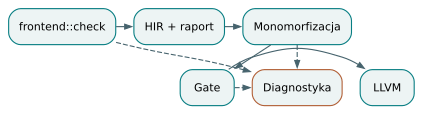

*Granica podzbioru backendu. Kolejne etapy mogą zgłaszać diagnostykę; poprawny HIR nie gwarantuje jeszcze gotowości backendu.*

## Co naprawdę trafia do LLVM

Lowering oznacza zastąpienie konstrukcji wyższego poziomu operacjami
bliższymi maszynie. W Borku nie należy dopisywać do tego opisu nieistniejącego,
osobnego etapu MIR. Backend pracuje na typowanym HIR i tworzy instrukcje LLVM
za pomocą Inkwell. Nazwy lokalne, typy wyrażeń, rozstrzygnięcia użycia wartości
oraz informacje o regionach zostały przygotowane wcześniej.

`build_with_options` rozpoczyna od sprawdzenia wyniku frontendu. Następnie
`mono::monomorphize` tworzy konkretne instancje kodu generycznego. Dopiero na
nich działa bramka. To ważna kolejność: `T` w definicji funkcji nie określa
jeszcze rozmiaru ani reprezentacji argumentu, a `String` w instancji już tak.
Specjalizacja zwraca razem HIR, raport regionów i plan pamięci. Nie wolno
połączyć nowego HIR ze starym planem: numeracja węzłów zmienia się podczas
tej transformacji, a alokacje są wyszukiwane właśnie po identyfikatorach.

Dalej powstaje kontekst LLVM, kontekst generowania `Codegen`, deklaracje
funkcji i ich ciała. Rozdzielenie deklarowania od emisji ciał pozwala
wywoływać funkcje zdefiniowane później i obsługiwać rekursję. Na zakończenie
moduł przechodzi weryfikator LLVM. Bramka i weryfikator sprawdzają różne
kontrakty: pierwsza zakres implementacji Borka, drugi poprawność powstałego IR.

Specjalizacja używana przy budowaniu zbiera kod osiągalny z `main`. To oznacza,
że backend może już nie zobaczyć niewywoływanej funkcji pomocniczej. LSP
wykonuje natomiast bramkę na HIR zachowanym przez frontend, bez tej samej
ścieżki budowania modułu. Identyczny komunikat bramki nie czyni tych dwóch
interfejsów równoważnymi w każdym przypadku. Przy diagnozowaniu rozbieżności
trzeba porównać także zbiór funkcji przekazany do przejścia, a nie tylko
implementację samego `gate_expr`.

## Typ logiczny a reprezentacja

Typ opisuje dostępne operacje i reguły programu. Layout opisuje rozmiar,
wyrównanie, położenie pól i reprezentację przekazywaną między funkcjami.
Dwa różne typy mogą mieć taki sam layout, zachowując odmienne znaczenie.

`Codegen::basic_type` odwzorowuje liczby całkowite na odpowiednie szerokości
LLVM, `bool` na `i1`, a `f32` i `f64` na typy zmiennoprzecinkowe. `unit` nie ma
zwykłej wartości LLVM. Dla obiektu klasy albo enuma wartością jest uchwyt
`{arena_control, object}`, czyli dwa wskaźniki. Pola klasy leżą osobno,
w zaalokowanym payloadzie. Dostęp do pola korzysta z typu struktury oraz
`getelementptr`; nie wylicza ręcznie przesunięcia przez sumowanie rozmiarów.
Wyrównanie może bowiem wprowadzać przerwy między polami.

Zarządzany `Ref<T>` ma inną reprezentację: `{target_control, object, kind:u8}`.
Pole `kind` rozróżnia stan uchwytu wymagany przez runtime. Kopiowanie takiego
uchwytu jest operacją semantyczną z odpowiednim helperem, a nie dowolnym
kopiowaniem bajtów. Zwykłe pożyczenie `&T` jest w `basic_type` rozpatrywane
przez reprezentację `T`; obowiązki związane z pożyczeniem pozostają kontraktem
wcześniejszych faz, nie dodatkowym bitem przy każdej wartości.

`String` oraz tablica używają deskryptora `{ptr, i64}`. Druga składowa oznacza
długość; bajty lub elementy są przechowywane oddzielnie. `Vec<T>` reprezentuje
wskaźnik do nagłówka `{buf, len, cap, arena}`. Z kolei `T?` jest slotem enuma
`Option<T>` i używa uchwytu obiektu. Nie należy przedstawiać obecnej wersji
jako pary „flaga obecności plus T”, również dla `i32?`.

Layout enuma ma znacznik `i32` i pola właściwe danemu wariantowi. Każdy slot
musi pomieścić największy wariant i spełniać największe wymagane wyrównanie.
Kod zaokrągla rozmiar do jego wielokrotności. Nie stosuje optymalizacji
wykorzystującej nieużywane reprezentacje payloadu, zwanej niche optimization.
Wariant bez danych nadal potrzebuje miejsca na znacznik.

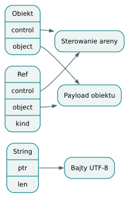

*Uchwyty i payloady. Deskryptor zawiera odwołania do danych; nie należy mylić go z samym payloadem.*

## Granice i kontrola zgodności

Źródłem layoutu danych jest `src/codegen/llvm/context.rs`; plik
`src/layout.rs` zajmuje się normalizacją nowych linii przy parsowaniu.
Rozróżnienie nazw chroni przed czytaniem niewłaściwego etapu kompilatora.

Nie każdy typ mający reprezentację jako pojedyncza wartość jest dopuszczalnym
elementem tablicy. `array_elem_layout` obsługuje skalary, `String` i zarządzane
`Ref`, a inne przypadki odrzuca. Część wymiarów jest zapisana dla obecnego
środowiska, na przykład deskryptor `String` jako 16 bajtów przy wyrównaniu 8.
Sam wybór natywnego celu LLVM nie czyni wszystkich tych założeń przenośnymi.

Bramka odrzuca między innymi przenoszenie obiektów klas, zwykłych wartości
enumów oraz tablic zarządzanych referencji. Część opcji nullable, na przykład
`Option<i32>` i `Option<String>`, ma obsługę `move`; opcja z enumowym
ładunkiem nadal podlega ograniczeniom bramki. Bramka nie jest pełnym dowodem, że
emisja zakończy się sukcesem: deklarowanie `main` i poszczególne emitery
mają dalsze kontrole. Test zgodności uchwytu `Ref` porównuje rozmiar,
wyrównanie i przesunięcia pól z runtime. Taka kontrola wiąże dwa niezależnie
zapisane fragmenty ABI i wykrywa zmianę jednego bez zmiany drugiego.

## Ćwiczenie z odpowiedzią

Dlaczego po sklonowaniu funkcji generycznej nie wystarczy przekazać
backendowi oryginalnego `MemoryPlan`? **Odpowiedź:** plan odwołuje się do
identyfikatorów węzłów, a instancje otrzymują nowe węzły i numerację. Backend
musi dostać plan oraz raport odpowiadające temu samemu wynikowi specjalizacji.

Do kodu prowadzą: [bramka `gate`](https://github.com/andrzejwitkowski/Bork/blob/56f4910a24b689087fe2dee30247651b7b432268/src/codegen_gate.rs),
[`build_with_options`](https://github.com/andrzejwitkowski/Bork/blob/56f4910a24b689087fe2dee30247651b7b432268/src/codegen/mod.rs),
[`Codegen::basic_type` i layout enumów](https://github.com/andrzejwitkowski/Bork/blob/56f4910a24b689087fe2dee30247651b7b432268/src/codegen/llvm/context.rs)
oraz [layout elementów tablic](https://github.com/andrzejwitkowski/Bork/blob/56f4910a24b689087fe2dee30247651b7b432268/src/codegen/llvm/array/layout.rs).


# 16. LLVM IR: wartości SSA, bloki i konwencja wywołań

## Graf zamiast kolejnych wierszy

LLVM IR jest językiem pośrednim. Nadal ma funkcje i typy, lecz sterowanie
wyraża przez bloki podstawowe oraz jawne skoki. Blok zawiera sekwencję
instrukcji i kończy się terminatorem, takim jak `ret` lub `br`. Zależności
między blokami tworzą graf przepływu sterowania, CFG. Generator kodu
konstruuje ten graf, a nie tylko tłumaczy każdy wiersz Borka na pojedynczy
wiersz asemblera.

Wartości obliczeń LLVM zapisuje w postaci SSA, czyli z pojedynczym miejscem
definicji każdej wartości. Zapis `%sum = add ...` definiuje `%sum` raz.
Zmienna Borka może jednak zmieniać wartość wielokrotnie. Emiter rozwiązuje
to przez slot pamięci: `alloca` tworzy miejsce, `store` zapisuje, a `load`
odczytuje. Sam adres slotu jest wartością SSA; jego zawartość może się
zmieniać. Nie ma tu sprzeczności.

Bork umieszcza lokalne `alloca` na początku bloku wejściowego przez
`entry_alloca`, również kiedy deklaracja występuje w pętli. Slot jest wtedy
rezerwowany raz na wywołanie funkcji. Optymalizator LLVM może później
usunąć część takich operacji pamięciowych. Emiter nie musi sam implementować
pełnego algorytmu konwersji wszystkich zmiennych źródłowych do SSA.

## Ślad wyrażenia warunkowego

Pełny przykład pochodzi z `programs/build/conditionals/value_if.bork`:

```bork
// exit: 42
fun pick(flag: i32): i32 {
    val v = if (flag == 1) { 40 } else { 7 }
    return v + 2
}

fun main(): i32 {
    return pick(1)
}
```

Warunek `flag == 1` daje wartość logiczną. `emit_if_with_driver` tworzy
bloki `then`, `else` i `endif`, po czym buduje skok warunkowy. Ciało każdej
gałęzi jest emitowane razem z jej regionem. Gałąź, która dochodzi do końca,
skacze do `endif` i przekazuje swoją ostatnią wartość. W `endif` instrukcja
`phi` wybiera wartość według krawędzi, którą wykonanie weszło do bloku.

Poniższy fragment jest **schematem LLVM**, nie rzeczywistym dumpem Borka;
pomija ABI, sloty lokalne, regiony i kod pomocniczy:

```llvm
then:
  br label %endif
else:
  br label %endif
endif:
  %v = phi i32 [ 40, %then ], [ 7, %else ]
  %result = add i32 %v, 2
  ret i32 %result
```

`phi` nie sprawdza warunku drugi raz. Informacja o wyborze jest już zawarta
w drodze przez graf. Dlatego para wejściowa zawiera wartość oraz blok
poprzedzający. Jeżeli gałąź zawiera `return`, nie dochodzi do `endif`
i nie może być zwykłym wejściem tej instrukcji. Emiter sprawdza obecność
terminatora przed dodaniem skoku oraz wartości do listy wejść.

Istotny szczegół pojawia się przy zagnieżdżonych wyrażeniach. Koniec emisji
gałęzi nie musi znajdować się w bloku, w którym ją rozpoczęto. Wewnętrzne
`if`, operator Elvis lub obserwacja `Ref` mogą utworzyć dodatkowe bloki.
Właściwym poprzednikiem `phi` jest aktualny blok po emisji, pobrany
z buildera. Użycie początkowej etykiety gałęzi może zbudować niepoprawny CFG
albo przypisać wartość do niewłaściwej drogi wykonania.

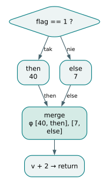

*Wartość if jako phi. Phi wybiera wartość z rzeczywistego poprzednika bloku merge, a nie oblicza ponownie warunku.*

## Leniwe operatory są sterowaniem

Operatory `&&` i `||` nie są zwykłą operacją na dwóch wcześniej obliczonych
argumentach. Prawa strona może nie zostać wykonana. Rzeczywisty korpus
`programs/build/conditionals/logical_short_circuit.bork` zawiera warunki
`false && side() == 1` i `true || side() == 1`. W obu przypadkach wywołanie
`side` powinno zostać pominięte podczas wykonania odpowiedniego warunku.

`emit_logical_from_lhs` buduje `log.rhs`, `log.short` i `log.end`. Dla `&&`
fałszywa lewa strona prowadzi do `log.short`, a prawdziwa do obliczenia
prawej. Dla `||` kierunki są odwrócone. `phi` łączy stałą wynikającą
ze skrócenia z wynikiem prawej strony. Takie obniżenie zachowuje również
efekty uboczne: odczyt, wypisanie tekstu lub modyfikacja obiektu po prawej
stronie następują tylko na przewidzianej ścieżce.

Pętla dodaje cykl do CFG. `for` ma nagłówek z testem, ciało, blok latch
zwiększający indeks i wyjście. W `while` latch prowadzi z powrotem do testu.
`continue` musi więc wskazywać odpowiedni latch, a `break` blok wyjścia.
Wewnętrzne pętle pomocnicze `Vec` używają również `phi` indeksu, które łączy
zero z preheadera z kolejną wartością obliczaną w ciele.

## ABI jako umowa obu stron wywołania

ABI ustala reprezentację argumentów, wyniku i symboli. Wewnętrzna funkcja
Borka ma więcej parametrów LLVM, niż wynika z jej deklaracji źródłowej.
`CallAbi` rozróżnia trzy sytuacje: `main`, zwykłe wywołanie i funkcję
z wynikiem wymagającym areny docelowej. Zwykła funkcja dostaje ukryty
wskaźnik leksykalnej areny wywołującego. Funkcja zwracająca wartość
posiadającą zasoby albo korzystającą z przechowywania arenowego dostaje
ponadto wskaźnik miejsca docelowego wyniku, nazywany result sink.

Są to parametry odpowiedzialne za czas życia pamięci. Nie oznaczają,
że wynik LLVM jest zawsze przekazywany przez dodatkowy wskaźnik wyjściowy:
na przykład deskryptor tekstu nadal może być bezpośrednią wartością
zwracaną. Sink wskazuje, gdzie mają powstać bajty, aby przetrwały zakończenie
funkcji. `main` zachowuje zewnętrzny symbol C, nie ma ukrytych parametrów
i zwraca `i32`; źródłowe `unit` jest zamieniane na kod wyjścia zero.
Pozostałe symbole otrzymują prefiks `bork.` i wewnętrzne wiązanie LLVM.

Wszystkie deklaracje i miejsca wywołań korzystają z `CallAbi`, co ogranicza
ryzyko różnego rozumienia kolejności parametrów. Wywołujący przekazuje
najpierw ukryte wartości, potem jawne argumenty. Wywoływany odczytuje rodzica
z parametru zerowego, a sink z pierwszego, jeśli taki występuje. Pomyłka
w tym miejscu może pozostawić poprawne typy wskaźnikowe, ale zniszczyć
semantykę własności, dlatego sam weryfikator LLVM nie wystarczy.

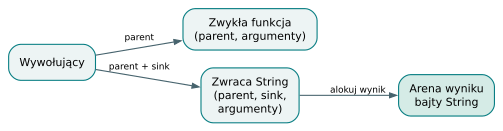

*Ukryte parametry ABI. Parametry techniczne przekazują kontekst pamięci, którego nie widać w sygnaturze źródłowej.*

## Ograniczenia i ćwiczenie

Nie należy utożsamiać możliwości LLVM z możliwościami obecnego emitera.
`emit_call_with_values` oczekuje bezpośrednio rozpoznanej funkcji; wywołania
pośrednie zgłaszają ograniczenie. `coerce_value_to_ty` ma też jawną odmowę
argumentów zmiennoprzecinkowych po przejściu walkera. To późniejsza granica
niż sam typ `f32` lub obsługa dodawania liczb zmiennoprzecinkowych.

Dlaczego prawa strona `a && b()` nie może być zawsze wyemitowana jako
zwykłe wywołanie przed logicznym `and`? **Odpowiedź:** program wykonałby
`b()` również dla fałszywego `a`. Potrzebny jest warunkowy skok, a wartość
wyniku należy połączyć dopiero w bloku wspólnym.

Zobacz [emisję `if` i regionów](https://github.com/andrzejwitkowski/Bork/blob/56f4910a24b689087fe2dee30247651b7b432268/src/codegen/llvm/region_emit.rs),
[operatory logiczne](https://github.com/andrzejwitkowski/Bork/blob/56f4910a24b689087fe2dee30247651b7b432268/src/codegen/llvm/binop.rs),
[`CallAbi`](https://github.com/andrzejwitkowski/Bork/blob/56f4910a24b689087fe2dee30247651b7b432268/src/codegen/llvm/call_abi.rs),
[deklaracje funkcji i sloty](https://github.com/andrzejwitkowski/Bork/blob/56f4910a24b689087fe2dee30247651b7b432268/src/codegen/llvm/emit_fn.rs)
i [emisję wywołań](https://github.com/andrzejwitkowski/Bork/blob/56f4910a24b689087fe2dee30247651b7b432268/src/codegen/llvm/expr.rs).


# 17. Cleanup regionów i Ref na wszystkich drogach wyjścia

## Dwa stosy, których nie wolno pomylić

Zakres zapisany w źródle ma wejście i wyjście, lecz wykonanie nie zawsze
dochodzi do zamykającej klamry. Może wcześniej wystąpić `return`, `break`
albo `continue`. Kompilator musi wtedy wyemitować sprzątanie na konkretnej
drodze sterowania. Samo dodanie `arena_pop` na końcu emitowanego bloku
nie wystarczy, bo skok może ten koniec ominąć.

W Borku należy rozdzielić stos używany podczas kompilacji od stosu aren
istniejących podczas wykonania programu. `RegionEmitter` pilnuje zgodności
przejścia HIR z raportem semantycznym. `ArenaCalls` zamienia zdarzenia
regionowe na wywołania runtime i przechowuje uchwyty potrzebne przy emisji
wcześniejszych wyjść. Przejście do następnej gałęzi `if` nadal wymaga
poprawnego obrazu otoczenia kompilacyjnego, nawet jeśli poprzednia gałąź
wyemitowała `return`.

Dlatego `ArenaCalls::unwind` emituje pop dla uchwytów od najgłębszego,
ale nie usuwa ich z wewnętrznej kolekcji. Usunięcie popsułoby emisję drugiej
gałęzi, która podczas wykonania stanowi alternatywę. To jedna z centralnych
zasad backendu: wygenerowanie instrukcji zmieniającej stan programu nie musi
zmieniać odpowiadającego mu stanu generatora w ten sam sposób.

## Powrót, przerwanie i kontynuowanie

`emit_return` najpierw oblicza zwracane wyrażenie i materializuje wynik
w odpowiednim sink. Następnie zamyka zakresy diagnostyczne, emituje unwind
aren i dopiero buduje `ret`. Kolejność jest konieczna dla danych
posiadających pamięć: wynik trzeba przenieść lub skopiować do docelowego
miejsca, zanim zniknie arena, z której pochodzi. Dla skalaru wystarczy wartość
LLVM, ale deskryptor tablicy sam nie chroni wskazywanego bufora.

`break` i `continue` korzystają ze szczytu `loop_stack`. Etykiety pętli
zapamiętują cele skoków i głębokość aren oraz zakresów debugowania.
`unwind_to_depth` emituje sprzątanie tylko dla aren otwartych głębiej.
`break` skacze potem do wyjścia pętli. `continue` trafia do latch, gdzie
wykonuje się aktualizacja indeksu albo reset iteracji. Zewnętrzny zakres
funkcji musi pozostać aktywny na obu drogach.

Arena pętli może być otwierana raz, resetowana po iteracji i zamykana po
wyjściu. Reset zwraca uchwyt bieżącej generacji, więc emiter umieszcza
`phi` uchwytu w nagłówku. Łączy ono początkową arenę z wartością zwróconą
przez reset w latch. Bez tego wyjście mogłoby użyć wartości zdefiniowanej
wyłącznie w latch, chociaż pętla może zakończyć się również przed pierwszą
iteracją lub przez `break`.

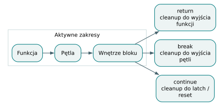

*Wyjścia z zagnieżdżonej pętli. Każda krawędź sprząta zakresy, które rzeczywiście opuszcza. Wiersz dotyczy schematu sterowania.*

## Ślad warunkowej obserwacji

Pełny program `programs/build/managed_refs/chained_three_bindings_value.bork`
pokazuje kilka zależnych obserwacji:

```bork
// exit: 3
class Node {
    id: i32
    next: Ref<Node>
}
fun main(): i32 {
    val c: Ref<Node> = Node(3, None)
    val b: Ref<Node> = Node(2, c)
    val a: Ref<Node> = Node(1, b)
    var found = 0
    if val (x = a, y = x.next, z = y.next) {
        found = z.id
    }
    return found
}
```

Najpierw oceniane jest źródło `a`. Emiter tworzy obserwację runtime,
sprawdza obecność obiektu i dopiero na drodze sukcesu wiąże `x`. Źródło
`x.next` jest obliczane w otwartym regionie obecności, a następnie tak samo
powstaje `y`; dopiero potem można odczytać `y.next` dla `z`. To zachowuje
kolejność, jednokrotne obliczanie źródeł i dostępność wcześniejszych nazw.

Obserwacja nie jest zwykłym sprawdzeniem wskaźnika. Podtrzymuje wymagany
stan runtime na czas używania obiektu i wymaga zwolnienia. Emiter rejestruje
sprzątanie obserwacji przy arenie. Jeśli drugie lub trzecie źródło okaże się
nieobecne, nie wolno po prostu skoczyć do `else`: wcześniejsze udane
obserwacje wciąż istnieją. `emit_chained_guards` kieruje takie ścieżki do
wspólnego `ref.failure.cleanup`, który zamyka otwarte regiony, a następnie
przechodzi na drogę nieobecności.

W przykładzie wszystkie trzy źródła mają być obecne, więc przypisanie
odczytuje `id` trzeciego węzła. Dyrektywa korpusu oczekuje kodu 3.
Wariant z nieobecnym drugim źródłem pozostawiłby `found` równe zero,
a trzeciego źródła nie należałoby w ogóle obliczać. Ta druga sytuacja jest
rozumowaniem o modyfikacji programu, nie przytoczonym wynikiem wykonania.

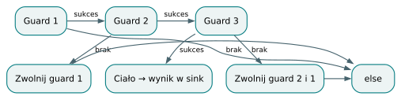

*Częściowy sukces if val. Przy częściowym sukcesie łańcucha sprzątane są tylko guardy, które zostały otwarte.*

## Uchwyt lokalny, wynik gałęzi i pole obiektu

Lokalny slot `Ref` rejestruje operację drop przy swojej arenie. Przypisanie
nowego uchwytu korzysta z `bork_ref_store_take_ptr`: runtime rozstrzyga
zwolnienie poprzedniej wartości i przyjęcie nowej. Pole `Ref` w obiekcie
jest analogicznie własnością areny obiektu. Dla tablic i wektorów referencji
potrzebne są operacje elementowe; skopiowanie deskryptora lub surowego
obszaru uchwytów nie odtwarza wymaganych zmian stanu referencji.

Wynik gałęzi może żyć dłużej niż jej lokalne obserwacje. `emit_presence_arm`
materializuje wynik w zewnętrznym sink przed `region_exit`. Bez tego
`if val` zwracające tekst albo tablicę mogłoby oddać deskryptor danych,
które właśnie usunięto. `materialize_owned_value` rozróżnia między innymi
przeniesienie właściciela `Ref`, kopiowanie bufora i kopiowanie nullable,
zamiast traktować wszystkie struktury LLVM jako równoważne.

Dostęp przez `?.` jest krótszą obserwacją. `emit_safe_ref_field` obserwuje
odbiorcę, zwalnia tymczasową kopię jego uchwytu, odczytuje i materializuje
pole na drodze sukcesu, po czym zwalnia obserwację. Droga nieobecności
również ją zwalnia i produkuje odpowiedni brak wartości. To samo źródłowe
pole może więc wymagać kilku wywołań runtime, chociaż wygląda jak pojedynczy
odczyt. LLVM nie zna tych obowiązków z samego typu wskaźnika.

## Ograniczenia i ćwiczenie

Kod po terminatorze bywa nadal odwiedzany, aby przejście regionów pozostało
zgodne z raportem. `ensure_open_block` tworzy wtedy blok bez poprzedników,
a operacje reset i pop pomijają nieosiągalne miejsca emisji. Nie należy
wyciągać liczby operacji wykonanych przez program z samej liczby ich
wystąpień w tekstowym IR. Alternatywne `return` mogą zawierać identyczne
sprzątanie, choć podczas jednego wywołania wykona się tylko jedna droga.

Korpus `chained_loop_cleanup.bork` łączy obserwacje z `continue`, `break`
i wynikami posiadającymi dane; `chained_partial_cleanup.bork` sprawdza
częściowe niepowodzenie po zastąpieniu źródłowego uchwytu. Obydwa przypadki
są ważniejsze niż test jednego poprawnego wyjścia na końcu bloku.

Dlaczego `unwind` przy pierwszym `return` nie może opróżnić kolekcji
uchwytów w generatorze? **Odpowiedź:** następna emitowana gałąź nadal
potrzebuje tych uchwytów. Runtime wykona tylko jedną z alternatywnych dróg,
ale generator musi skonstruować wszystkie.

Źródła: [`ArenaCalls` i generacje pętli](https://github.com/andrzejwitkowski/Bork/blob/56f4910a24b689087fe2dee30247651b7b432268/src/codegen/llvm/arena.rs),
[`emit_return`, `emit_break`, `emit_continue`](https://github.com/andrzejwitkowski/Bork/blob/56f4910a24b689087fe2dee30247651b7b432268/src/codegen/llvm/emit_fn.rs),
[łańcuchy obserwacji i cleanup](https://github.com/andrzejwitkowski/Bork/blob/56f4910a24b689087fe2dee30247651b7b432268/src/codegen/llvm/region_emit.rs)
oraz [materializacja i operacje `Ref`](https://github.com/andrzejwitkowski/Bork/blob/56f4910a24b689087fe2dee30247651b7b432268/src/codegen/llvm/managed_ref.rs).


# 18. Od modułu do pliku: obiekt, linker i profile wykonania

## Trzy różne produkty kompilacji

Moduł LLVM jest reprezentacją programu w pamięci procesu kompilatora.
Plik obiektowy zawiera kod maszynowy oraz informacje potrzebne do jego
połączenia z innym kodem. Plik wykonywalny powstaje dopiero po rozwiązaniu
symboli i połączeniu programu z runtime oraz bibliotekami systemowymi.
Rozdzielenie tych produktów pozwala przypisać błąd do właściwego miejsca:
niepoprawny IR, nieudany zapis obiektu i brak biblioteki runtime wymagają
innej naprawy.

`build_with_options` tworzy tymczasowy plik z końcówką `.o`, prosi LLVM
o jego zapisanie, a następnie uruchamia linker przez `clang`. Żywotnością
pliku tymczasowego zarządza obiekt biblioteki `tempfile`. Nie istnieje tu
pośredni plik C ani wywołanie kompilatora C tłumaczącego kod źródłowy
Borka. `clang` dostaje gotowy plik obiektowy i archiwum runtime.

## Minimalny ślad przez CLI

Pełny program `programs/build/basics/return_constant.bork` jest celowo mały:

```bork
// exit: 7
fun main(): i32 {
    return 7
}
```

Poniższe polecenia są instrukcją odtworzenia śladu, nie raportem z wykonanej
sesji. Zakładają przygotowane LLVM 23 oraz `clang` i uruchamianie z katalogu
repozytorium:

```bash
cargo run --features codegen --bin bork -- \
  programs/build/basics/return_constant.bork
cargo run --features codegen --bin bork -- build \
  -o /tmp/bork-return programs/build/basics/return_constant.bork
/tmp/bork-return
```

Pierwsze polecenie sprawdza program. Drugie powinno utworzyć plik
wykonywalny, a trzecie uruchamia już ten plik. Oczekiwany kod wyjścia 7
pochodzi z programu i dyrektywy korpusu. Sam sukces kompilatora ma kod zero;
nie należy mylić go z kodem uruchomionego programu. W powłoce niezerowy kod
wyjścia może ponadto przerwać łańcuch poleceń oparty na `&&`.

CLI nie ma w tej wersji podkomendy `check`: trybem sprawdzania jest po
prostu ścieżka do pliku. `build` rozpoznaje `-g` i `-o`. Domyślna ścieżka
wyniku powstaje przez usunięcie rozszerzenia wejścia. Kontrola `paths_overlap`
chroni przed wybraniem tego samego pliku na wejście i wyjście, także przez
kanonikalizację istniejących ścieżek. Błędy programu kończą budowanie kodem
1; problemy narzędziowe albo niepoprawne użycie CLI typowo kodem 2.

Samo włączenie domyślnych cech Cargo nie uruchamia backendu LLVM. Cecha
`codegen` jest opcjonalna; bez niej komenda `build` zgłasza potrzebę
przekompilowania Borka z tą cechą. Dzięki temu parser, frontend i LSP mogą
być rozwijane bez kompletnej instalacji LLVM.

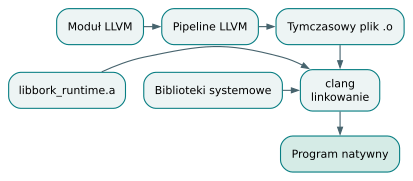

*Od modułu do programu. Linker łączy kod wygenerowany przez LLVM z archiwum runtime i bibliotekami systemowymi.*

## Cel natywny i rzeczywiste optymalizacje

`native_target_machine_with_debug` inicjalizuje cel natywny, pobiera domyślny
triple, nazwę procesora gospodarza i jego cechy. Ustawia relokację PIC
oraz domyślny model kodu. Nie jest to interfejs dowolnej kompilacji krzyżowej:
CLI nie przyjmuje tu osobnego triple ani wyboru architektury. Wykorzystanie
cech gospodarza ma też znaczenie, jeśli gotowy plik ma być przenoszony
na inny procesor.

Najłatwiej pomylić trzy poziomy określane słowem „release”. Profil
`cargo build --release` dotyczy samego kompilatora napisanego w Rust.
Opcja Borka `build -g` dotyczy generowanego programu. Oddzielnie budowane
jest archiwum runtime. Żaden z tych wyborów nie jest automatycznie
synonimem pozostałych.

Dla programu bez `-g` `write_object_with_debug` uruchamia rzeczywisty
pipeline `default<O3>,mergefunc,function-attrs,globaldce`. Włącza też opcje
wektoryzacji pętli, SLP, rozwijania i przeplatania pętli. Poziom maszyny
celowej to jednak `OptimizationLevel::Default`, a nie stała nazwana
`Aggressive`. Te dwie konfiguracje należą do różnych warstw LLVM.

W trybie `-g` pipeline ma postać `default<O0>`, a maszyna celowa używa
`OptimizationLevel::None`. Zmniejsza to przekształcenia utrudniające
przechodzenie debuggerem po źródle. Ustawienie opcji wektoryzacji w obiekcie
opcji nie oznacza, że pipeline O0 wykona te same transformacje co O3.
Przed zapisem pliku moduł jest ponownie weryfikowany po przejściu pipeline.

LLVM może upraszczać stałe, usuwać martwy kod, scalać funkcje i analizować
atrybuty w granicach przekazanego modułu. Nie wolno z samej nazwy O3
wywnioskować usunięcia wszystkich alokacji lub zniesienia kosztu `Ref`.
Wywołania zewnętrznego runtime mają własne kontrakty i skutki, a statyczne
linkowanie archiwum nie oznacza automatycznie optymalizacji LLVM obejmującej
wspólnie kod aplikacji i runtime.

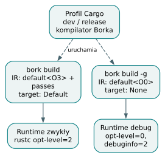

*Trzy niezależne poziomy optymalizacji. Profil narzędzia Rust, optymalizacja programu Borka i profil runtime to odrębne decyzje.*

## Archiwum runtime i linkowanie

`build.rs` buduje runtime przez bezpośrednie wywołanie `rustc`, aby uniknąć
zagnieżdżonego Cargo i konfliktu jego blokad. Zwykłe archiwum otrzymuje
`opt-level=2`. Archiwum diagnostyczne ma `opt-level=0`, `debuginfo=2`
i cechę `debug-runtime`. Obie wersje powstają przy budowie kompilatora
z cechą `codegen`, niezależnie od tego, jaki program użytkownik zbuduje później.

Linker wybiera archiwum zwykłe albo diagnostyczne. Zmienne
`BORK_RUNTIME_LIB` i `BORK_RUNTIME_DEBUG_LIB` pozwalają nadpisać zapisane
ścieżki. Brak pliku jest zgłaszany przed uruchomieniem `clang`.
Linkowanie dodaje biblioteki wymagane przez statyczną bibliotekę Rust,
między innymi pthread, m i dl. Konkretna lista oraz argument
`--require-defined=bork_debug_abi_v1` pokazują praktyczne ukierunkowanie
tej ścieżki na środowisko testowane w repozytorium.

Wymagany symbol wersji debug ABI zapobiega podłączeniu zwykłego runtime
do programu oczekującego rejestru diagnostycznego. To wczesna kontrola
zgodności, uzupełniająca zgodność layoutów z poprzednich rozdziałów.
Komunikat błędu `clang` zachowuje jego status i tekst stderr, dzięki czemu
brak symbolu można odróżnić od braku pliku archiwum.

## Ograniczenia i ćwiczenie

Nawet przed LLVM budowanie wymaga funkcji `main`, bez parametrów,
z wynikiem `unit` lub `i32`. Frontend może sprawdzać bibliotekopodobny plik
bez takiego punktu wejścia. Powodzenie `check` nadal nie zastępuje więc
weryfikacji całej drogi do pliku.

Dlaczego przyspieszenie kompilatora przez `cargo build --release` nie jest
dowodem zmiany poziomu optymalizacji programu Borka? **Odpowiedź:** profil
Cargo optymalizuje wykonywany kompilator, natomiast pipeline programu
wybiera kod `write_object_with_debug` na podstawie `BuildOptions::debug`.

Źródła: [CLI i statusy wyjścia](https://github.com/andrzejwitkowski/Bork/blob/56f4910a24b689087fe2dee30247651b7b432268/src/main.rs),
[pipeline oraz zapis obiektu](https://github.com/andrzejwitkowski/Bork/blob/56f4910a24b689087fe2dee30247651b7b432268/src/codegen/llvm/mod.rs),
[natywna maszyna celowa](https://github.com/andrzejwitkowski/Bork/blob/56f4910a24b689087fe2dee30247651b7b432268/src/codegen/llvm/context.rs),
[linkowanie](https://github.com/andrzejwitkowski/Bork/blob/56f4910a24b689087fe2dee30247651b7b432268/src/codegen/link.rs)
i [budowa obu wersji runtime](https://github.com/andrzejwitkowski/Bork/blob/56f4910a24b689087fe2dee30247651b7b432268/build.rs).


# 19. Diagnostyka, dumpy i obserwowanie programu w debuggerze

## Zachować pochodzenie informacji

Dobra diagnostyka mówi, co jest niepoprawne i gdzie szukać przyczyny.
W kompilatorze wieloetapowym potrzebuje również informacji, która faza
rozpoznała problem. Bork reprezentuje ją przez `Diagnostic`: fazę,
ważność, komunikat oraz opcjonalny `Span`. Fazy to `parse`, `ownership`,
`type` i `codegen`. Span wskazuje przedział bajtów oryginalnego tekstu,
a nie numer instrukcji w HIR.

Parser mapuje różne rodzaje błędów LALRPOP na ten wspólny format, zachowując
między innymi listę oczekiwanych tokenów. Błędy własności są przekształcane
z `SemaError`. Frontend może zebrać błędy własności i typów w jednym wyniku;
nie musi zatrzymać się po pierwszym. Raport aren bywa nadal dostępny przy
błędzie semantycznym, natomiast nie ma go po nieudanym parsowaniu.

CLI wylicza linię i kolumnę na podstawie początku spanu. Linia i kolumna
są numerowane od jednego; kolumna jest liczona znakami Rust, nie bajtami.
W tej wersji formatter wypisuje słowo `error` dla każdej diagnostyki,
choć struktura danych przewiduje także `Warning`. LSP respektuje ten
poziom ważności osobno. Wspólny model danych nie oznacza identycznego
formatowania we wszystkich interfejsach.

## Cztery obserwacje na różnych poziomach

`--dump-arenas` pokazuje drzewo raportu semantycznego: regiony, wiązania,
obserwacje i oznaczenia własności. Nie jest zrzutem rzeczywistego sterty
uruchomionego programu. Oznaczenie zagęszczonych klamer wyjaśnia, dlaczego
liczba węzłów raportu może różnić się od liczby klamer w źródle.

Plan pamięci odpowiada na inne pytanie: gdzie sklasyfikowano miejsce
alokacji i jaki przydzielono mu czas życia. Jest dostępny programistycznie
w `CheckResult::memory_plan`; test `memory_plan_golden` zapisuje stabilne
reprezentacje takich decyzji. CLI nie reklamuje tutaj osobnej flagi
`--dump-memory-plan`. Podobnie istnieją snapshoty instancji generycznych,
ale nie należy wymyślać dla nich niezaimplementowanej podkomendy.

`BORK_DUMP_IR` zapisuje tekst modułu LLVM do wskazanego pliku. W obecnej
kolejności dzieje się to po ustawieniu triple i data layout, lecz przed
pipeline optymalizacyjnym. Zrzut pozwala badać decyzje emitera; nie jest
bezpośrednim obrazem końcowego kodu maszynowego. Włączenie `-g` oznacza też,
że moduł ma już metadane i instrumentację diagnostyczną.

Czwarty poziom to rejestr debug runtime i odczyty debuggerów. Opisuje
konkretny stan zatrzymanego procesu: areny, obiekty i zarejestrowane sloty
referencji. Statyczny raport i dynamiczny graf mogą mieć inne rozmiary,
bo jedna pętla źródłowa wykonuje wiele iteracji, a jedna instrukcja
konstruktora może utworzyć wiele obiektów.

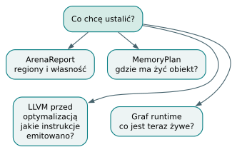

*Cztery widoki programu. Każdy widok służy innemu pytaniu. Wydruk aren nie jest obrazem całej pamięci procesu.*

## Przykład: pole osiągalne przez Ref

Pełny program `programs/build/classes/safe_ref_field.bork`:

```bork
// exit: 7
class Point {
    x: i32
    y: i32
}

fun main(): i32 {
    val p: Ref<Point> = Point(7, 1)
    val n: Ref<Point> = None
    val a: i32? = p?.x
    val b: i32? = n?.x
    return (a ?: 0) + (b ?: 0)
}
```

Na poziomie źródła mamy obecny `p`, nieobecny `n` i dwa wyniki nullable.
Raport aren pomaga ustalić zakresy wiązań. LLVM pokazuje obserwacje,
rozgałęzienia i tworzenie `Option<i32>`. Debugger powinien umożliwić
obejrzenie uchwytu oraz payloadu żywego punktu bez tworzenia nowej,
semantycznej kopii referencji tylko po to, aby ją wyświetlić.

Przykładowa procedura przygotowania artefaktów wygląda tak; polecenia
nie zostały wykonane przy opracowaniu tekstu:

```bash
cargo run --features codegen --bin bork -- --dump-arenas \
  programs/build/classes/safe_ref_field.bork
BORK_DUMP_IR=/tmp/point.ll \
  cargo run --features codegen --bin bork -- build -g \
  -o /tmp/point programs/build/classes/safe_ref_field.bork
```

Po uruchomieniu GDB dla `/tmp/point` można użyć poniższych komend,
zatrzymując program przy linii poprzedzającej obliczenie `a`:

```text
source tools/bork-debug/bork_gdb.py
break safe_ref_field.bork:10
run
print p
bork-arenas
bork-graph /tmp/point.dot
```

LLDB udostępnia analogiczny adapter przez
`command script import tools/bork-debug/bork_lldb.py`. Jego standardową
komendą oglądania zmiennych jest `frame variable`. Oba adaptery dodają
`bork-arenas` i `bork-graph`; opcja `--svg` pozwala poprosić eksportera
również o wersję SVG. Samo załadowanie skryptu nie tworzy rejestru w zwykłym
programie: plik musi zostać wcześniej zbudowany z `-g`.

## DWARF i rejestr runtime

DWARF wiąże adresy instrukcji i położenia danych z plikami, liniami,
zakresami oraz nazwami typów. `DebugInfo::new` tworzy pełne informacje
DWARF w wersji 4; jako język źródłowy ustawia C, a jako producenta Bork.
Nie oznacza to, że źródło zostało przetłumaczone przez C. Jest to wybór
metadanych używanych przez narzędzia debugujące.

Każda funkcja otrzymuje opis parametrów i wyniku, a lokalne wiązania opis
zmiennej związany z jej slotem. Zakresy leksykalne zachowują znaczenie
przesłaniania nazw. Typy diagnostyczne rozróżniają uchwyt `bork::Ref<T>`,
uchwyt obiektu i payload. Typ nullable jest opisywany jako uchwyt enuma
`Option`, zgodnie z bieżącym layoutem, zamiast dawnym polem `present`.

Instrumentacja obejmuje również kod pomocniczy utworzony przed
inicjalizacją `DebugInfo`. Przechodzi po gotowych funkcjach, dodaje ramki
diagnostyczne, kontrole odczytów i zapisów oraz obsługę operacji kopiowania
pamięci. Pomija adresy jednoznacznie pochodzące z lokalnego `alloca` lub
globalnej zmiennej. Adres odczytany ze slotu, wybrany przez `select` albo
połączony `phi` może jednak wskazywać do areny i wymaga dalszej kontroli.

Adaptery GDB i LLDB odczytują pamięć zatrzymanego procesu i dekodują
wersjonowany rejestr. Nie wywołują metod programu, aby zbudować widok
referencji. Umożliwia to sprawdzanie stabilności: testy porównują eksport
grafu przed obejrzeniem wartości i po nim. Zmiana licznika referencji
spowodowana samym `print` byłaby błędem narzędzia obserwacyjnego.

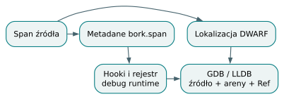

*Od spanu do debuggera. Informacja o źródle jest przenoszona do metadanych i do mechanizmów inspekcji programu.*

## Ograniczenia i ćwiczenie

Diagnostyczny runtime oraz dodatkowe kontrole zmieniają koszt i kształt
programu. Nie należy używać sesji `-g` jako pomiaru wydajności wersji
optymalizowanej. Z kolei rozbudowane metadane nie gwarantują jeszcze,
że każda funkcja konkretnej wersji debuggera odtworzy wszystkie obiekty
idealnie. Repozytorium ma osobne testy integracyjne GDB i LLDB; brak
narzędzia może spowodować pominięcie odpowiedniego testu.

Dlaczego pusty slot `Ref` oglądamy inaczej niż wygasłą słabą referencję?
**Odpowiedź:** brak uchwytu i uchwyt wskazujący obiekt, którego życie już
się zakończyło, mają różne znaczenie. Rejestr oraz stan kontrolny runtime
pozwalają narzędziu je rozróżnić bez dereferencji martwego payloadu.

Źródła: [model diagnostyki](https://github.com/andrzejwitkowski/Bork/blob/56f4910a24b689087fe2dee30247651b7b432268/src/diag.rs),
[tekstowy dump aren](https://github.com/andrzejwitkowski/Bork/blob/56f4910a24b689087fe2dee30247651b7b432268/src/dump.rs),
[tworzenie DWARF](https://github.com/andrzejwitkowski/Bork/blob/56f4910a24b689087fe2dee30247651b7b432268/src/codegen/llvm/debug/mod.rs),
[instrumentacja modułu](https://github.com/andrzejwitkowski/Bork/blob/56f4910a24b689087fe2dee30247651b7b432268/src/codegen/llvm/debug/checks.rs)
i [integracyjne testy debuggerów](https://github.com/andrzejwitkowski/Bork/blob/56f4910a24b689087fe2dee30247651b7b432268/tests/debuggers.py).


# 20. LSP, testy i bezpieczne rozszerzanie języka

## Edytor korzysta z kompilatora

Language Server Protocol rozdziela edytor od analizy języka. Edytor wysyła
tekst dokumentu i pozycje kursora, serwer publikuje diagnostyki i odpowiada
na pytania o symbole. Dzięki temu podstawowe informacje o języku nie muszą
być implementowane osobno w każdym edytorze.

Bork nie ma drugiego systemu typów napisanego na potrzeby LSP.
`analyze_source` uruchamia `frontend::check`, przekształca diagnostyki,
a gdy dostępny jest HIR, dodatkowo wywołuje bramkę backendu. Potem zachowuje
raport, typy, rozstrzygnięcia członków oraz indeks węzłów AST w obiekcie
`Analysis`. Hover czyta ten wynik, zamiast za każdym ruchem kursora
ponownie kompilować cały tekst.

Zakres deklarowanych możliwości jest niewielki i konkretny: pełna
synchronizacja tekstu, hover i komenda `bork.dumpArenas`. Nie należy z samej
obecności serwera wywodzić obsługi uzupełniania kodu, zmiany nazw lub
nawigacji do definicji. Binarne `bork-lsp` komunikuje się przez stdin/stdout,
a biblioteczne funkcje analizy pozostają testowalne bez uruchamiania
całego protokołu JSON-RPC.

## Rzeczywisty ślad aktualizacji dokumentu

Jako dokument można otworzyć pełny program
`programs/build/loops/while_break.bork`:

```bork
// exit: 3
fun main(): i32 {
    var i: i32 = 0
    while (i < 10) {
        if (i == 3) {
            break
        }
        i = i + 1
    }
    return i
}
```

Po `didOpen` serwer zapisuje tekst i wynik analizy. Hover na lokalnym `i`
może odczytać jego typ, własność oraz region z raportu. Zmiana tekstu
przychodzi jako pełna nowa treść w `didChange`, więc frontend pracuje
na spójnym dokumencie, a nie na serii samodzielnie interpretowanych łatek.
Publikowane diagnostyki otrzymują wersję dokumentu.

Otwarcie, zmiana i zamknięcie zwiększają licznik epoki przypisany URI.
Przed zapisaniem wyniku analizy serwer sprawdza, czy epoka nadal pasuje.
To chroni stan dokumentu przed przyjęciem wyniku rozpoczętego dla starszej
wersji. `didClose` usuwa analizę i publikuje pustą listę diagnostyk.
Mechanizm dotyczy zarządzania stanem serwera; nie zmienia semantyki
samego programu Borka.

Pozycje LSP są liczone jednostkami UTF-16, podczas gdy span kompilatora
korzysta z bajtów UTF-8. `SourceMap` wykonuje tłumaczenie między tymi
układami współrzędnych. Dla ASCII liczby zwykle się zgadzają, co łatwo
ukrywa błąd. Znak spoza podstawowego planu Unicode zajmuje cztery bajty
UTF-8 i dwie jednostki UTF-16. Test ograniczony do nazw `x` i `sum`
nie sprawdzi więc poprawności wskazywania miejsca błędu w takim tekście.

Hover szuka wiązań w raporcie, potem informacji o członkach i dokumentacji
builtinów. Dla metody potrzebne są wcześniejsze rozstrzygnięcia typecheckera,
a dla przesłoniętej nazwy właściwy zakres i span. To pokazuje, dlaczego
nowa cecha języka musi zachować informacje o pochodzeniu węzłów nawet wtedy,
gdy sam backend potrafiłby działać bez nich.

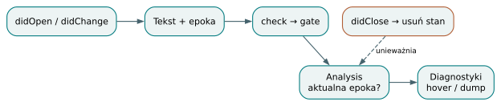

*Dokument w LSP. Publikacja wyników musi odpowiadać aktualnemu dokumentowi; zamknięcie usuwa przechowany stan.*

## Korpus jako zestaw kontraktów

`tests/programs.rs` traktuje katalog nadrzędny jako opis oczekiwanego
zachowania programu. `check` ma przejść przez frontend, `check_fail` ma
zostać odrzucony, `build` ma utworzyć wykonywalny program o oczekiwanym
zachowaniu, a `build_fail` ma zakończyć się błędem bez pliku wynikowego.
Dyrektywy w pierwszych trzydziestu liniach określają kod wyjścia, stdout
lub fragment diagnostyki. Umożliwia to zapisanie małego regresyjnego
programu bez rozbudowywania infrastruktury dla każdego przypadku.

Obecny harness ma ważną granicę: test frontendowy wybiera `check`
i `check_fail`, zaś test budowania wybiera `build` i `build_fail`.
Nie należy zakładać, że każdy program z `build_fail` jest w tym samym teście
oddzielnie sprawdzany pod kątem sukcesu frontendu. Jeżeli istotą regresji
jest właśnie rozbieżność check/build, warto uczynić obie części kontraktu
jawnymi, jak w parze przykładów końcowej lambdy.

Korpus budowania jest uruchamiany w dwóch wariantach, zwykłym i `-g`.
To wychwytuje różnice wynikające z instrumentacji i odrębnego runtime.
Testy Rust sprawdzają dodatkowo konkretne własności IR: kolejność cleanup,
poprzedniki `phi`, layout zgodny z runtime albo brak resetu na martwej
ścieżce. Wynik procesu potwierdza zachowanie, a taka asercja wewnętrzna
wyjaśnia istotny mechanizm, którego przypadkowo dobry wynik mógłby nie ujawnić.

Golden tests zamrażają inne granice: typowany HIR, raporty aren, decyzje
pamięci, instancje specjalizacji i odpowiedzi hover. Snapshot hover zawiera
liczbę trafień oraz hash wyników dla pozycji w pliku. Zmiana hasha wskazuje
zmianę zachowania, ale sama nie uzasadnia automatycznego zaakceptowania
nowej wartości. `BORK_BLESS` służy aktualizacji po rozpoznaniu intencji.

## Co naprawdę obejmuje CI

Workflow uruchamia zwykłe budowanie i testy workspace, korpus frontendowy,
testy bez domyślnych cech oraz budowanie serwera LSP. Osobny job instaluje
LLVM 23 i `clang`, po czym uruchamia testy z `codegen`, w tym korpus
budowania. Sprawdza również dołączenie `libLLVM` obok binarnego kompilatora
i budowę małego programu przy ograniczonym PATH.

Nie jest to dowód uruchamiania każdego skryptu znajdującego się w repozytorium.
W szczególności osobny `tests/debuggers.py` wymaga dostępnych debuggerów;
nie ma jego bezpośredniego wywołania w badanym workflow. Podobnie testy
adapterów Python i rozszerzenia edytora trzeba powiązać z konkretnym
poleceniem, zanim przypisze się ich pokrycie zielonemu statusowi CI.

## Jak dodać cechę bez rozsuwania faz

Rozszerzenie zaczyna się od ustalenia znaczenia programu: typów, kolejności
obliczania, własności i zachowania przy opuszczaniu zakresu. Dla hipotetycznej
nowej operacji buforowej trzeba rozstrzygnąć, czy wynik pożycza dane,
czy je posiada, oraz co dzieje się przy pustym buforze. To są decyzje
językowe, a nie szczegóły buildera LLVM.

Potem można prześledzić najmniejszy program przez parser, AST, typy,
HIR i odpowiednie przejścia własności. Nowy wariant HIR wymaga kontroli
wszystkich walkerów, numerowania, specjalizacji i planowania pamięci.
Dodanie samej gałęzi `match` w emiterze nie zapewni zgodności raportu
regionów ani stabilnego hover. Gdy backend pozostaje niegotowy, bramka
powinna wyraźnie zgłaszać ograniczenie; po ukończeniu emisji musi ono
zostać usunięte razem z aktualizacją właściwych testów.

Dobry zestaw regresji zawiera mały sukces, właściwy błąd typu lub własności
oraz przypadek, który sprawdza nowy obowiązek pamięciowy. Jeżeli cecha tworzy
obserwację, trzeba uwzględnić częściowy sukces i wcześniejsze wyjście.
Jeżeli zmienia reprezentację, należy powiązać backend z runtime testem ABI.
Tak dobierane testy kontrolują konsekwencje projektu, zamiast powielać
każdy wiersz implementacji.

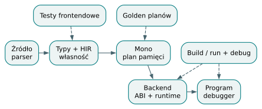

*Cecha przechodząca przez kontrakty. Testy powinny utrwalać kontrakty na granicach reprezentacji, a nie tylko ostatni wynik programu.*

## Ćwiczenie z odpowiedzią

Nowy wariant HIR buduje poprawny program, ale po dodaniu go hover wskazuje
inne wiązanie. Czy wystarczy poprawić skrypt edytora? **Odpowiedź:** najpierw
należy sprawdzić zachowanie spanów, indeksu AST, numerowania i rozstrzygnięć
członków w `Analysis`. Edytor otrzymuje wynik tych danych; objaw może
pochodzić z wcześniejszej transformacji kompilatora.

Źródła: [analiza i mapowanie pozycji LSP](https://github.com/andrzejwitkowski/Bork/blob/56f4910a24b689087fe2dee30247651b7b432268/src/lsp.rs),
[stan dokumentów i protokół](https://github.com/andrzejwitkowski/Bork/blob/56f4910a24b689087fe2dee30247651b7b432268/src/bin/bork_lsp.rs),
[harness programów](https://github.com/andrzejwitkowski/Bork/blob/56f4910a24b689087fe2dee30247651b7b432268/tests/programs.rs),
[snapshoty hover](https://github.com/andrzejwitkowski/Bork/blob/56f4910a24b689087fe2dee30247651b7b432268/tests/hover_golden.rs)
i [rzeczywisty workflow CI](https://github.com/andrzejwitkowski/Bork/blob/56f4910a24b689087fe2dee30247651b7b432268/.github/workflows/ci.yml).


# 21. Jeden program przez cały kompilator

## Przykład, który łączy fazy

Zamiast dopisywać kolejne pojęcia, prześledźmy jeden program od tekstu do wyniku. Ten przykład pochodzi dokładnie z `programs/build/classes/walkthrough_point.bork`:

```bork
// exit: 8
class Point {
    name: String
    x: i32
    y: i32
}

fun sum(p: &Point): i32 {
    return p.x + p.y
}

fun main(): i32 {
    val p = Point("a", 3, 4)
    return sum(&p) + p.name.length
}
```

Program nie wypisuje ósemki. Zwraca `8` jako kod zakończenia procesu. Ta różnica ma znaczenie podczas testowania: narzędzie sprawdzające tylko standardowe wyjście nie zobaczy wyniku. Dyrektywa `// exit: 8` jest komentarzem dla języka i oczekiwaniem dla infrastruktury korpusu.

Wartość obliczamy ręcznie: `sum` dodaje współrzędne `3 + 4`, a długość napisu `"a"` wynosi jeden bajt. Wynik całego wyrażenia to `7 + 1 = 8`. Prosty rachunek stanie się punktem odniesienia dla wszystkich reprezentacji pośrednich.

## Tekst, struktura i znaczenie nazw

Parser rozpoznaje klasę, dwie funkcje oraz instrukcje wewnątrz ich bloków. Na poziomie AST zapis `Point("a", 3, 4)` ma postać wywołania. Dopiero analiza semantyczna zna tablicę deklaracji i ustala, że nazwa `Point` oznacza konstruktor klasy. Wywołanie `sum(&p)` wygląda składniowo podobnie, ale zostaje związane z funkcją.

Użycie `p` w `sum` odnosi się do parametru, a użycie `p` w `main` do lokalnego wiązania. Tekst nazwy jest taki sam, lecz deklaracje są różne. To jedna z przyczyn wprowadzania identyfikatorów definicji i wiązań. Nie wolno globalnie potraktować wszystkich wystąpień napisu `p` jako tej samej zmiennej.

W tablicy pól `Point` kolejność pozostaje następująca: `name` ma indeks 0, `x` indeks 1, a `y` indeks 2. Dalsze fazy mogą używać indeksów zamiast szukać pola po napisie przy każdym odczycie. Jest to przejście od wygodnego zapisu źródłowego do formy odpowiadającej układowi danych.

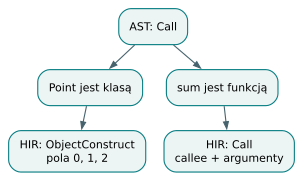

*Od dwóch nazw do dwóch operacji. Podobna składnia zostaje rozdzielona po odnalezieniu deklaracji.*

## Typowanie krok po kroku

Konstruktor dostarcza oczekiwanych typów argumentom. Napis ma typ `String`, a literały `3` i `4` są sprawdzane wobec `i32` z deklaracji pól. Nie są tu potrzebne ogólne konwersje liczbowe. Lokalne `p` otrzymuje typ `Point`.

Sygnatura `sum` wymaga `&Point`. Wyrażenie `&p` wyraża pożyczenie obiektu, a nie utworzenie zarządzanego `Ref<Point>`. W ciele `sum` odczyty `p.x` i `p.y` mają typ `i32`, więc ich dodawanie również ma typ `i32`. Zgadza się on z zadeklarowanym typem zwrotu.

W `main` odczyt `p.name` prowadzi do pola typu `String`, a `.length` daje `i32`. Całe końcowe dodawanie łączy dwa `i32`. W typowanym HIR pola klasy mają już ustalone indeksy. Schemat najważniejszych informacji wygląda tak:

```text
Konstrukcja Point:
  pole 0: "a" : String
  pole 1: 3   : i32
  pole 2: 4   : i32

sum:
  p : &Point
  add(field(p, 1), field(p, 2)) : i32

main:
  p : Point
  add(call(sum, borrow(p)), length(field(p, 0))) : i32
```

To schemat dydaktyczny, a nie dosłowny format dumpu HIR. Zachowuje informację potrzebną do zrozumienia przejścia: znaczenie nazw, indeksy pól oraz typ każdego wyniku.

## Własność i plan pamięci

Pożyczka w wywołaniu `sum(&p)` pozwala funkcji odczytać pola, zachowując właściciela w `main`. Po powrocie wolno więc odczytać `p.name.length`. Gdyby wywołanie konsumowało właściciela przez odpowiedni `move`, późniejszy odczyt wymagałby innego uzasadnienia; sama zgodność typów nie wystarczyłaby.

Rzeczywisty wydruk polecenia `bork --dump-arenas` dla tego programu jest następujący:

```text
Arenas
├── fun sum
│   └── p [Borrow ← call site]
└── fun main
    └── p [Local]
```

Raport pokazuje perspektywę analizy własności: skąd pochodzi pożyczka i w jakim regionie zadeklarowano lokalne wiązanie. Nie jest jeszcze kompletnym diagramem fizycznych alokacji. `MemoryPlan` osobno rozstrzyga klasyfikację adresowalnych obiektów.

Planner aktualnej wersji jest konserwatywny wobec wywołań bez podsumowań ucieczki. Obiekt przekazany do funkcji może otrzymać dynamiczną arenę w domenie programu, również gdy argument jest pożyczony. Nie znaczy to, że ciało `sum` faktycznie zachowuje wskaźnik. Znaczy, że analiza nie dowodzi dokładniejszego czasu życia. Ten przykład pokazuje różnicę między rzeczywistym zachowaniem programu a bezpiecznym przybliżeniem kompilatora.

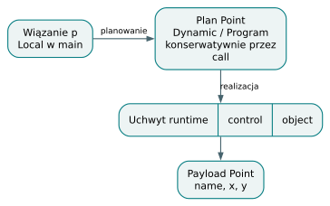

*Trzy pytania o ten sam obiekt. Region wiązania, domena planu i adres runtime są powiązane, ale nie są jednym opisem.*

## Dane i instrukcje

Backend reprezentuje `String` przez wskaźnik na bajty i długość. Rekord `Point` zawiera ten deskryptor oraz dwa pola `i32`. Wartość obiektowa używana przez generator jest uchwytem łączącym arenę i wskaźnik do obiektu. Dzięki temu odczyt danych i operacje na czasie życia mają dostęp do obu informacji.

Odczyty pól można przedstawić w uproszczonym LLVM IR. Poniższy fragment jest schematem operacji wewnątrz `sum`, pomija pobieranie wskaźnika z uchwytu oraz szczegóły ABI:

```llvm
; Schemat: %obj wskazuje na strukturę Point.
%px = getelementptr %Point, ptr %obj, i32 0, i32 1
%py = getelementptr %Point, ptr %obj, i32 0, i32 2
%x = load i32, ptr %px
%y = load i32, ptr %py
%value = add i32 %x, %y
; Przed ret obowiązują właściwe operacje cleanup.
```

`getelementptr` wylicza adres pola według typu struktury; samo nie pobiera wartości. Odczyt wykonuje `load`. Rozdzielenie adresu i wartości jest istotne również przy przypisaniach: lewa strona potrzebuje miejsca zapisu, a prawa obliczonej wartości.

Funkcje Borka mogą mieć dodatkowe parametry techniczne, takie jak arena rodzica i sink dla wyniku posiadającego dane. Nie są one widoczne w programie źródłowym. W tym przykładzie `sum` zwraca liczbę, ale nadal uczestniczy w protokole aren. Publiczny punkt wejścia programu ma odrębną rolę względem wewnętrznych funkcji.

Po emisji modułu sprawdzana jest poprawność LLVM IR. Następnie powstaje plik obiektowy, a linker łączy go z runtime'em i bibliotekami systemowymi. Dopiero uruchomienie programu oraz porównanie kodu zakończenia z `8` zamyka całą ścieżkę weryfikacji.

## Jak debugować ten przebieg

Jeżeli wynik jest błędny, pytaj po kolei o zachowanie informacji. Czy AST ma właściwy priorytet końcowego dodawania? Czy `sum` oznacza właściwą definicję? Czy pole `name` ma indeks zero? Czy długość wynosi jeden bajt? Czy pożyczony uchwyt trafia do właściwego parametru ABI? Czy cleanup odbywa się po ostatnim użyciu?

Takie pytania lokalizują problem. Zmiana kodu alokatora w odpowiedzi na błąd indeksu pola byłaby działaniem w niewłaściwej warstwie. Reprezentacje pośrednie są nie tylko etapami tłumaczenia, lecz również punktami obserwacji.

Ćwiczenie: zmień nazwę napisu na `"ż"`, nie zmieniając współrzędnych. Jaki wynik powinien dać odczyt długości bajtowej? Odpowiedź: `ż` jest kodowane w UTF-8 przez dwa bajty, więc suma wynosi `9`. Liczba widocznych znaków i liczba bajtów to różne wielkości.

Źródła: [program walkthrough_point](https://github.com/andrzejwitkowski/Bork/blob/56f4910a24b689087fe2dee30247651b7b432268/programs/build/classes/walkthrough_point.bork), [planer](https://github.com/andrzejwitkowski/Bork/blob/56f4910a24b689087fe2dee30247651b7b432268/src/memory.rs), [układ wartości backendu](https://github.com/andrzejwitkowski/Bork/blob/56f4910a24b689087fe2dee30247651b7b432268/src/codegen/llvm/context.rs), [ABI](https://github.com/andrzejwitkowski/Bork/blob/56f4910a24b689087fe2dee30247651b7b432268/src/codegen/llvm/call_abi.rs).

# 22. Laboratorium: przewiduj, uruchamiaj, wyjaśniaj

## Metoda pracy z ćwiczeniem

Dobre ćwiczenie kompilatorowe wymaga przewidywania. Przed uruchomieniem zapisz: czy program powinien przejść parser, kontrolę typów, analizę własności oraz backend? Następnie określ oczekiwany wynik albo kategorię błędu. Dopiero potem porównaj przewidywanie z narzędziem. Jeśli wynik się różni, znajdź pierwszą fazę, której model był niepoprawny.

W tym rozdziale pliki pochodzą z korpusu. Pełne programy są dołączone w katalogu `przyklady`, z zachowaną strukturą ścieżek. Własne modyfikacje zapisuj pod inną nazwą. Pliki w katalogach `check_fail` i `build_fail` celowo demonstrują odrzucenie programu; błąd jest tam oczekiwanym wynikiem.

## Laboratorium A: inferencja jako przepływ informacji

Otwórz `programs/check/inference/literal_fixed_by_use.bork` i zestaw go z `programs/check_fail/inference/literal_conflicting_uses.bork`. Znajdź deklarację nieadnotowanego literału, a następnie wszystkie użycia wymuszające jego typ. Narysuj graf: węzłem centralnym jest nieznany typ, a krawędziami wymagania z wywołań.

Pytanie: dlaczego przypisanie `val x = 1` nie musi od razu ustalać `i32`? Odpowiedź: kompilator może odroczyć decyzję i zebrać ograniczenia z dalszej części ciała. Wartość domyślna jest wybierana dopiero wtedy, gdy nie ustaliło jej inne wymaganie.

Pytanie trudniejsze: czy wymuszenie jednocześnie `u8` i `f32` oznacza, że kompilator powinien wybrać wspólny większy typ? Odpowiedź: nie w tym systemie. Inferencja nie jest automatyczną polityką konwersji. Sprzeczne wymagania mają prowadzić do diagnozy.

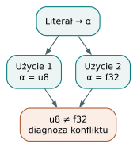

*Graf sprzecznych ograniczeń. Wymagania dotyczą tej samej niewiadomej. Nie da się ich spełnić przez wybór dwóch typów naraz.*

## Laboratorium B: własność po rozgałęzieniu

Porównaj `programs/check_fail/conditionals/if_one_path_move_then_use.bork` z `programs/check/conditionals/if_return_move_then_use.bork`. Zaznacz ścieżki, które docierają do instrukcji po `if`. Przy każdej dopisz stan właściciela: dostępny albo przeniesiony.

Odpowiedź na podstawowe pytanie brzmi: do analizy użycia po `if` trzeba uwzględnić każdą ścieżkę, która może do niego dojść. Jeżeli jedna z nich przeniosła właściciela, nie można bezwarunkowo odczytać go dalej. Ścieżka zakończona `return` nie dochodzi do późniejszej instrukcji; to właśnie dlatego informacja o przepływie sterowania należy do analizy własności.

Narysuj teraz wariant z dwiema gałęziami kończącymi funkcję. Pytanie „jaki stan właściciela po `if`?” traci praktyczny sens, ponieważ ten punkt nie jest osiągalny. Kompilator nadal może sprawdzać strukturę kodu, ale nie powinien mylić nieosiągalnego połączenia z normalnym przepływem.

## Laboratorium C: decyzja kompilatora a liczniki runtime'u

Uruchom `programs/build/managed_refs/weak_back_edge_usage.bork`. Program tworzy rodzica i dziecko oraz wiąże je w obie strony. Przed uruchomieniem zaznacz kierunki krawędzi. Następnie przeczytaj komentarz korpusu, który wskazuje silną krawędź rodzic–dziecko i słabą krawędź powrotną.

Pytanie: czy kopiowanie słabego uchwytu do parametru powinno automatycznie tworzyć silny uchwyt? Odpowiedź: nie. W tym przykładzie przekazanie zachowuje rodzaj uchwytu. Odczyt celu nadal musi sprawdzić obecność. Gdy cel przestaje żyć, słaba krawędź daje brak wartości zamiast prawa do odczytu zwolnionej pamięci.

Pytanie dodatkowe: dlaczego licznik odwołań do areny nie jest licznikiem odwołań do pojedynczego obiektu? Odpowiedź: arena grupuje obiekty, a odwołania podtrzymują jej domenę życia. Kilka odrębnych obiektów może uczestniczyć w tych samych licznikach. Ta różnica jest istotna podczas interpretowania `strongCount`.

## Laboratorium D: koszt wzrostu Vec

Program `programs/build/vec/push_grow_sum.bork` dodaje dziesięć liczb i odczytuje ich sumę. Oczekiwany kod zakończenia wynosi `45`. Rozpisz pojemności `4`, `8`, `16`, długość po każdym `push` oraz momenty kopiowania bufora.

Pytanie: czy każdy `push` ma koszt stały? Odpowiedź: operacja bez wzrostu ma stałą pracę związaną z dopisaniem elementu, ale wzrost wymaga przeniesienia lub skopiowania dotychczasowej zawartości. Przy geometrycznym wzroście liczbę takich prac można uśrednić w długiej sekwencji.

Pytanie istotne dla aren: czy stary bufor natychmiast wraca do ogólnego alokatora? Odpowiedź: nie należy tak zakładać. Arena zarządza większymi fragmentami pamięci i może utrzymywać miejsce po starym buforze do końca swojego czasu życia. Analiza złożoności operacji oraz analiza zużycia pamięci w konkretnym alokatorze to osobne zadania.

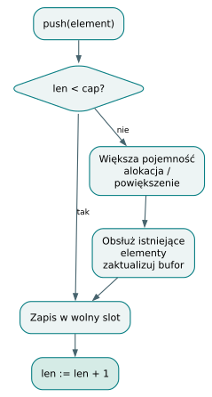

*Kiedy Vec płaci za wzrost. Długi ciąg dopisań przechodzi głównie krótką ścieżką; wzrost wiąże się z dodatkową pracą.*

## Laboratorium E: statyczne wywołanie traitu

Otwórz `programs/build/traits/dispatch_bound.bork`. Trait `Show` ma dwie implementacje. Funkcja `say<T: Show>` jest wywoływana z `Circle` i `Square`. Wynik na standardowym wyjściu to kolejno `circle` i `square`, każde w osobnym wierszu.

Przewidź, jakie konkretne implementacje wywoła każda instancja `say`. Odpowiedź: dla `Circle` wybierana jest implementacja `Show for Circle`, a dla `Square` — `Show for Square`. Wybór zostaje rozstrzygnięty podczas instancjonowania kodu. W runtime nie potrzeba tablicy wirtualnej do tego wywołania.

Usuń bound w roboczej kopii. Dlaczego ciało generycznej funkcji nie powinno po prostu czekać, aż zobaczy jakiś konkretny typ? Ponieważ kontrakt ciała generycznego ma być sprawdzalny względem jego deklarowanych wymagań. Bound daje prawo użycia metody; późniejsza monomorfizacja wybiera jej implementację.

## Laboratorium F: check i build

Zestaw `programs/check/methods/trailing_closure.bork` z `programs/build_fail/methods/trailing_closure.bork`. To celowo pokazana granica zakresu implementacji. Frontend rozumie daną konstrukcję, a bramka backendu ją odrzuca.

Odpowiedź na pytanie „czy język to obsługuje?” wymaga więc doprecyzowania etapu. W pracy nad kompilatorem używaj określeń „parsuje”, „przechodzi frontend” oraz „buduje się i działa”. Pozwala to uniknąć zarówno przedwczesnej deklaracji gotowości, jak i niesłusznego uznania poprawnego frontendu za uszkodzony.

Źródła: [korpus i dyrektywy testowe](https://github.com/andrzejwitkowski/Bork/blob/56f4910a24b689087fe2dee30247651b7b432268/tests/programs.rs), [przykład Vec](https://github.com/andrzejwitkowski/Bork/blob/56f4910a24b689087fe2dee30247651b7b432268/programs/build/vec/push_grow_sum.bork), [przykład dispatchu](https://github.com/andrzejwitkowski/Bork/blob/56f4910a24b689087fe2dee30247651b7b432268/programs/build/traits/dispatch_bound.bork).

# 23. Kompendium: gdzie szukać odpowiedzi

## Trzy zapisy, trzy znaczenia

`&T` oznacza pożyczony widok wartości. Nie ma autonomicznego prawa przedłużania życia właściciela. W aktualnym języku występuje w dozwolonych pozycjach, takich jak parametry i lokalne `val`; nie jest ogólnym polem do przechowywania pożyczek w obiektach. Rozdziały 9 i 10 wyjaśniają związek tej reguły z regionami.

`Ref<T>` oznacza zarządzany, sprawdzany pod kątem obecności uchwyt. Wiąże się z protokołem aren i silnych lub słabych odwołań. Nie należy utożsamiać go z pożyczką ani zakładać, że zwykła kropka od razu daje prawo dostępu do celu. Guard jest częścią uzasadnienia odczytu.

`T?` jest zapisem `Option<T>`. To wartość sumy wariantów, a nie uniwersalny bit nullable dopięty do dowolnej reprezentacji. Zagnieżdżenie zapisuje się jako `Option<Option<T>>` albo `Option<T>?`. Sam skrót `i32??` jest odrzucany przez gramatykę tej wersji, mimo że wewnętrzny system typów dopuszcza dwie warstwy opcji. `None` ma znaczenie zależne od kontekstu i rozwiązywania nazw; prelude nie jest zwolnione z reguł widoczności.

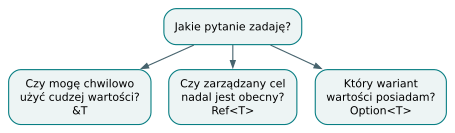

*Pożyczka, uchwyt i opcja. Pytania o dostęp, obecność i wariant wartości prowadzą do różnych mechanizmów języka.*

## Szybka mapa składni

| Zapis | Znaczenie i rozdział |
|---|---|
| `val x = ...` | Stałe wiązanie; pola obiektu mają własne reguły, rozdział 2 |
| `var x = ...` | Wiązanie dopuszczające przypisanie, rozdział 2 |
| `fun f(x: T): R` | Sygnatura funkcji, rozdziały 2 i 5 |
| `class C { x: T }` | Rekord z polami w kolejności deklaracji, rozdział 2 |
| `enum E { A, B(x: T) }` | Suma wariantów, rozdział 6 |
| `when value { ... }` | Dopasowanie wzorców i kontrola wyczerpywania, rozdział 6 |
| `trait X { ... }` | Kontrakt metod, rozdział 8 |
| `impl X for C { ... }` | Implementacja kontraktu, rozdział 8 |
| `T: X` i `where T: X` | Wymaganie traitu, rozdział 8 |
| `&value` | Pożyczenie, rozdział 9 |
| `move value` | Jawna operacja przeniesienia, rozdziały 9–10 |
| `promote value` | Operacja promocji danych, rozdziały 10 i 14 |
| `if val x = value` | Sprawdzenie obecności i ograniczone wiązanie, rozdział 12 |
| `[T; N]` | Tablica o długości należącej do typu, rozdział 13 |
| `Vec<T>()` | Rosnący kontener wbudowany, rozdział 14 |

Tabela jest drogowskazem, a nie kompletną gramatyką. Szczególnie przy `move`, `promote`, polach i receiverach znaczenie zależy od rodzaju wartości. Aktualny backend ma dodatkowe ograniczenia omawiane przy konkretnych konstrukcjach.

## Komendy, które rzeczywiście istnieją

Sprawdzenie źródła nie wymaga LLVM. Z katalogu repozytorium można uruchomić:

```bash
cargo run --bin bork -- programs/build/basics/return_constant.bork
cargo run --bin bork -- --dump-arenas plik.bork
```

Nie ma tu potrzeby dopisywania podkomendy `check`. Nazwa pliku bez `build` uruchamia frontend. Natywny backend wymaga kompilatora z cechą Cargo `codegen`, LLVM 23 oraz narzędzia linkującego dostępnego jako `clang`:

```bash
cargo run --features codegen -- build -o /tmp/program plik.bork
cargo run --features codegen -- build -g -o /tmp/program-g plik.bork
```

Nie pomyl profilu budowania kompilatora w Cargo z wyborem debugowania programu Borka. `cargo build --release` optymalizuje narzędzie napisane w Ruście. Flaga `bork build -g` dotyczy emitowanego programu, informacji debugowych i debugowego runtime'u. Rzeczywiste ustawienia optymalizacji backendu omawia rozdział 18.

Do uruchomienia wybranych testów służą między innymi:

```bash
cargo test programs_corpus_check
cargo test --workspace --features codegen
cargo test --features codegen --test programs
```

Pierwsza komenda obejmuje frontendową część korpusu. Ostatnia uruchamia zestawy korpusu zdefiniowane w `tests/programs.rs`, także budowanie zwykłe i debugowe, gdy włączona jest cecha `codegen`. Instalacja LLVM w niestandardowym prefiksie może wymagać zmiennej `LLVM_SYS_231_PREFIX`; szczegóły środowiska są niezależne od poprawności programu źródłowego.

## Diagnoza według pierwszego niespełnionego kontraktu

| Objaw | Pierwsze miejsce do sprawdzenia |
|---|---|
| Nieoczekiwany token lub nowa linia | `parser.lalrpop`, `layout.rs`, rozdział 3 |
| Nazwa wskazuje złą deklarację | `defs.rs`, resolver, środowisko, rozdział 4 |
| Sprzeczne typy literału | `infer/`, `typeck/solve.rs`, rozdział 5 |
| Brak wariantu w `when` | `typeck/exhaustive.rs`, rozdział 6 |
| Brak implementacji lub niejednoznaczna metoda | `typeck/traits.rs`, rozdział 8 |
| Odczyt po przeniesieniu | `sema/walk/branches.rs`, rozdział 9 |
| Dane przeżywają lokalny region | `escape.rs`, `hoist.rs`, rozdział 10 |
| Wygasły cel `Ref` | `bork_runtime/src/refs.rs`, rozdział 12 |
| Zły bajt lub długość napisu | `llvm/text.rs`, `runtime/text.rs`, rozdział 13 |
| Check działa, build odrzuca konstrukcję | `codegen_gate.rs`, rozdział 15 |
| Błąd weryfikatora LLVM | Emiter danego wyrażenia i CFG, rozdział 16 |
| Licznik pozostaje po return | Cleanup ścieżek wyjścia, rozdział 17 |
| Brak pliku runtime albo linkera | `codegen/link.rs`, rozdział 18 |
| Dobra diagnoza, złe podkreślenie w edytorze | Span i konwersja pozycji LSP, rozdziały 3 i 20 |

Źródła: [definicja CLI](https://github.com/andrzejwitkowski/Bork/blob/56f4910a24b689087fe2dee30247651b7b432268/src/main.rs), [kanoniczne typy](https://github.com/andrzejwitkowski/Bork/blob/56f4910a24b689087fe2dee30247651b7b432268/src/ty/mod.rs), [wspólna analiza](https://github.com/andrzejwitkowski/Bork/blob/56f4910a24b689087fe2dee30247651b7b432268/src/frontend.rs), [korpus](https://github.com/andrzejwitkowski/Bork/blob/56f4910a24b689087fe2dee30247651b7b432268/tests/programs.rs).

# 24. Słownik pojęć i mapa powiązań

## Reprezentacje i identyfikacja

**ABI — Application Binary Interface.** Umowa opisująca przekazywanie argumentów, wyniku i informacji technicznych na poziomie kodu maszynowego lub IR. Sygnatura widoczna w źródle może różnić się od sygnatury emitowanej funkcji, ponieważ backend dodaje parametry zarządzania pamięcią.

**AST — Abstract Syntax Tree.** Drzewo opisujące strukturę źródła po parsowaniu. Zachowuje pojęcia bliskie składni, np. wywołanie po nazwie. Nie musi jeszcze zawierać rozstrzygnięcia, czy zapis oznacza konstruktor czy funkcję.

**AstId, NodeId.** Identyfikatory węzłów w określonych reprezentacjach programu. Pozwalają przypinać metadane bez używania samego tekstu nazwy albo pozycji źródłowej jako uniwersalnego klucza. Nie należy zakładać wymienności różnych przestrzeni identyfikatorów.

**DefId.** Identyfikator definicji. Oddziela tożsamość deklaracji od jej pisowni. Jest przydatny dla typów nominalnych, sygnatur, rozwiązywania nazw i instancjonowania generyków.

**HIR — High-level Intermediate Representation.** Reprezentacja pośrednia bliższa semantyce niż AST. W Borku zawiera typy i rozstrzygnięte operacje, takie jak konstrukcja obiektu albo pole o znanym indeksie. Nadal zachowuje strukturę wysokiego poziomu potrzebną analizom.

**Interner i TyId.** Interner przechowuje jedną kanoniczną reprezentację danego kształtu typu w kontekście kompilacji. `TyId` identyfikuje zapis w tej strukturze. Porównywanie identyfikatorów ma sens w kontekście, który je utworzył; obcy identyfikator nie jest przenośnym opisem typu.

**Span.** Przedział w źródle pozwalający wskazać miejsce diagnozy i wrócić od reprezentacji pośredniej do tekstu. Offset bajtowy nie jest tym samym co numer widocznego znaku ani pozycja UTF-16 używana w protokole edytora.

## Typy i wybór operacji

**Bound.** Wymaganie wobec parametru typu. W deklaracji `T: Show` daje ciału generycznej funkcji prawo do korzystania z metod `Show`. Nie nadaje dowolnie wszystkich operatorów ani pól, jakie mogłyby istnieć w konkretnej przyszłej instancji.

**Coherence.** Spójność zbioru implementacji traitów: kompilator ma zapobiegać konfliktującym implementacjom, których wybór nie byłby jednoznaczny. Bork porównuje nagłówki implementacji, a ograniczenia bounds nie służą mu do rozłączania nakładających się przypadków.

**Exhaustiveness — wyczerpywanie.** Własność dopasowania, według której każdy dozwolony przypadek jest pokryty. Nie jest równoważna policzeniu nazw wariantów: wzorce zagnieżdżone mogą pokrywać tylko część wartości wariantu.

**Inferencja.** Wyprowadzanie brakujących typów z ograniczeń otoczenia. Obejmuje zbieranie wymagań, rozwiązywanie zmiennych oraz wykrywanie sprzeczności. Wybór domyślnego typu literału jest jednym z elementów, a nie całą inferencją.

**Monomorfizacja.** Wytwarzanie konkretnych instancji kodu generycznego dla wybranych argumentów typowych. W Borku jest także miejscem rozstrzygania wywołań traitowych do konkretnych implementacji. Nie oznacza dynamicznego wyboru metody przy każdym wywołaniu.

**Typ nominalny.** Typ, którego tożsamość wynika z deklaracji. Dwie klasy z takimi samymi polami nie stają się z tego powodu jednym typem. Ich `DefId` pozostają różne.

**Unifikacja.** Próba doprowadzenia dwóch opisów typu do zgodności przez rozwiązanie niewiadomych. Jeśli po jednej stronie jest `Vec<α>`, a po drugiej `Vec<i32>`, może ustalić `α = i32`. Nie tworzy zgody między dowolnymi różnymi konstruktorami typów.

## Pamięć i czas życia

**Arena.** Obszar zarządzania pamięcią umożliwiający grupowanie alokacji i wspólny protokół zwalniania. Arena stronicowana dodaje kolejne strony bez przesuwania dotychczasowych obiektów. Jej sterowanie i same strony danych pełnią różne role.

**Borrow — pożyczka.** Ograniczone prawo dostępu do wartości właściciela. Analiza musi wykazać, że właściciel żyje wystarczająco długo. Pożyczka nie jest samodzielnym mechanizmem odzyskiwania pamięci.

**Cleanup.** Operacje przy opuszczaniu zakresu lub ścieżki wykonania: odpinanie odwołań, kończenie guardów i zwalnianie właściwych regionów. Muszą wystąpić także przy `return`, `break` i `continue`, zgodnie z tym, jakie zakresy rzeczywiście zostają opuszczone.

**Domena czasu życia.** Opis tego, jak długo obiekt lub arena mają pozostać dostępne. Może być związana z zakresem leksykalnym lub z dłuższym życiem programu. Jest informacją analizy, której realizację dobiera backend i runtime.

**Escape.** Ucieczka wartości poza zakres, w którym zapewniono jej pamięć. Sprawdzenie ucieczki odpowiada na pytanie, czy użycie wartości w dłuższym kontekście pozostaje bezpieczne. Nie jest tym samym co test, czy zmienna pojawia się w `return`.

**Hoist.** Przeniesienie miejsca wykonania alokacji do odpowiednio długowiecznej domeny. Może pozwolić od razu utworzyć dane w docelowej arenie, zamiast później kopiować już zbudowany wynik. Wymaga znajomości odbiorcy i kształtu wyrażenia.

**Move i promote.** Operacje języka wpływające na własność i docelowy region danych. Ich realizacja zależy od rodzaju wartości; nie wolno utożsamiać zapisu `move` z fizycznym skopiowaniem jednego wskaźnika. Backend nie obsługuje wszystkich rodzajów wartości, które rozumie frontend.

**Outlives.** Relacja „żyje co najmniej tak długo jak”. Jeżeli region odbiorcy może przetrwać region danych, zapis do odbiorcy wymaga dodatkowego uzasadnienia, relokacji lub jest odrzucany. Porównywanie samych numerów linii nie oddaje tej relacji.

**Sink.** Miejsce lub domena przeznaczona na wynik. Przekazanie docelowej areny podczas budowy wartości może uniknąć tymczasowych danych, które po powrocie funkcji utraciłyby ważność.

**Silna i słaba krawędź.** Silna uczestniczy w podtrzymywaniu życia celu zgodnie z protokołem runtime'u; słaba umożliwia sprawdzany dostęp, ale nie utrzymuje celu samodzielnie. W Borku klasyfikacja wiąże się z arenami, a nie ze zwykłą adnotacją `weak` na każdym użyciu.

## Kod natywny i narzędzia

**CFG — Control-flow Graph.** Graf bloków podstawowych i możliwych przejść sterowania. Ułatwia zrozumienie warunków, pętli, short circuit oraz wszystkich wyjść wymagających cleanupu.

**DWARF.** Format informacji debugowej łączącej kod natywny z funkcjami, liniami, zakresami i typami źródłowymi. Obecność prawidłowego kodu maszynowego nie gwarantuje jeszcze użytecznych informacji debugowych.

**GEP — getelementptr.** Instrukcja LLVM obliczająca adres elementu wewnątrz struktury danych. Nie wykonuje odczytu wartości; do tego potrzebne jest np. `load`.

**Phi.** Instrukcja SSA wybierająca wartość na podstawie bloku, z którego przyszło sterowanie. Nie jest funkcją obliczającą obie gałęzie warunku. Powiązanie argumentu phi z rzeczywistym poprzednikiem ma znaczenie dla poprawności IR.

**SSA — Static Single Assignment.** Forma, w której konkretna nazwa wartości IR jest definiowana raz. Zmienna mutowalna z języka źródłowego może początkowo być realizowana przez komórkę pamięci oraz `load` i `store`; nie przeczy to istnieniu SSA dla nazw instrukcji.

**LSP — Language Server Protocol.** Protokół łączący edytor z analizą języka. Wspólne wywołanie frontendu pomaga utrzymać zgodność diagnoz z CLI, ale wymaga także prawidłowej obsługi wersji dokumentu i pozycji tekstu.

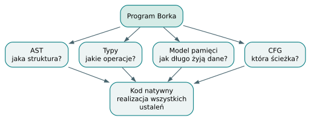

*Dlaczego kompilator potrzebuje kilku modeli. Modele opisują różne aspekty tego samego programu i wspólnie uzasadniają jego wykonanie.*

# Dodatek A. Źródła, wersja i weryfikacja

## Dokładny punkt odniesienia

Repozytorium: [andrzejwitkowski/Bork](https://github.com/andrzejwitkowski/Bork). Gałąź odczytana przez `git fetch origin main`: `main`. Commit: `56f4910a24b689087fe2dee30247651b7b432268`. Tytuł commita: `feat: trait method resolution and static dispatch (TS-P5-04) (#188)`. Data commita: 30 października 2026, 13:52:58, strefa `+01:00`. Data opracowania: 2 listopada 2026.

Podręcznik nie opisuje niezatwierdzonych plików roboczych ani rozwoju z innych gałęzi. W szczególności nie przypisuje tej wersji typów skojarzonych traitów. Plany i historyczne RFC służą jako kontekst; za dowód bieżącego zachowania uznano implementację i testy przypiętego commita.

Źródła projektu zawierają licencję Apache License 2.0; jej pełna kopia jest dołączona do materiałów jako `LICENSE-Bork.txt`. Cytowane programy i fragmenty implementacji pochodzą z Borka. Niniejszy tekst jest opracowaniem objaśniającym tę wersję, a nie normatywną specyfikacją wszystkich przyszłych wydań.

## Co sprawdzono podczas przygotowania

Zbudowano kompilator ze snapshotu wskazanego commita, z LLVM 23 oraz cechą Cargo `codegen`, bez domyślnej cechy `lsp`. Uruchomiono `tests/programs.rs`. Wszystkie trzy testy zbiorcze zakończyły się powodzeniem: korpus `check` i `check_fail`, korpus `build` i `build_fail` oraz wariant debugowy `build` i `build_fail`.

W lokalnym środowisku nie było programu `clang`. Etap końcowego linkowania wykonywał systemowy GCC, dostępny dla wywołania linkera przez tymczasowy alias `clang`. Emisja LLVM i runtime pochodziły z właściwego snapshotu. Wynik potwierdza działanie przykładów w tym środowisku; nie jest dodatkowym testem instalacji Clanga ani przenośności na inne systemy.

Osobno uruchomiono program `walkthrough_point.bork`: wynik to kod zakończenia `8`. Wydruk aren w rozdziale 21 pochodzi z tego samego kompilatora. Programy dołączone w materiałach odpowiadają plikom ze snapshotu. Fragmenty objaśniające, pseudokod oraz schematy IR nie są deklarowane jako osobne uruchomione programy.

Sprawdzenie składu PDF obejmuje obecność wszystkich rozdziałów i rysunków, ekstrakcję tekstu, polskie znaki, odsyłacze oraz próbki wyrenderowanych stron. Te kontrole służą jakości książki; nie zastępują pełnej weryfikacji semantycznej całego kompilatora. Dane techniczne i wyniki kontroli znajdują się również w pliku `weryfikacja.json`.

## Dokumentacja narzędzi do dalszej nauki

Podręcznik opiera opis Borka na źródłach projektu. Poniższe dokumenty są przydatne do pogłębienia pojęć użytych w jego implementacji; nie stanowią specyfikacji samego języka Bork:

- [LALRPOP — dokumentacja projektu](https://lalrpop.github.io/lalrpop/): gramatyki i generowanie parsera.
- [LLVM Language Reference Manual](https://llvm.org/docs/LangRef.html): znaczenie instrukcji i reguły poprawności IR. Dokumentacja internetowa rozwija się wraz z LLVM, dlatego szczegóły wersyjne trzeba zestawiać z LLVM 23 użytym przez Borka.
- [LLVM Kaleidoscope Tutorial](https://llvm.org/docs/tutorial/): samodzielne ćwiczenie implementacji małego języka z backendem LLVM.
- [Language Server Protocol 3.17](https://microsoft.github.io/language-server-protocol/specifications/lsp/3.17/specification/): protokół komunikacji z edytorem.

## Jak odświeżyć książkę po zmianie main

Najpierw ustal nowy commit i różnicę względem wersji wskazanej na okładce. Dla zmienionej cechy prześledź parser, typowanie, własność, HIR, planowanie i backend. Zaktualizuj przykłady pozytywne i negatywne, a następnie uruchom odpowiednie testy. Dopiero potem zmień twierdzenia w tekście, diagramy oraz identyfikator wersji.

Sama zamiana krótkiego SHA na okładce nie aktualizuje podręcznika. Szczególnie wrażliwe miejsca to reprezentacja typów, semantyka `Option`, protokół uchwytów `Ref`, ABI oraz lista konstrukcji odrzucanych przez backend. Indeks i spis treści należy ponownie przeliczyć po składzie.

# Dodatek B. Indeks tematyczny

Numery prowadzą do początku rozdziałów omawiających dane pojęcie. Indeks działa także jako zestaw odsyłaczy w czytniku PDF. Szczegółowe podrozdziały są dostępne w zakładkach dokumentu.

- **ABI**: rozdz. 16, 18, 21, 24
- **adresowalność**: rozdz. 2, 8, 15
- **aliasy typów**: rozdz. 2, 5
- **alokacja**: rozdz. 10, 11, 14, 15
- **arena dynamiczna**: rozdz. 10, 12, 21
- **arena stronicowana**: rozdz. 11
- **ArenaReport**: rozdz. 9, 10, 17, 19, 21
- **AST**: rozdz. 3, 4, 24
- **AstId**: rozdz. 3, 4, 20
- **bajty i UTF-8**: rozdz. 13, 21
- **bloki podstawowe**: rozdz. 16, 17
- **borrow / pożyczka**: rozdz. 9, 12, 21, 23
- **bounds**: rozdz. 8, 22, 24
- **bramka backendu**: rozdz. 15, 20, 22
- **break**: rozdz. 2, 17
- **check a build**: rozdz. 1, 15, 22, 23
- **cleanup**: rozdz. 11, 12, 17
- **coherence**: rozdz. 8, 24
- **const**: rozdz. 2, 4
- **continue**: rozdz. 2, 17
- **Copy**: rozdz. 2, 5, 9
- **DefId**: rozdz. 4, 5, 24
- **deskryptor**: rozdz. 13, 14, 15, 21
- **diagnostyka**: rozdz. 3, 5, 19, 20
- **domena czasu życia**: rozdz. 10, 21
- **domknięcia**: rozdz. 2, 15, 22
- **DWARF**: rozdz. 19, 24
- **enum**: rozdz. 6, 15
- **escape**: rozdz. 10, 13, 21
- **exhaustiveness**: rozdz. 6, 24
- **field / pole**: rozdz. 2, 4, 15, 21
- **for**: rozdz. 2, 17
- **GDB i LLDB**: rozdz. 19
- **generyki**: rozdz. 7, 8
- **getelementptr**: rozdz. 15, 16, 21
- **graf przepływu sterowania**: rozdz. 16, 17
- **guard**: rozdz. 12, 17
- **HIR**: rozdz. 4, 5, 7, 15
- **hoist**: rozdz. 10, 21, 24
- **if jako wyrażenie**: rozdz. 2, 16
- **if val**: rozdz. 12, 17
- **impl**: rozdz. 8
- **inferencja**: rozdz. 5, 7, 8, 22
- **interner**: rozdz. 5, 24
- **klasy**: rozdz. 2, 4, 15, 21
- **klasyfikacja silna i słaba**: rozdz. 12, 14
- **kolejka instancji**: rozdz. 7
- **konflikt typów**: rozdz. 5, 22
- **LALRPOP**: rozdz. 3
- **layout danych**: rozdz. 15, 21
- **lexer**: rozdz. 3
- **linkowanie**: rozdz. 18, 23
- **literały liczbowe**: rozdz. 2, 5, 22
- **LLVM IR**: rozdz. 16, 18, 19, 21
- **LSP**: rozdz. 19, 20, 24
- **main**: rozdz. 2, 18, 21
- **MemberResolutions**: rozdz. 4, 9
- **MemoryPlan**: rozdz. 10, 15, 19, 21
- **metody i this**: rozdz. 2, 4, 8
- **monomorfizacja**: rozdz. 7, 8, 15
- **move**: rozdz. 9, 10, 13, 14, 15
- **mutowalność**: rozdz. 2, 9, 14
- **nakładanie implementacji**: rozdz. 8
- **NodeId**: rozdz. 3, 4, 7, 10
- **None i Some**: rozdz. 6, 12, 23
- **normalizacja nowych linii**: rozdz. 3
- **numeracja węzłów**: rozdz. 3, 4, 7
- **obiekty i payload**: rozdz. 11, 12, 15
- **Option**: rozdz. 6, 12, 15, 23
- **optymalizacja**: rozdz. 14, 18
- **outlives**: rozdz. 10, 24
- **phi**: rozdz. 16, 24
- **plan pamięci**: rozdz. 10, 19, 21
- **plik obiektowy**: rozdz. 18
- **podstawienie typów**: rozdz. 5, 7, 8
- **prelude**: rozdz. 4, 6
- **priorytety operatorów**: rozdz. 3
- **promote**: rozdz. 9, 10, 14
- **przesłanianie nazw**: rozdz. 2, 4, 6, 8
- **punkt stały**: rozdz. 8, 10
- **Ref<T>**: rozdz. 9, 12, 14, 15, 23
- **region**: rozdz. 9, 10, 17
- **rekursja**: rozdz. 7, 16
- **Result**: rozdz. 6
- **return**: rozdz. 10, 17, 21
- **rozgałęzienia i własność**: rozdz. 9, 17, 22
- **runtime**: rozdz. 11, 12, 18, 19
- **short circuit**: rozdz. 2, 16
- **silne odwołania**: rozdz. 12, 14
- **sink**: rozdz. 10, 13, 16
- **slice**: rozdz. 9, 13
- **Span**: rozdz. 3, 4, 19, 20
- **SSA**: rozdz. 16, 24
- **statyczny dispatch**: rozdz. 8, 22
- **String**: rozdz. 10, 13, 15, 21
- **strongCount i weakCount**: rozdz. 12, 14, 22
- **słabe odwołania**: rozdz. 11, 12, 14
- **tablice**: rozdz. 9, 13
- **testy golden**: rozdz. 7, 19, 20
- **testy korpusu**: rozdz. 20, 22
- **trait**: rozdz. 8, 22
- **TyCtx i TyId**: rozdz. 4, 5, 7, 24
- **unifikacja**: rozdz. 5, 8
- **use after move**: rozdz. 9, 22
- **val i var**: rozdz. 2, 9, 14
- **Vec**: rozdz. 14, 22
- **weryfikator LLVM**: rozdz. 15, 16
- **when**: rozdz. 6, 12, 16
- **while**: rozdz. 2, 17
- **wyrównanie**: rozdz. 11, 15
- **wzorce**: rozdz. 6, 12
- **własność**: rozdz. 9, 10, 17
- **zagnieżdżone Option**: rozdz. 6, 23
- **zwalnianie pamięci**: rozdz. 11, 12, 17
