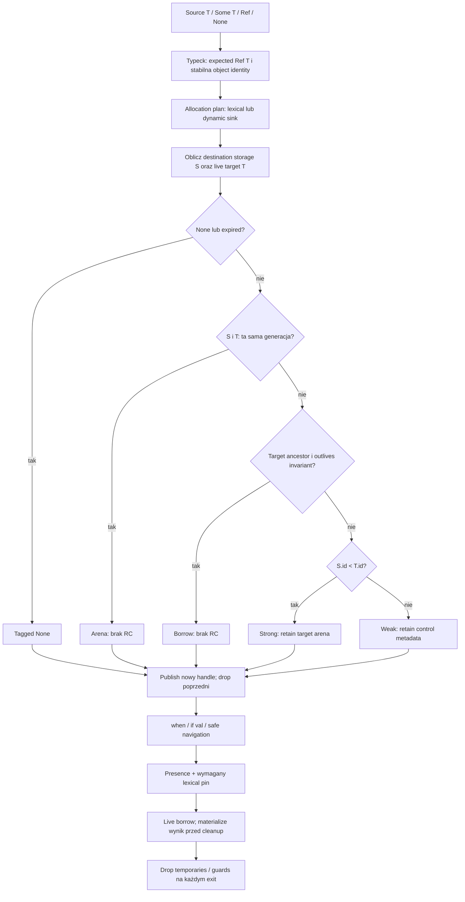

# Ref<T> i dynamiczne areny — plan implementacji

> **For agentic workers:** REQUIRED SUB-SKILL: Use superpowers:executing-plans to implement this plan task-by-task. Steps use checkbox (`- [ ]`) syntax for tracking. Ten dokument jest planem do przeglądu, nie zgodą na rozpoczęcie implementacji.

**Goal:** Dodać publiczny `Ref<T> = Some(live &T) | None`, zarządzający referencjami między arenami przy zachowaniu region/arena-first i acyklicznego grafu trwałych strong edges.

**Architecture:** Rozszerzyć istniejący AST, typed HIR, typeck/sema, allocation sinks i LLVM emitter. Dodać stabilną tożsamość aren, tagged handle, RC na granicach dynamicznych aren oraz type-directed cleanup przed zwolnieniem payloadu. Zachować zwykłe alokacje regionalne i bulk-free; nie wprowadzać dodatkowego backendu ani runtime grafu referencji.

**Tech Stack:** Rust 2021, LALRPOP 0.23, istniejący Inkwell/LLVM 23, runtime Rust `staticlib`, obecne testy Rust i korpus `.bork`; bez nowych zależności w MVP.

**Spec:** Wymagania 1–75 z zlecenia użytkownika z 2026-10-06. Użytkownik wybrał wariant A kontraktu D1: drzewo aren jest rzeczywistym lifetime tree. Szczegółowe rozwinięcie: [wariant A — lifetime tree](../specs/2026-10-06-managed-ref-lifetime-a-design.md). Pozostałe kontrakty D2–D6 pozostają rekomendacjami do przeglądu, nie zgodą na implementację.

## Podstawa analizy i ograniczenia

- Remote: `https://github.com/andrzejwitkowski/Bork.git`, gałąź `origin/main`.
- Pobrany i analizowany commit: `56edc60afc3b945ef47f7da6fbe917f1ccef3c4b`, `feat(parser): desugar else if to nested else { if } (#19)`.
- Lokalny HEAD podczas analizy: `ed8c39f32781b49597010b44a1d9fc239d3d797d`. Analiza dotyczy snapshotu remote, nie lokalnych plików eksperymentalnych i patchy.
- Snapshot analizy: `/tmp/bork-ref-main-COHz99`. Numery linii w tym dokumencie odnoszą się do wskazanego commita.
- Nie zmieniono implementacji, nie przełączono gałęzi, nie zastosowano lokalnych patchy. Dodano wyłącznie dokumenty planu i rozwinięcia wariantu A.

### Global Constraints

- Publiczną abstrakcją języka ma być wyłącznie `Ref<T>`; `T` i `&T` pozostają odrębnymi pojęciami.
- „Nie wprowadzamy `null`.” `None` jest semantyką języka; zerowy pointer może być wewnętrzną reprezentacją pustej wartości.
- „Ref<T> zawsze semantycznie dopuszcza None.” Znany statycznie Strong nie zmienia typu publicznego.
- „Strong references mogą wskazywać wyłącznie od starszej areny do młodszej areny.” Dotyczy trwałych edges przechowywanych w payloadach aren; wyjątek dla roots/pins wymaga doprecyzowania opisanego poniżej.
- `parent.arena_id < child.arena_id`; identyfikator `u64`, monotoniczny, bez używania adresu jako ID, bez reparentingu.
- RC dotyczy całej dynamicznej areny, nie obiektów w jej wnętrzu.
- Bez GC, cycle collectora, runtime grafu, DFS, SCC, Tarjana i reverse lists WeakRef.
- Pierwsza implementacja: pojedynczy wątek, `usize strong_count`, `usize weak_count`, bez atomików w retain/release.
- Destructor/managed drop następuje przed reset/pop payloadu. Cleanup obejmuje normal exit, return, break i continue.
- Użytkownik nie wybiera Strong/Weak, nie wywołuje upgrade/downgrade/retain/release.

### Review Focus

1. Zewnętrzny handle utrzymuje child po zniszczeniu parent: nie wolno dereferencjonować ancestor Borrow bez rzeczywistej gwarancji lifetime. Testy etapów 5, 6, 11 i 18.
2. `r = r`, `a.field = a.field`, alias źródła z RHS oraz drop ostatniego ownera podczas unwrap: najpierw zabezpieczyć nową wartość/live borrow. Testy etapów 9–14.
3. Copy/move/return Ref do innej areny storage: nie wolno zachować tagu Strong dla niedozwolonego kierunku ani wynieść Arena/Borrow poza dowód lifetime. Testy etapów 6, 12 i 18.
4. Wynik `weak?.name` zawiera String/array descriptor wskazujący do targetu: dane muszą być utrwalone przed zdjęciem guarda. Testy etapów 15–17.
5. Nested break/continue, shadowing, częściowa inicjalizacja i iteracja po reset: cleanup dokładnie raz, właściwe granice i nowa tożsamość generacji. Testy etapów 5, 12, 13 i 18.

---

## 1. Obecny Bork: co rzeczywiście istnieje

### AST i parser

`src/ast.rs:4` definiuje `Program { functions }`. Brak deklaracji klas/struktur, pól obiektów i constructorów. `Type::Named` nie oznacza gotowej obsługi typów użytkownika: `src/typeck/mod.rs:123` akceptuje jako nazwany typ tylko `String`.

`src/ast.rs:24` ma `Type::Ref { inner, nullable }`, lecz ten wariant oznacza **`&T`**, a nie projektowane `Ref<T>`. Odpowiednio `src/hir/ty.rs:83` ma `TyKind::Ref(Box<Ty>)` dla lexical borrow. Nie można podmienić semantyki tych wariantów na managed handle.

`src/parser.lalrpop` ma już:

| Konstrukcja | Aktualna implementacja | Wniosek |
|---|---|---|
| `None`, `Some(e)` | Atom → `Expr::None/Some` | Rozszerzyć expected typing o managed Ref; nie dodawać nowych literalów |
| `T?` | Suffix w produkcjach `Type` | To opcjonalna wartość; nie alias `Ref<T>` |
| `?.` | `FieldOp` → `Expr::Field { safe: true }` | Token zajęty zgodnie z żądaną semantyką; rozszerzyć typowanie/lowering |
| `?:` | `ExprElvis`, prawostronna asocjatywność | Operator jest już obecny, zachować precedence i lazy RHS |
| `!!` | `UnaryOp::NotNullAssert` | Istnieje dla `T?`; nie może ujawnić niechronionego Ref pointera |
| postfix `?` w wyrażeniu | Brak produkcji | Potencjalnie dostępny; trzeba sprawdzić rzeczywiste konflikty LALRPOP |
| `if val`, `when` | Brak | Wymagają AST/parser/typeck/sema/codegen |
| field assignment | `AssignTarget` tylko Name/Index | `a.next = b` obecnie nie parsuje się jako poprawny target |
| generic `Ref<T>` | Brak typu parametrycznego | Dodać dedykowaną produkcję, bez budowania pełnego systemu generics |

`if` ma składnię `if (cond) { ... }`; ostatnia zmiana remote obniża `else if` do zagnieżdżonego `else { if }`. Separatorami instrukcji są nowe linie. `src/layout.rs` normalizuje nowe linie tylko wewnątrz nawiasów, nie wewnątrz `<...>`; nowa gramatyka nie powinna przypadkowo zmienić tego kontraktu.

### Pipeline i type system

`src/frontend.rs:30`: parse → `typeck::check` → `sema::analyze_with_decl_tys` → stamp `codegen_push` → `hoist::annotate` → `escape::check_function`. HIR powstaje w typeck przed ownership analysis. `src/codegen_gate.rs` kontroluje subset codegenu i jest używany również przez LSP.

`Ty { kind, nullable }` istnieje już jako reprezentacja opcjonalności. Nie-null primitive jest Copy. String, array i nullable primitive nie są Copy. `uses_arena_storage()` obecnie rozpoznaje String/array i ich borrows, nie ogólne typy obiektowe. Tablice dopuszczają primitive i String; nie mają jeszcze managed element destruction.

`src/typeck/expr/field.rs:8` implementuje wyłącznie `.length` dla String/array. `&T` jest dopuszczone na parametrach `val` i lokalnych `val`; nie można go zwracać ani posiadać w `var`. Call sites dla `&T` wymagają jawnego `&`. Obecny borrow descriptor dla String/array nie jest ogólnym pointerem do obiektu.

### Ownership, move, shared, borrow

`src/sema/policy.rs:14` klasyfikuje **użycie bindingu**: ten sam region → Local; primitive → Copy; outer `val` nie-Copy → Shared; outer `var` nie-Copy → błąd bez move/borrow. Shared oznacza obserwację przy lexical nesting; **nie jest reference countingiem**.

`src/sema/walk.rs` sprawdza `move`, `promote`, transfer do bindingu/argumentu, borrow view i zakaz move outer binding w loop. `BindingOrigin::{Declared,Captured,View}` oraz `EnvBinding.moved` są stanem statycznym. Borrow zagnieżdżonego view jest ograniczony do reborrow na czas wywołania.

`apply_moved_merge` w `src/sema/env.rs:57` uznaje outer name za moved po if, gdy jest moved w obu gałęziach. To nie wystarcza jako dynamiczna flaga destrukcji zasobów: wartość może zostać zabrana tylko w jednej gałęzi. Dla Ref trzeba osobno śledzić stan inicjalizacji/dropu i odrzucać późniejszy odczyt possibly-moved wartości.

`UseKind` w HIR to Local/Shared/Copy/Move/Promote/Borrow. W LLVM `src/codegen/llvm/expr.rs:195` move/promote descriptorów wykonuje kopię payloadu do sinka. `copy_array_into_arena` kopiuje buffer, a dla String elements również bytes. Nie ma Ref retain, Ref drop ani clearing moved handle.

### Region/arena tracking

`ArenaNode { id: usize, label, compacted_braces, codegen_push, bindings, observations, children }` w `src/sema/report.rs:43` opisuje **statyczny site regionu**, nie runtime instancję. Analyzer nadaje ID w porządku przejścia AST. Rooty funkcji są osobnymi korzeniami raportu. Rekurencja i loop iterations wielokrotnie wykonują ten sam site.

`src/region_walk.rs` synchronizuje typed HIR i AST-derived report przez kolejność child regions. `src/codegen/regions.rs` emituje Push/Reset/Pop. Puste nested braces są peelowane, a arena fizyczna może zostać pominięta przez `codegen_push=false`. HIR nie niesie obecnie region identity. Statycznego `ArenaNode.id` nie wolno użyć do porównania runtime wieku aren.

### Allocation sinks

`FnEmitter.alloc_sink: Option<PointerValue>` i `sink_arena()` w `src/codegen/llvm/emit_fn.rs:112,201` wybierają miejsce alokacji. Assignment kieruje wynik do `Slot.home_arena`. `alloc_in_binding` w HIR oraz `src/hoist.rs` potrafią skierować initializer do znanej areny outer bindingu.

`without_alloc_sink` oddziela argumenty wywołania od miejsca alokacji wyniku. Concat i array allocation używają runtime handle, więc dynamiczna arena może być nowym rodzajem tego samego sinka. **Sam pointer sinka nie wystarczy jako wiedza o object identity, miejscu storage Ref i lifetime.** Obecny String literal jest stałą globalną `{ptr,len}`, nie alokacją w bump bufferze; concat/move tworzą arena-backed bytes.

`src/escape.rs` modeluje głównie depth payloadów String/array i odrzuca niektóre return/if escapes. To nie jest ogólny system lifetime dla obiektów i managed references. Nie można po prostu wyłączyć tych kontroli po dodaniu `Ref`.

### Layout, codegen i runtime

`src/codegen/llvm/context.rs:39` mapuje obecne `&T` na ten sam LLVM typ co T. String i array mają descriptor `{ ptr, i64 }`. Nullable scalar ma `{ i1, value }`; nullable buffer używa zerowego pointera jako None. `src/codegen/llvm/nullable.rs` implementuje `Some`, `None`, `!!`, Elvis, safe `.length` i equality. Buffer equality obecnie porównuje pointer i length, nie zawartość tekstu.

**Właściwy runtime** jest w `crates/bork_runtime/src/lib.rs`, budowany przez `build.rs` bezpośrednio poleceniem rustc do staticlib. `src/arena.rs` jest osobnym modelem/testowym prototypem, nie runtime używanym przez wygenerowany program.

Runtime ma `Arena { buf: [u8;4096], offset }`, `ArenaPool { free: Vec<Box<Arena>> }` oraz `bork_arena_push/reset/pop/alloc`. Nie ma parent, depth, runtime ID, stanu, control blocku ani RC. Pool jest thread-local; nie oznacza to wsparcia cross-thread references.

Slab jest `Box<Arena>` i bump allocation nie relokuje wcześniejszych przydziałów. Adresy payloadu są stabilne **do reset/pop**. Pool ponownie używa tych samych adresów, reset ponownie wykorzystuje ten sam slot. To wymaga nowego ID/generacji, a nie identity opartej wyłącznie na adresie. `alloc()` panikuje po przekroczeniu 4096 bytes; arena nie rośnie.

### Cleanup obecnie

| Exit | Implementacja na remote main | Brakująca część dla managed Ref |
|---|---|---|
| Normal block exit | `RegionVisitor::exit_region` → `pop_region` → arena pop, jeśli fizyczny region istnieje | Drop lokali, root handles, fields i guards przed pop |
| Return | `emit_return` oblicza wartość, `ArenaCalls::unwind` popuje otwarte fizyczne areny w reverse order, potem ret | Transfer result, type-directed drops, cleanup guarda i właściwe rozróżnienie ownership/storage |
| Loop iteration | Arena push przed loop, reset na latch, pop na exit | Drop iterator-local zasobów przed każdym reset, nowa identity generacji |
| Break/continue | `emit_break/emit_continue` to bezpośredni branch do exit/latch | Cleanup nested scopes porzuconych przez skok; dziś terminated blocks pomijają ich runtime pop |
| Abort | Bounds/`!!` emitują libc abort + unreachable | Brak unwind; abort kończy proces, nie obiecuje user destructorów |
| Exception/panic | Brak source-level mechanizmu wyjątków | Nie projektować teraz exception unwinding |

Kompilator nie ma `needs_drop`, drop glue, ordered list lokali ani registry destructorów areny. `scopes: Vec<HashMap<String,Slot>>` służy lookup, nie kolejności destrukcji. Dodanie destructorów bez zmiany tej części byłoby niepoprawne.

### Sprawdzony baseline

- `cargo test --workspace --offline --no-default-features` w snapshotcie: **229 testów zaliczonych** (174 library, 13 arrays, 38 parser, 1 corpus runner, 3 runtime).
- `cargo test --workspace --offline --no-default-features --features codegen --lib --quiet`, z `LD_LIBRARY_PATH` wskazującym lokalne biblioteki LLVM 23: **202 compiler library + 3 runtime testy zaliczone**.
- Pełne native build/run integration nie zostało zweryfikowane: środowisko nie ma `clang` w PATH. Pierwsze uruchomienie codegen suite zatrzymało się na brakującym loader path do `libLLVM.so.23.1`; poprawiona konfiguracja umożliwiła testy bibliotek/IR. Nie jest to deklaracja, że native korpus przeszedł.
- Nie uruchamiano testów LSP z default features w tej analizie. Aktualne CI ma osobne frontend i LLVM jobs, w tym instalację clang.

## 2. Kontrakty wymagające decyzji przed implementacją

Dowód DAG przez rosnący `arena_id` jest poprawny. Nie dowodzi jednak memory safety Arena/Borrow ani poprawności przenoszenia handle. Poniższe luki trzeba zamknąć jawnie, a nie schować w optymalizacji.

### D1. Wybrany wariant A: drzewo gwarantuje lifetime

Kontrprzykład: `P(id=10)` ma child `C(id=20)`; `C.parent` jest Borrow do P. Starsza, niezależna arena `X(id=5)` trzyma Strong do C. Drop ostatniego root P uruchamia zniszczenie P, ale C nadal żyje dzięki X. Borrow w C staje się dangling, mimo poprawności wszystkich nierówności strong graphu. Weak metadata lease do P zachowa tylko control block, nie payload.

**Decyzja użytkownika: A.** Payload child musi przestać istnieć przed zwolnieniem/recyklingiem payloadu parenta. Nie wystarczy zachować parent control block. Podczas destruction parent może mieć stan Destroying, ale jego bytes pozostają dostępne aż do zakończenia wymaganych drops dzieci.

Wszystkie swobodnie uciekające dynamiczne areny tworzyć jako children trwałej domeny R0. Dynamic child pod śmiertelnym parentem dopuścić w MVP tylko pod lexical arena, z pozytywnym dowodem ograniczenia wszystkich owners/pins/publikacji do jej lifetime. Nie tworzyć niezależnej dynamic child pod dynamic parentem: owned części dzielą jego sink, niezależne escaping groups są siblings R0. Relacja `Node.parent` nie wyznacza parenta areny.

Brak dowodu confinement oznacza wybór R0 **przed alokacją**, nie ancestor→Weak w classifierze ani zmianę parenta po publikacji. Planner propaguje wymagania także do targets Ref przechowywanych w uciekającej grupie; lexical payload nie staje się retainable tylko dlatego, że wskazuje na niego Ref. Scope-limited child nigdy nie jest siłowo niszczona przy dodatnim strong_count.

Nie wprowadzamy ukrytego child→parent strong retain. Pełna tabela klasyfikacji pozostaje bez zmian; ograniczeniu podlega tworzenie drzewa, nie publiczny Ref API. Szczegóły polityki parenta, funkcji, confinement, cleanup, testów i granic MVP są w [rozwinięciu wariantu A](../specs/2026-10-06-managed-ref-lifetime-a-design.md).

### D2. Roots i temporary strong guards nie są trwałymi edges payloadów

Weak upgrade wykonywany w nowszej arenie wskazuje do starszej. Gdyby każdy temporary strong musiał spełniać `current.id < target.id`, żądany weak pin byłby niemożliwy.

Rozróżnić w IR/runtime **persistent edge owner** i **external root/lexical pin**. `strong_count` zlicza oba, ale dowód DAG dotyczy tylko strong edges przechowywanych w payloadach aren. Root/pin nie może zostać zapisany jako nieklasyfikowany Strong do pola. Przy takim zapisie wywołuje się normalny classifier. Pin jest ograniczony lexical lifetime i zwalniany na każdym exit.

Wartość publicznego lokalnego Ref ma source storage region i podlega rebase; ukryty root-owning handle i pin są odrębnymi, niesource'owymi wartościami IR. Same arena edges nie zwiększają `strong_count`.

### D3. Przypisanie musi zabezpieczyć nowy handle przed drop starego

Podany w wymaganiu pseudoalgorytm `drop(old)` przed `create/retain(new)` niszczy target przy samoprzypisaniu lub aliasingu, gdy old jest ostatnim ownerem. Bezpieczny porządek to: obliczyć RHS dokładnie raz → uzyskać live target/pin → sklasyfikować względem rzeczywistego destination owner → retain/create nowy handle → zastąpić destination → drop old. Przy move można przejąć ledger zamiast retain, jeśli klasyfikacja się nie zmienia. Nie przenosić wyjątku samoprzypisania do każdego callera; jeden wspólny store helper.

### D4. „Move bez RC” wymaga stałego ownera/storage klasyfikacji

W payload A(id=10) istnieje Strong do B(id=20). Przenieśmy go do C(id=30), sibling B. W C edge musi być Weak. Bytewise move z zachowaniem Strong łamie DAG; move z zamianą na Weak wymaga `weak++` i `strong--`.

Rekomendacja: **move bez retain/release dla tej samej areny ownershipu i niezmienionego RefKind; zmiana ownera = rebase z odpowiednim bilansem RC**. Rozdzielić `RefMove` od `RefRehome`. Po move binding jest statycznie moved, runtime slot wyzerowany dla cleanup. Publicznie nie dodawać nowego operatora. Jeśli wymaganie „każdy move ma zero RC” ma być absolutne, konieczne jest ograniczenie cross-arena move; nie da się jednocześnie zachować dowolnych transferów i pełnej tabeli klasyfikacji.

### D5. `?.` nie może wynosić descriptoru z umierającego targetu

`val name = weakUser?.name` po wyjściu z wyrażenia nie może wskazywać na String bytes z areny, której ostatni pin właśnie zdjęto. Domyślny model:

- Copy field → skopiować scalar do `T?`.
- Owned String/array/owned aggregate field → zmaterializować niezależną wartość w consumer sinku **przed** drop pin; albo dowieść, że użycie jest tylko w guard scope. Nie zostawiać surowego descriptoru na później.
- Field `Ref<U>` → stworzyć/rebase niezależny handle do U w destination storage; canonical flat `Ref<U>`, a nie `Ref<U>?`. Expired Weak działa jak None.
- Wspólne, wewnętrzne optional borrow do T istnieje tylko z guard lifetime. Nie jest nowym publicznym `BorrowRef<T>`.

Bez tego poprawny weak upgrade w pierwszym segmencie nadal kończy się UAF w wyniku całego wyrażenia.

### D6. Powstawanie dynamicznych aren i user classes

Repo nie ma ani user objects, ani API tworzenia dynamicznych aren. Samo dodanie Ref runtime nie uruchomi przykładów Node/User.

Proponować minimalne `class` jako record bez inheritance, metod, vtable i user-written destructorów. Constructor `Node(...)` bierze pola w kolejności deklaracji; pole `Ref<T>` domyślnie None, gdy argument pominięty. W MVP `val` wiąże niezmienną tożsamość obiektu, a mutowalność jego pól jest osobną decyzją; przykłady użytkownika wymagają zapisu `a.next = b` dla `val a`. Przyjąć writable record fields w tej wersji, zachowując immutable binding, oraz nie pozwalać na reseating obiektu przez `&T`.

Arena plan wybiera miejsce **przed utworzeniem adresowalnego obiektu**. Normalne, nieuciekające constructors korzystają z lexical sinka. Constructor, którego tożsamość ma wyjść przez Ref poza lexical lifetime, tworzy compiler-managed dynamic construction arena pod R0; jej całe owned poddrzewo korzysta z tego sinka. Ukryty owning handle konstrukcji zaczyna z `strong_count=1`; przypisania Ref tworzą niezależne edges. To jest conservatywna grupa konstrukcji z wieloma obiektami/payloadami, nie obowiązkowe RC każdego obiektu.

Granice grup nie są arbitralne: w MVP jedna grupa obejmuje constructor root i tworzone dla niego owned pola; istniejące obiekty przekazywane przez Ref pozostają w swoich arenach. Dwa niezależne escaping constructor roots mogą być siblings R0. Nie scalać automatycznie już opublikowanych grup. Dla celowo wspólnego lexical grafu wszystkie zwykłe constructors w aktualnym sinku trafiają do tej samej areny, a escaping owned construction poddrzewo dzieli dynamic sink root. Precyzyjniejsze łączenie kilku escaping roots w jedną dynamiczną grupę jest optymalizacją, nie warunkiem memory safety.

MVP planner może bezpiecznie nadmiernie wybierać dynamiczne construction groups dla adresowalnych obiektów uczestniczących w escaping Ref. Nie może po fakcie przestawić pointera istniejącego obiektu ani przemianować lexical areny na dynamiczną, gdy stworzono już BorrowRef. Nie proponować publicznego Rc/Weak/Strong ani automatycznego deep-copy grafu z cyklami. Jeżeli nie potrafi określić sinka z sygnatury wywołania, w MVP użyć konserwatywnego dynamic result sinka, nie zgadywać lifetime.

Wyjątek od R0 dla dynamic construction group: jeśli wszystkie owning handles i publikacje są statycznie ograniczone do konkretnego lexical parenta, można od początku utworzyć dynamic child pod tym parentem. Tak uzyskuje się wymagany Parent→Child Strong / Child→Parent Borrow w programie, bez ręcznego wyboru rodzaju Ref. To wymaga pozytywnego confinement proof, nie późniejszego zakazu użycia już opublikowanego handle. Gdy dowód nie jest dostępny, od początku wybrać sibling pod R0; backref do innej śmiertelnej areny jest wtedy Weak. Nie zmieniać parenta po publication.

Alternatywa wymagająca decyzji: jawny arena allocation block zamiast automatycznej analizy konstrukcji. Nie jest domyślnym elementem tego planu, ponieważ żądana ergonomia ma działać bez wskazywania ownership pointerów i dodatkowych zabiegów użytkownika.

## 3. Docelowa architektura

### 3.1 Typy i canonical optional semantics

Zachować istniejący `Type::Ref` / `TyKind::Ref` dla `&T`, dodając `Type::ManagedRef { inner }` oraz `TyKind::ManagedRef(Box<Ty>)` dla publicznego `Ref<T>`. Nazwy wewnętrzne mogą zostać później uporządkowane, ale hurtowy rename starego Ref nie jest warunkiem wdrożenia.

`Ref<T>` zawsze jest fallible/presence-capable, nawet gdy `Ty.nullable=false`: ten bit opisuje istniejące `T?`, a nie managed liveness. Dodać oddzielne `is_managed_ref()`, `managed_ref_inner()` i `is_presence_capable()`; nie pozwalać, aby `with_nullable(false)` przypadkowo „odnullował” Ref. `Ref<T>?` w MVP odrzucić jako redundantne; `&Ref<T>` oznacza lexical borrow handle, nie unwrap do `&T`. W pierwszej wersji Ref target to adresowalne arena-backed record/String/array, bez reference do stack primitive, funkcji i innego Ref handle.

`None` w expected `Ref<T>` tworzy pusty handle. `Some(obj)` w tym kontekście tworzy Ref do stabilnego obj; `obj` przypisane do expected Ref jest ergonomiczną koercją do tego samego HIR Ref creation. Bez expected Ref `Some(value)` zachowuje obecną semantykę `T?` — nie zmieniać istniejących programów. Nie inferować `val r = None` bez informacji o typie.

Canonical operation w typed HIR: `PresenceMatch` z obecnym/nieobecnym ramieniem i typed bindingiem. Dla `Ref<T>` present binding ma `&T` oraz ukryty guard; dla `T?` present binding jest wartością T zgodnie z ownership. Dodać bazowy source `when e { Some(x) => { ... }; None => { ... } }`, przy czym rzeczywistymi separatorami są newline, nie średniki. MVP `when` obsługuje tylko te dwa exhaustive patterns, bez ogólnego pattern language.

`if val`, `?.`, `?:` i opcjonalny `?` mają wspólną operację obserwacji presence; source AST może zachować dotychczasowe Field/Binary nodes. Nowego niezależnego interpretera opcji nie potrzeba.

### 3.2 Trzy różne miejsca ownershipu

Rozdzielić:

1. **lexical binding/scope** — gdzie lokal jest nazwany i gdzie kończy się jego cleanup;
2. **storage arena Ref** — arena, w której fizycznie/semantycznie mieszka destination field/array element/lokalny handle;
3. **target arena** — rzeczywisty owner adresowalnego T i jego owned payloadu.

Dzisiejszy `Slot.home_arena` często opisuje payload sink, a stack slot descriptoru jest w entry alloca. W Ref field source to owner obiektu odbiorcy, nie current scope ani deklaracja nazwy odbiorcy. W array element source to arena bufferu, nie arena lokalnego descriptoru. Dodać `Slot.storage_arena`, `Slot.payload_arena` i guard/initialization info zamiast przeciążać jedno `home_arena`.

Adresowalny record/String/array musi mieć stabilny object cell. Dla nowych records wystarczy wewnętrzny descriptor `{ object_ptr, arena_handle }`, object body w bump payload. Dla istniejącego String/array pozostawić ABI descriptoru wartości; managed Ref do nich wskazuje do arena-resident cell zawierającego descriptor, nigdy do function-entry alloca. Materiałowanie cell dla `Ref<String>`/`Ref<[T;N]>` jest osobnym allocation operation z udokumentowaną identity, nie ref do chwilowego wyniku.

Dla adresowalnego recordu wielokrotne `Some(obj)` zachowuje tę samą tożsamość object body. Dla String/array wymagającego cell należy przy pierwszym address-taking przypisać bindingowi jedną stabilną cell i ponownie jej używać; dwie konstrukcje Ref z tego samego bindingu nie mogą tworzyć dwóch identity. Tymczasowy String/array materializuje własną cell w wybranym sinku. Zmiana owned bindingu aktualizuje/zmienia object identity zgodnie z regułą replace; nie reseatować cell obserwowanej przez wcześniejsze Ref bez zdefiniowanej semantyki mutacji.

### 3.3 Tożsamość i drzewo aren

`ArenaNode.id` pozostaje statycznym region site. Nowe `ArenaControl.arena_id: u64` oznacza runtime instancję payload lifetime. Pooling może odzyskać slab/control memory, ale nie ID. Loop reset kończy poprzednią payload generation i tworzy nową; jeśli weak handles do poprzedniej istnieją, zachować ich Dead control, a nowa generacja ma osobny control. Nie „ożywiać” istniejącego Dead control.

R0 jest tworzona przed pozostałymi runtime arenami i trwa do końca programu. Jest sentinel root z `parent=None`; reguła jednego parenta dotyczy pozostałych aren. R0 nie posiada strong ownership nad wszystkimi children. Dla wariantu A internal funkcje dostają hidden `lexical_parent: control*`: root callee jest child aktualnej fizycznej lexical areny callera. To zachowuje ancestry przy przekazaniu Ref do lexical targetu bez wymuszania dynamicznej alokacji przy każdym call. Main zachowuje zewnętrzne C ABI i pobiera R0; nested regiony używają aktualnej fizycznej areny. Lexical parent nie jest dynamic alloc_sinkiem.

Reset nie może polegać wyłącznie na podmienieniu compilerowego `Vec<PointerValue>` w latch: LLVM body zostało już wygenerowane z poprzednim handle. Loop header musi mieć runtime handle phi z incoming initial-control z preheader i next-generation-control z latch; body, nested pushes i final pop używają bieżącego phi. Równoważny wariant to mutable runtime handle slot ładowany przy użyciu. Plan wybiera phi, bez nadawania tożsamości loop site całemu ciągowi generacji.

Pominięty fizyczny region nie otrzymuje osobnego allocator/control; jego lokals dziedziczą rzeczywisty storage arena, lecz nadal mają lexical cleanup scope. Kompaktowanie braces nie może usuwać guard/drop lifetime scope. ID przy overflow abortuje przed reuse; nigdy wrap do 0. Liczniki również mają checked increments/decrements.

Process-global monotonic ID może być zwykłym single-thread counter, jeśli runtime wymusza jedną domenę wykonania. Istniejące Rust unit tests działają równolegle: dla global counter w harnessie użyć serializacji testów/ID generatora lub osobnej globalnej atomiki wyłącznie dla nadawania ID. To nie usprawiedliwia atomowego strong/weak RC ani cross-thread Ref.

### 3.4 Bazowy tagged layout

Proponowany ABI handle, opis koncepcyjny, nie kod do wklejenia:

```text
RefKind: repr(u8) { None=0, Arena=1, Borrow=2, Strong=3, Weak=4 }
RefHandle: repr(C) {
    control: *ArenaControl,
    object: *opaque,
    kind: u8,
    padding wg target ABI
}
```

Na obecnym 64-bit target: dwa pointers + tag/padding, zwykle **24 bytes, align 8**. Docelowe size/alignment pobrać z LLVM TargetData i skonfrontować z Rust `repr(C)`, nie wpisać 24 jako uniwersalnego stride. Ustawić data layout przed layout-dependent lowering; dziś jest ustawiany dopiero w `write_object`.

Control jest dostępny dla wszystkich niepustych RefKinds, aby umożliwić późniejszy rebase i identity. Arena/Borrow dereference używa bezpośrednio object pointera, bez RC, upgrade i dead check, **pod warunkiem dowiedzionego lifetime**. Uniform handle kosztuje miejsce/tag nawet dla tych przypadków; „zero-cost” w MVP oznacza brak RC/liveness dispatch w dowiedzionym fast path, nie automatycznie jedno słowo dla każdego pola.

None ma `kind=0`, resztę zerową. Dla Weak object może fizycznie wskazywać w zwolniony slab, lecz nie wolno użyć go do load/GEP payloadu bez udanego upgrade. Kopia samego nieużywanego address bits nie jest dereference; LLVM lowering ma umieszczać faktyczne payload accesses dopiero za live branch.

Nie używać tagged pointera na tym etapie. Pola zmieniają kind w czasie; layout nie zależy od pierwszego initializeru.

### 3.5 Klasyfikacja

| Source S → Target T | Warunek | RefKind | Efekt utworzenia |
|---|---|---|---|
| Same arena | Ta sama runtime identity/generation | Arena | Brak RC |
| Child/descendant → parent/ancestor | T jest ancestor S **i system gwarantuje payload outlives** | Borrow | Brak RC |
| Older → newer, w tym ancestor→descendant | S≠T i S.id<T.id | Strong | target strong++ |
| Newer → older unrelated | Pozostały przypadek | Weak | target weak++ |
| None/expired incoming Weak | Brak live targetu przy store/obserwacji | None | Brak nowego edge |

Wybrany wariant A gwarantuje outlives przez politykę tworzenia i confinement. Runtime ancestor test wystarcza do wybrania Borrow; nie ma awaryjnej reguły ancestor→Weak. Jeżeli confinement nie jest dowiedzione, planner wcześniej wybiera inne drzewo/areny.

Runtime classifier: same identity → ancestor test → ID ordering → Weak. `isAncestor` przechodzi wyłącznie parent chain z użyciem depth, O(depth); to traversal drzewa tworzenia aren, nie grafu referencji. Nie używa DFS/SCC. Compiler może pominąć parent-chain walk wyłącznie dla udowodnionych actual storage arenas. Nie używać porównań static site IDs, szczególnie w rekurencji, funkcjach, loops i po hoist.

Control metadata parenta musi być dostępne do końca życia control child, również gdy któryś payload jest Dead. Najprostsze: child trzyma **metadata weak lease** do parent control, doliczony do weak_count; lease zwalniany przy final free child control. To nie zachowuje parent payloadu i nie jest Borrow lifetime proof. Registry tych leases jest parent chain, nie reverse-edge lista.

### 3.6 Runtime control i API

```text
ArenaControl {
    arena_id: u64,
    parent: *ArenaControl | root sentinel,
    depth: usize,
    mode: Lexical | Dynamic | DomainRoot,
    strong_count: usize,
    weak_count: usize,     // external weak + ancestry metadata leases
    live_scoped_children: usize, // assertion confinement przed recycle lexical parenta
    state: Alive | Destroying | Dead,
    payload: boxed stable slab | unavailable,
    drops: ordered DropEntry list
}
DropEntry { object_ptr, drop_fn, initialized/active }
```

Control block alokować **poza payloadem**, jako stabilny Box. Sam buffer nadal jest osobnym Box slabem z poola. Nie osadzać control w bufferze, który może zostać oddany do poola przy strong=0. Lexical mode nie jest niszczony przez chwilowe strong=0; zniszczenie następuje na scope cleanup. Persistent Strong może trzymać jedynie Dynamic target. Ref do krócej żyjącej Lexical target, który miałby stać się Strong/Weak, wymaga wcześniejszego dynamic allocation planu, a nie nieskutecznego retain lexical slab.

Minimalne ABI zachowuje prefiks `bork_` i opaque handles. Nowe funkcje, docelowo w `crates/bork_runtime/src/lib.rs`, declarations w `src/codegen/llvm/context.rs`:

| Funkcja | Kontrakt |
|---|---|
| `bork_arena_root() -> control*` | Zwraca trwały R0, inicjalizowany raz przed tworzeniem children |
| `bork_arena_push(parent*) -> control*` | Lexical instance, nowy ID; zmiana obecnego push ABI skoordynowana z emitterem |
| `bork_arena_create_dynamic(parent*) -> control*` | Dynamic Alive, strong=1 dla ukrytego ownera; waliduje politykę parent/lifetime |
| `bork_arena_alloc(control*, usize, usize) -> ptr` | Ten sam sink ABI co dziś, alokacja tylko Alive |
| `bork_arena_register_drop(control*, object*, drop_fn*) -> entry*` | Rejestruje tylko w pełni zainicjalizowany owning payload root |
| `bork_arena_retain_strong(control*)` | Alive Dynamic, checked strong++; tylko classifier/root/pin emitter |
| `bork_arena_release_strong(control*)` | checked strong--; przy 0 rozpoczyna destroy |
| `bork_arena_retain_weak(control*)` | checked weak++; control istnieje |
| `bork_arena_release_weak(control*)` | checked weak--; free tylko state=Dead i zero owners/leases |
| `bork_arena_weak_upgrade(control*) -> bool` | Jeśli Alive Dynamic i strong>0: strong++ oraz true; inaczej false |
| `bork_arena_is_alive(control*) -> bool` | Presence/identity check bez payload load; nie zastępuje pin przy dereference |
| `bork_arena_classify(source*, target*) -> u8` | Jedno źródło runtime reguł tabeli; assertions kierunku i trybów |
| `bork_arena_pop(control*)` | Lexical destroy/drop → payload recycle → Dead; control zachowany dla leases |
| `bork_arena_reset(control*) -> control*` | Koniec lexical generation i nowa identity; emitter aktualizuje aktywny handle |

`usize` w Rust/C odpowiada LLVM intptr targetu; obecny backend korzysta z i64. W MVP zachować sprawdzany 64-bit target albo rozszerzyć layout/ABI przez TargetData. Nie dodawać oddzielnego publicznego `arena_destroy`; internal `destroy_payload` jest wspólną implementacją lexical pop i dynamic strong-zero.

Single-thread runtime musi unikać żywego `&mut ArenaControl` lub `RefCell` borrow podczas wywoływania `drop_fn`: callback może kaskadowo wejść do retain/release i dotknąć ancestry controls. Ustawić state, odłączyć/odczytać entries, zakończyć Rust borrow, dopiero wywołać callbacks. POOL borrow trzymać wyłącznie podczas acquire/release slab, nie w czasie managed destruction.

### 3.7 Roots, copy, move, store i destruction

Dynamic construction owner otrzymuje strong=1. Jeden ukryty root utrzymuje lifetime całej construction group podczas zwykłego używania T; obiekty/owned pola w jej wnętrzu nie dostają własnych counts. Własność root przenosi się z wynikiem owning T albo kończy na lexical exit. Ref publication/copy tworzy odrębny handle. Root ownership jest widoczne tylko w IR/cleanup, nie jako `Rc<T>`.

`Ref<T>` **nie jest bitwise Copy**. Naturalna kopia `val b = a`, argument lub przypisanie jest dozwolona bez user `clone()`, ale lowering wykonuje managed copy/rebase. Tym samym `is_copy()` pozostaje false; dodać `UseKind::RefCopy` zamiast obejść całą politykę dla non-Copy typów.

`Shared` dla starego T nadal oznacza lexical obserwację. Odczyt Ref podczas match/`?.` może obserwować slot bez utworzenia persistent kopii, o ile emitter zabezpiecza lifetime i aliasing. Zapis niezależnego handle to inna operacja. Nie rejestrować drop dla borrowed aliasów i slice views jako ownerów bufferu.

Wspólne operacje IR/codegen: create/rebase, copy, move, drop, presence-open, presence-close. Ref store zawsze dostaje destination storage arena. Drop najpierw logicznie czyści handle do None, potem dispatch po starej kopii kind; chroni to przed double-drop/reentrancy. Move z niezmienioną klasyfikacją przenosi handle i czyści source bez RC. Zmiana source owner wymaga rehome z D4.

`needs_drop(T)` jest własnością compiler type, niezależną od `uses_arena_storage(T)`:

- Primitive/owned String bez managed pól: false dla managed glue.
- Lexical `&T`: false.
- `Ref<T>`: true, niezależnie od bieżącego tagu; glue dla Arena/Borrow/None jest no-op.
- Record: true, jeśli jakiekolwiek **owned** pole wymaga drop.
- Array<T>: true, jeśli owning elements wymagają drop.
- Nullable T: zależy od T, drop tylko dla present value.

Ref nie powoduje rekurencyjnego wejścia w target type przy wyliczaniu `needs_drop`; inaczej self-referential Node zapętli analizę. By-value cykle recordów odrzucić w type/layout checkerze. Nie odrzucać cykli przez Ref. Generator drop glue dla recordów i tablic odwiedza owned pola/elementy w reverse order, ale **nie podąża za Arena/Borrow edges**.

Interprocedural sink dla owning wyniku, którego payload powstaje w callee: dodać hidden `result_arena: control*` do internal function ABI tylko dla takich sygnatur, przy których planner go potrzebuje. Caller wybiera consumer sink przed call; callee alokuje owned result i safe-navigation materialization w tym sinku. Ref return nie kopiuje T — przenosi/rebase handle do storage caller i zachowuje target control. Ukryty result sink nie jest publicznym parametrem i nie trafia do zip user params/args; `declare_function`, callee parameter binding i `emit_call_with_values` muszą obsłużyć go jawnie. Obecne scalar i zwykłe borrowed String return paths zachować. Gdy dynamic group zwraca owning T, hidden root przekazać wraz z internal result ownership, zamiast release przed ret.

Destruction dynamic arena:

1. Po strong→0 ustawić Destroying; nowe weak upgrades fail.
2. Uruchomić aktywne, type-directed drop entries w reverse construction order, z payloadem nadal istniejącym. Field Ref drops i ewentualne builtin resource destructors są częścią jednej glue kolejności, nie dwoma nakładającymi się przebiegami.
3. Oddać slab do poola; payload staje się unavailable.
4. Ustawić Dead.
5. Zwolnić control tylko gdy weak_count=0; potem zwolnić jego parent metadata lease. W Destroying nie free'ować control nawet jeśli releaseWeak obniży count do 0.

Drop registry nie jest grafem: zawiera tylko `(object address, function pointer, active state)`, bez target lists, incoming lists i cycle analysis. Nie rejestrować zarówno owning recordu, jak i jego owned nested array do podwójnego zniszczenia. Moved/extracted payload root usuwa/transferruje odpowiedzialność rejestracji. Konstrukcja częściowa sprząta zainicjalizowany prefix; dopiero completed root dostaje final drop entry.

Rekurencyjna kaskada jest dopuszczona jako pierwsza wersja; stan Destroying chroni przed reentry. Znany limit: stos dla długich chains. Późniejsza queue nie jest collector, tylko kolejką zero-count destruction.

### 3.8 Lifetime guard i sugar

Wszystkie formy obecności używają wspólnego `open_presence`:

- None/expired Weak → brak branch bindingu.
- Arena/Borrow → raw borrow tylko jeśli source storage i outlives proof przeżywają całe użycie.
- Weak → successful upgrade daje ukryty pin aż do końca live lexical użycia.
- Strong → bez dodatkowego retain tylko gdy owner slot nie może zostać nadpisany/moved/dropped podczas borrow. W przeciwnym razie dodatkowy temporary strong pin; nie wystarczy mieć Strong tag w chwili wejścia do bloku.

`if val x = r { ... }` daje `x: &T`; live-use scope obejmuje cały blok, wszelkie nested calls i exits. Existing explicit reborrow syntax nadal działa dla parametrów `&T`; binding utworzony przez compiler nie musi udawać user `&name` z outer var.

Canonical `when` uruchamia identyczny guard dla `Some(x)` branch. MVP negative guard: `when r { Some(x) => { continuation }; None => { return } }` lub zwykłe `if val ... else { return }` **z x tylko w then scope**. Nie twierdzić, że `if val ... else { return }` udostępnia x po if bez nowego lifetime scope. Osobny `if !val` można dodać później, gdy flow analysis i enclosing-scope pin są gotowe.

`user?.manager?.name`:

1. Otworzyć user presence, pin jeśli potrzebny; brak user pomija resztę chainu.
2. Pod pierwszym guardem odczytać `manager: Ref<User>` i zabezpieczyć jego handle przed końcem user borrow. Sam skopiowany tag nie jest owning temporary.
3. Otworzyć manager presence/pin; przy fail sprzątnąć utworzone temporaries i pominąć field name.
4. Wykonać odczyt name. Jeśli wynik escaping String: skopiować bytes do consumer sink; jeśli wynik to Ref: rebase/copy do destination storage.
5. Zamknąć guards w odwrotnej kolejności, po zabezpieczeniu wyniku. Najprostsza wersja trzyma oba guards do zakończenia całego chainu, bez agresywnego skracania lifetimes.

Każdy receiver jest obliczany raz. Side effects kolejnych segmentów nie wykonują się po None. Guard cleanup jest związany z **lexical/full-expression scope**, a nie `eval_stack.truncate`: usunięcie wartości z compiler stack nie zwalnia runtime zasobu. Existing short-circuit walker i skipped-operand path muszą zachować synchronizację report/HIR również przy nested if w niewykonanym RHS.

Elvis dla `T?` zachowuje obecną semantykę. Dla `Ref<T>` rekomendowany wynik to optional-live-borrow extraction z zachowanym guardem do końca miejsca użycia, fallback `&T` w tym samym scope; owning materialization T wymaga jawnie zdefiniowanej semantyki kopii. MVP ograniczyć bezpośredni `Ref ?: fallback` do kompatybilnych borrowed targets i pełnej kontroli lifetime; podstawowy `user?.name ?: "unknown"` daje owning String z sinka i nie ma tej dwuznaczności. Nie przyjąć automatycznie Rustowego `Rc` clone ani structural copy T z racji unwrap.

Postfix `?`, jeśli przyjęty: Ref operand daje `&T` i pin należący do enclosing lexical scope bindingu. Na None emitowany jest `return None` przez tę samą cleanup ścieżkę co explicit return. Funkcja musi zwracać `Ref<U>` albo obsługiwane `U?`; nie dopuszczać w unit/scalar-only functions. Zwykłe `T?` może propagować opcję z value extraction. `return manager.name` po Ref? musi zmaterializować owned String w return sink przed cleanup.

### 3.9 Equality i identity

Rekomendacja: `None == None` true; expired Weak jest logicznym None; live vs absent false. Dwie live referencje porównują **runtime arena generation ID + object address**, ignorując RefKind, strong/weak counters i structural content. Dwa różne obiekty w jednej arenie są różne. Pinned observation wymagana, jeśli obliczenie drugiego operand może zmienić liveness pierwszego; obliczać operands raz w source order. Nie dereferencjonować T do comparison. Nie opierać identity na slab address po jego recyklingu.

Nie dodawać ordering `<` dla Ref. Existing equality String/nullable buffers pozostaje osobną semantyką; dokumentacja nie może mylić jej z equality Ref.

### 3.10 Diagram przepływu Ref



### 3.11 Diagram lifecycle dynamicznej areny

```mermaid
stateDiagram-v2
    [*] --> Alive: create; nowy ID; ukryty root strong=1
    Alive --> Alive: persistent retain/release lub lexical pin; strong>0
    Alive --> Destroying: ostatni strong release
    Destroying --> Destroying: reverse drop glue; kaskadowe releases; upgrades fail
    Destroying --> Dead: payload recycle; brak dalszych dereferences
    Dead --> Dead: istnieją Weak lub ancestry metadata leases
    Dead --> [*]: weak_count=0; free control; release parent metadata lease
```



## 4. Mapa konkretnych plików

Poniższa lista jest zakresem wymaganym przez ten projekt na wskazanym main. Nie zakłada modyfikacji wszystkich plików repo; zmiany traversalów wynikają z nowych wariantów enumów, a nie z hurtowego refaktoru.

| Plik istniejący | Struktury / odpowiedzialność do zmiany |
|---|---|
| `src/ast.rs` | Program.classes, ClassDecl/FieldDecl, ManagedRef type, Field target, when/if-val/patterns, optional Propagate |
| `src/parser.lalrpop` | Class/Ref syntax, field assignments, patterns/if-val; istniejące FieldOp/ExprElvis pozostają; optional postfix `?` |
| `src/hir/ty.rs` | ManagedRef, record identity, presence helpers, arena storage vs needs_drop |
| `src/hir/mod.rs` | Class/type table, typed object/field places, Ref operation nodes, PresenceMatch, use kinds, allocation/cleanup metadata |
| `src/typeck/mod.rs`, `src/typeck/env.rs` | Class table/signatures, expected coercions, declaration types keyed by source position, scope guard bindings |
| `src/typeck/stmt.rs` | Field targets, immutable binding vs mutable object fields, initializer coercions, all-path returns |
| `src/typeck/expr/mod.rs` | None/Some expected Ref, new canonical optional forms, retained old nullable behavior |
| `src/typeck/expr/{borrow,call,control,field,binary,array}.rs` | Managed handle copy/move vs lexical borrow; class constructors, Ref identity, `?.`, `?:`, arrays Ref |
| `src/sema/{analyze,env,policy,region,walk,report,free_vars}.rs` | Binding ownership/confinement, RefCopy exceptions, if-val bound view/guard, source typing map, new region sites and captures |
| `src/frontend.rs` | Integracja allocation/lifetime plan, spójne stamping/hoist/escape ordering |
| `src/hoist.rs` | Ref nie trafia do descriptor payload-copy; class construction sink annotations |
| `src/escape.rs` | Stable object identity, managed handle escapes, guard materialization; zachowanie starych ograniczeń T/&T |
| `src/region_walk.rs` | Nowe expression/region sites, presence branches i full-expression cleanup, actual allocation predicates |
| `src/codegen/regions.rs` | Spójność statycznego schedule z nowymi sites; region identity ≠ runtime ID; cleanup boundary hooks |
| `src/codegen_gate.rs` | Record/ManagedRef/Presence lowering support; general optional representation gate |
| `src/codegen/llvm/context.rs` | LLVM layouts record/ref, ABI runtime declarations, TargetData przed emisją layouts |
| `src/codegen/llvm/emit_fn.rs` | Ordered cleanup scopes, separate storage/payload arena, root owners, return/move/store, loop unwind boundaries |
| `src/codegen/llvm/arena.rs` | Runtime parent handles, ID generations, reset zwraca nowy control, unwind do wskazanej granicy |
| `src/codegen/llvm/region_emit.rs` | Presence CFG, typed branch result transfers, cleanup przed pop, if-val guards |
| `src/codegen/llvm/expr.rs` | Ref operations zamiast descriptor memcpy, record ctor/field loads, tracked temporaries/eval-stack ownership |
| `src/codegen/llvm/nullable.rs` | Wspólne presence paths, Ref equality/Elvis/safe-navigation przy zachowaniu T? |
| `src/codegen/llvm/array/emit.rs` | Ref element layouts/load/store/drop; TargetData stride; bez raw memcpy managed elems |
| `src/codegen/llvm/mod.rs` | Nowe emitter moduły, data layout dostępny wcześniej, testy IR |
| `crates/bork_runtime/src/lib.rs` | Stable ArenaControl, boxed payload, modes/IDs/tree, RC/upgrades/drop registry/reset generations |
| `build.rs` | Przy dodaniu runtime podmodułów także `rerun-if-changed`; nadal dependency-free staticlib |
| `src/lib.rs` | Rejestracja allocation planning module; przykłady publicznego API, gdy feature gotowe |
| `src/span.rs` | Jeśli Span jest kluczem mapy deklaracji: derive Hash; alternatywnie istniejące `(start,end)` keys |
| `src/dump.rs`, `src/lsp.rs` | Source display Ref vs &T, guard binding spans; static/dynamic identity opisane osobno |
| `tools/bork-lsp-extension/syntaxes/bork.tmLanguage.json` | Class/when/Ref syntax highlighting; żadnego publicznego Strong/Weak |
| `docs/language.md`, `docs/memory-model.md`, `README.md`, `TODO.md` | Source semantics, lifetime/tree limits, ergonomia i usunięcie nieaktualnego opisu „null” |
| `tests/{parser,arrays,build,programs}.rs`, `src/typeck/tests/mod.rs`, `src/sema/tests/mod.rs` | Rejestracja nowych testów i zachowanie istniejącego korpusu |
| `.github/workflows/ci.yml` | Runtime tests + nowy Ref korpus w obecnych jobs; serializacja tylko testów wymagających global single-thread runtime |

**Nowe pliki, tylko gdy potrzebne:** `src/memory.rs` (allocation/lifetime plan i compile-time classification facts), `src/typeck/expr/object.rs` (record constructors/places), `src/codegen/llvm/managed_ref.rs` (tagged handle operations/presence), `src/codegen/llvm/drop.rs` (type-directed glue i cleanup helpers), `src/typeck/tests/managed_ref.rs`, `src/sema/tests/managed_ref.rs`. Runtime początkowo pozostaje w istniejącym lib.rs; podział na moduły można wykonać przy rzeczywistym wzroście, z aktualizacją build.rs. Nie dodawać nowego general-purpose MIR framework.

`src/layout.rs`, `src/builtins.rs`, `src/codegen/link.rs` i `crates/bork_runtime/Cargo.toml` zostały sprawdzone: bazowy plan nie wymaga ich zmiany. Zmiana layout normalization potrzebna tylko, jeśli osobno przyjmie się multiline generic syntax; nowe user intrinsic nie jest potrzebne; linker nadal linkuje tę samą runtime staticlib. `src/arena.rs` nie jest miejscem wdrażania RC i nie należy dublować w nim pełnego nowego runtime.

## 5. Kolejność wdrożenia: etapy z interfejsami i testami

Każdy etap wdrożeniowy kończy się testami swojego kontraktu i małym commitem. Nie zaczynać kolejnego kosztem niejasności poprzedniego. Poniżej AST/typeck/sema/HIR/codegen/runtime oznaczają faktyczny zakres danej zmiany; „bez zmian” oznacza brak nowej odpowiedzialności w tej warstwie na tym etapie, nie brak późniejszych edits.

### Etap 1 — baseline, analiza i zamknięcie specyfikacji

**Pliki:** ten dokument, `docs/memory-model.md`, przyszłe test names w istniejącym harnessie. Analiza istniejących struktur: `Program`, `Ty`, `ArenaReport`, `RegionEmitter`, `FnEmitter`, runtime `Arena`.

**Interfejs:** wybrany D1=A; pozostałe kontrakty D2–D6, rozdzielenie persistent edges/roots/pins i reguły result materialization do zatwierdzenia. AST/typeck/sema/HIR/codegen/runtime: jeszcze bez implementacji.

- [x] Pobrać remote main i wskazać pełny hash; przeczytać actual source wszystkich wymienionych subsystemów.
- [x] Sprawdzić frontend/runtime baseline oraz LLVM library/IR tests i opisać ograniczenie clang.
- [x] Wybrać D1=A: rzeczywisty lifetime tree; brak ancestor→Weak fallback i reparentingu.
- [ ] Przed implementacją zatwierdzić szczegóły wariantu A oraz pozostałe kontrakty D2–D6.
- [ ] Zapisać decision tests: `child_cannot_outlive_borrowed_parent`, `ref_move_between_owners_reclassifies`, `safe_name_survives_last_owner_drop`.

**Regresje:** analiza lokalnego checkoutu zamiast remote, przeniesienie niezatwierdzonych patchy, deklaracja nieuruchomionego native test suite. **Zależności:** brak; reszta zależy od tego kontraktu.

### Etap 2 — model typów Ref<T>, None i needs_drop

**Pliki:** `src/ast.rs`, `src/hir/ty.rs`, `src/typeck/mod.rs`, `src/typeck/expr/mod.rs`, `src/sema/walk.rs` (`hir_to_ast`), type tests.

**Struktury:** `Type::ManagedRef`, `TyKind::ManagedRef`; `Ty::{is_managed_ref,managed_ref_inner,is_presence_capable}`; `needs_drop(ty, class_table) -> bool`. Existing Ref nadal `&T`; `is_copy()` dla ManagedRef false. Class table może być pustą częścią Program aż do etapu 3.

**Warstwy:** typeck expected None/Some, sema konwersja typed declaration info, HIR nowy typ; parser syntax w etapie 3; codegen gate odrzuca jeszcze niewspierane runtime operations; runtime bez zmian.

- [ ] Dodać unit assertions: `Ref<String>` różne od `&String` i `String?`; None typuje w expected Ref; `Ref<T>?` i Ref<stack scalar> odrzucone.
- [ ] Rozszerzyć exhaustive matches, Display i helpers; nie używać `nullable=false` jako dowodu liveness.
- [ ] Dodać test `needs_drop(Ref<Node>) == true` bez recursion po target Node; primitive i borrow false.
- [ ] Uruchomić `cargo test --workspace --no-default-features` i istniejące nullable/reference tests.

**Regresje:** pomylenie starego &T z nowym Ref, `Some` bez kontekstu zmienia meaning, zbyt szerokie is_copy bypass. **Zależności:** 1; pełne struct needs_drop po 3–4.

### Etap 3 — AST/parser oraz minimalne records i places

**Pliki:** `src/ast.rs`, `src/parser.lalrpop`, `src/hir/mod.rs`, `tests/parser.rs`, `src/sema/free_vars.rs`; syntax highlighting przy udostępnieniu syntax.

**Nowe struktury:** `ClassDecl { name, fields }`, `FieldDecl { name, ty }`, `Program.classes`; `AssignTarget::Field { receiver, name, span }`; `Pattern::{Some(binding),None}`, `Expr::When`, `Expr::IfVal { binding, value, then_block, else_block }`. Ref syntax jest specjalnym parametric type, nie ogólnymi generics. Constructor jest istniejącą Call składnią, rozpoznawaną w typeck.

**HIR:** typed class table, FieldPlace, ObjectConstruct; optional AST naraz może pozostawać codegen-gated do etapów 7/14. **Typeck/sema/codegen/runtime:** aktualizacja exhaustive traversalów; behavior wdrażane w etapach 4 i 7+, runtime bez zmian.

- [ ] Dodać parser tests: mieszany program classes/functions, recursive `Ref<Node>` field, `a.next=b`, `if val`, exhaustive when i spans.
- [ ] Użyć istniejących `Some`, `None`, `?.`, `?:`; dodać tylko nowe production alternatives. Zachować else-if lowering.
- [ ] Sprawdzić nested `Ref<Ref<Node>>` jako poprawny parse, ale rejected type w MVP; `Ref<Node>` nie może rozbić `<`/`>` w expression comparisons.
- [ ] Uruchomić `cargo test --test parser`; build parsera ma zakończyć się bez LALRPOP conflict. Testować newline separators i `else` folding.

**Regresje:** zastrzeżenie słowa Ref jako zwykłego binding name, niedozwolone field assignment w starych typach, nowe syntactic scopes bez sema walk, parsing generic closers. **Zależności:** 2.

### Etap 4 — semantic typing, records i ergonomiczne Ref coercions

**Pliki:** `src/typeck/{mod,env,stmt}.rs`, `src/typeck/expr/{mod,call,field,borrow,binary,array,control}.rs`, nowy `src/typeck/expr/object.rs`; `src/sema/{analyze,env,policy,walk,free_vars}.rs`, `src/span.rs`, `src/frontend.rs`.

**Struktury/interfejs:** ClassTable keyed by name; FieldId/index w typed places; constructor signatures; `DeclTypes` keyed by declaration name-span start/end zamiast order-only VecDeque. `check_ref_coercion(expr, expected, destination) -> HirExpr` produkuje jawne typed Ref creation. `UseKind::RefCopy/RefMove` lub równoważne dedicated handle nodes, nie primitive Copy.

**Typeck:** weryfikacja declared types/duplicate fields/recursive by-value layouts, field mutation rules, argument/result Ref coercions. **Sema:** naturalne kopiowanie Ref bypassuje wyłącznie wymóg explicit move dla tego typu, zachowując moved-state i guard escape checks. **HIR:** RefCreate/Copy/Move intents; codegen gate do czasu backend support. **Runtime:** bez zmian.

- [ ] Testować `a.next=b` i `b.parent=a` z `val` object bindings, błędny target type, None default Ref field i owned constructor arguments.
- [ ] Testować `val r2=r1` oraz `f(r1)` bez clone/move, a po `move r1` odrzucić read r1.
- [ ] Testować `&Node` jako borrow i zakaz przypisania live guarded `&Node` do escaping owned field bez Ref conversion/sink proof.
- [ ] Zastąpić positional declaration typing mapą po spans, test RHS-guided typechecking z nested declarations/when bindingami i shadowing.
- [ ] Uruchomić `cargo test typeck` oraz `cargo test sema`; brak regresji istniejących move/shared/reborrow tests.

**Regresje:** osłabienie bezpieczeństwa starego var String, auto-coercion z view do owned T, funkcja/class symbol collision, podwójne liczenie deklaracji przez pattern sugar. **Zależności:** 3.

### Etap 5 — arena identity, parent/depth i allocation plan

**Pliki:** nowy `src/memory.rs`, `src/frontend.rs`, `src/escape.rs`, `src/hoist.rs`, `src/hir/mod.rs`, `src/sema/report.rs`, `src/region_walk.rs`, `src/codegen/regions.rs`, runtime lib.rs; arena emitter wiring w 8.

**Struktury:** compile-time `ArenaClass::{Lexical,Dynamic,DomainRoot}`, `AllocDestination::{Current,Binding,DynamicGroup,CallerResult}`, `LifetimeDomain::{Program,LexicalScope}`, `CreationParent::{DomainRoot,LexicalScope}` oraz allocation plan/facts keyed by existing source positions; runtime `ArenaId(u64)` lub u64 pole, `ArenaState`, parent/depth. Nie używać compile-time class jako RefKind pola. ScopedDynamic to dynamic arena pod lexical parentem, nie nowy publiczny typ.

**Interfejs:** `memory::plan(hir, report) -> (allocation facts, diagnostics)` przed ostatecznym stamping. Planner wybiera constructor sink, confinement i stable identity. Odświeżyć escape rules dla managed references, utrzymując stary reject lexical dangling returns. Hoist nie przestawia already-published objects.

**AST/parser:** bez nowej publicznej składni aren w rekomendowanym wariancie. **Typeck/sema/HIR:** wyniki lifetime/constructor requirements, właściwe actual arena facts. **Codegen/runtime:** nowy ID generator i reset generation kontrakt, jeszcze bez RC.

- [ ] Runtime tests: parent ID mniejszy od child; pooling adresu nie powiela ID; recursion sites mają różne runtime IDs; checked ID overflow.
- [ ] Plan tests: zwykły object w lexical arena; escaping Ref target planowany Dynamic **przed alokacją**; owned String/array/nested record w tej samej construction group.
- [ ] Testować actual storage gdy logical empty region nie ma własnego slab oraz field assignment przez alias w innym scope.
- [ ] Wdrożyć A1–A6 z rozwinięcia wariantu A: provenance i ograniczenia ownerów, plan przed alokacją, runtime parent policy, hidden caller context, cleanup oraz assertion confinement.
- [ ] Testować parent policy A: escaping group i unknown escape pod R0; confined child pod lexical parentem; żaden owning handle/pin nie przeżywa parenta.
- [ ] Propagować escape przez Ref fields i owned aggregates aż do stabilnego planu; nie tworzyć Strong/Weak do zwykłego lexical payloadu ani późno zmieniać parenta.
- [ ] Uruchomić `cargo test memory` i `cargo test -p bork_runtime`; stary region schedule zgodny po aktualizacji predicates.

**Regresje:** zbyt wiele dynamicznych groups, zgubienie identity po move/promote, ancestor używający Dead parent metadata, resets ożywiające Weak. **Zależności:** 4, D1/D6; runtime data layout finalizowany w 8.

### Etap 6 — jedna klasyfikacja i rebase kontrakt

**Pliki:** `src/memory.rs`, `src/sema/policy.rs` (wyłącznie facts/ownership integration), runtime lib.rs, `src/hir/mod.rs`; tests managed_ref.

**Enum:** `RefKind::{None,Arena,Borrow,Strong,Weak}`. Compile-time `RefClassification::{Known(kind),Dynamic}`; internal classifier nie jest publicznym typem. **Interfejs:** `classify_reference(source, target) -> RefKind`; static version operuje tylko dowiedzionymi actual instances/facts. Runtime `is_ancestor(ancestor, source) -> bool` robi depth-guided parent loop.

**AST/parser/typeck:** bez zmian składni, checker odrzuca persistent Ref do niepromowanej lexical target, jeśli nie ma outlives. **Sema/HIR:** jawny destination owner w RefCreate/Rehome; **codegen:** jeszcze deklaracje/interfejs; **runtime:** klasyfikator i assertions.

- [ ] Table tests: same Arena; confined descendant→ancestor Borrow; older unrelated Strong; newer unrelated Weak; mixed tree.
- [ ] Testować dynamic receiver przez function param i dwa wywołania tego samego site; bez compare static IDs.
- [ ] Zdefiniować rebase: liveness/pin incoming Weak, nowy source owner, dopiero create odpowiedniego kind. Test copied ArenaRef do innego ownera oraz Strong→Weak rehome.
- [ ] Assert `Strong => source.id<target.id`, `Arena=>same generation`, `Borrow=>ancestor && valid lifetime mode`.
- [ ] Uruchomić runtime classifier tests i compiler plan tests; property verification w etapie 18.

**Regresje:** zachowanie tagu z RHS przy field copy, liveness check bez pin przy conversion, nielegalny Strong do Lexical arena. **Zależności:** 5.

### Etap 7 — HIR reprezentacja i canonical presence lowering

**Pliki:** `src/hir/mod.rs`, `src/frontend.rs`, `src/region_walk.rs`, `src/codegen/regions.rs`, `src/codegen_gate.rs`, `src/typeck/expr/control.rs`.

**Nowe IR:** ObjectConstruct/FieldPlace; `RefCreate`, `RefCopy`, `RefMove`, `RefRehome`, `PresenceMatch`, `GuardId`, constructor/allocation owner metadata. HIR pozostaje typed IR, nie tworzyć drugiego pełnego AST ani nowego SSA framework. Model expression value zawiera ownership/guard obligations obok BasicValue, aby compiler stack usunięcie nie zgubiło runtime drop.

**Interfejs:** wspólna semantyka presence branch dla canonical when i sugar. `RegionSite` ma corresponding present/absent sites; sema tworzy je identycznie jak typed walker. Wprowadzić lowering na etapie, na którym można zsynchronizować report i HIR; nie dodawać phantom regions po stamp bez aktualizacji raportu.

**Typeck/sema:** typed Some binding `&T` dla managed Ref i view origin/guard info; AST/parser bez nowych changes. **Codegen:** gate nadal zgłasza niegotowe operations precyzyjnie, nie panicuje. **Runtime:** brak nowych funkcji.

- [ ] HIR tests sprawdzają rodzaj bindingu i guard owner, classification dynamic dla mutable field, nie fixed layout Strong.
- [ ] Schedule tests: when/if-val i nested branches konsumują każdy ArenaReport child raz, także w skipped Elvis RHS.
- [ ] Testować empty branch/return w branch i lexical cleanup scope bez fizycznego arena push.
- [ ] Uruchomić `cargo test region_walk`, schedule tests i frontend tests.

**Regresje:** order desynchronization report/HIR, double evaluation receiver, przedwczesny flatten `T?` vs Ref semantics. **Zależności:** 4–6.

### Etap 8 — runtime ArenaControl i bazowe LLVM layouts

**Pliki:** runtime lib.rs, `src/codegen/llvm/{context,arena,mod,emit_fn,expr}.rs`, nowy managed_ref.rs, `src/codegen/llvm/array/emit.rs`, `src/codegen_gate.rs`, build.rs jeśli runtime zostanie podzielony.

**Struktury:** stable control Box + payload Box, DomainRoot/Lexical/Dynamic modes, `#[repr(C)] RefHandle`; LLVM struct `{ptr,ptr,i8}` z target padding. Record body + internal object descriptor. Field offsets i Ref element stride z TargetData.

**Interfejs:** ABI tabeli z 3.6, na tym etapie create/alloc/pop/reset/layout. Nowy `push(parent)` i `reset(old)->new` aktualizują `ArenaCalls` handle stack; statyczny RegionSink reset może zachować swoją sygnaturę, gdy jego implementation zapisuje nowy runtime handle. Root=R0 przed body.

Loop current handle jest header phi initial/new-generation, nie compilerowym pointerem ustawionym dopiero po emisji body. Internal funkcje dostają hidden lexical_parent z 3.3; owning-return functions dodatkowo hidden result sink z 3.7. Callers i param binding uwzględniają oba oddzielnie od source argumentów. Runtime śledzi liczbę żywych scoped dynamic children lexical parenta, bez list dzieci i bez grafu edges.

**AST/typeck/sema/HIR:** bez nowych source form, konsumowanie gotowych allocation facts. **Codegen:** layout/basic_type/record construction/place lowering; **runtime:** nowe controls bez final managed destruction (gate chroni brak drop do etapu 13).

- [ ] Runtime assertions size/align/field offsets RefHandle zgodne z LLVM TargetData; tag nie interpretuje optional scalar shape.
- [ ] Test stabilnych pointerów po kolejnych allocations, kontroli poza slab i weak-retired control po payload recycle.
- [ ] Test powstania object cell dla String/array i odmowy Ref do entry alloca.
- [ ] Test repeated Ref construction z jednego bindingu ma tę samą identity; reset loop korzysta z nowego handle w drugiej iteracji, nie tylko z nowego slab offsetu.
- [ ] Test owning constructor/String result z callee trafia do caller-selected sink i przeżywa callee pop; hidden sink nie zmienia source arity.
- [ ] Test Ref do lexical caller object zachowuje ancestry w callee; recursion i loop przekazują aktualną generation, nie alloc_sink ani static site ID.
- [ ] LLVM module verify dla record fields i Ref slots; stare nullable i function ABI tests nadal pass.
- [ ] Uruchomić `cargo test -p bork_runtime`, `cargo test --features codegen --lib`.

**Regresje:** mieszanie dwóch runtime ABI wersji ze starym `BORK_RUNTIME_LIB`, layout ustawiany po codegen, align>slab, shared scalar path omyłkowo Ref handle jako integer. **Zależności:** 7; całość publish dopiero z 12–13.

### Etap 9 — strong RC i root ownership

**Pliki:** runtime lib.rs; `src/codegen/llvm/{context,managed_ref,emit_fn,expr}.rs`; `src/hir/mod.rs`, `src/memory.rs`.

**Interfejs:** `retain_strong`, `release_strong`, create dynamic strong=1, hidden root owner cleanup, persistent Strong assert wieku. Constructor root i T owning result są oddzielne od RefCopy. **AST/typeck/sema:** istniejące source intent; **HIR/codegen:** publikacja/kopiowanie Strong retainuje target arena, whole-group move przekazuje root; **runtime:** checked strong i zero-state transition, final callbacks w 13.

- [ ] Runtime test root=1; retain/release transitions; shared same-arena graph nie zmienia counts.
- [ ] Test `r=r` i old-last-owner RHS alias: nowy retain przed release starego, payload nadal Alive.
- [ ] Assert retain Destroying/Dead niedopuszczone; nie podnosić z 0 Alive bez legalnego ownera.
- [ ] IR test counts ctor root i field edges, brak per-object counter.
- [ ] Uruchomić runtime i managed_ref codegen tests.

**Regresje:** immediate destruction przed publish, root nigdy nie dropnięty, hidden self root entry utrzymujący własną arenę. **Zależności:** 8,6; kompletna destrukcja w 13.

### Etap 10 — weak RC, upgrade i metadata leases

**Pliki:** runtime lib.rs, `src/codegen/llvm/{context,managed_ref}.rs`.

**Interfejs:** `retain_weak`, `release_weak`, `weak_upgrade -> bool`, `is_alive`, parent metadata lease. Upgrade tworzy lexical pin z D2. **AST/typeck/sema/HIR:** korzystają z GuardId z 7; **codegen:** live branch przed payload access; **runtime:** Dead control retention, free dopiero zero weak+Dead.

- [ ] Test Some→None po death bez przepisania RefHandle; raw object bits pola pozostają, control Dead.
- [ ] Test weak>0 zachowuje control, a payload już oddany do poola; final weak drop zwalnia control dokładnie raz.
- [ ] Test upgrade Alive i fail Destroying/Dead; dropping last external Strong pod pin nie niszczy payload do release guarda.
- [ ] Test child metadata lease bez zachowania payload parent i reentrant weak release podczas parent Destroying.
- [ ] Uruchomić runtime lifecycle tests i LLVM test kolejności live branch / load.

**Regresje:** weak counts mieszane z strong, parent ancestry UAF, RefCell reentry panic, early free Destroying block. **Zależności:** 9.

### Etap 11 — Arena/Borrow bez RC i bezpieczny fast path

**Pliki:** `src/memory.rs`, `src/escape.rs`, `src/codegen/llvm/managed_ref.rs`, `src/sema/policy.rs`; lifetime tests.

**Interfejs:** Known Arena/Borrow presence używa raw object pointer tylko w dowiedzionym storage/guard lifetime. Tagged field dalej ma uniform layout. **AST/typeck:** source `&T` różne od managed Borrow repr; **sema/HIR:** outlives/confinement facts; **codegen:** brak retain/release/upgrade calls; **runtime:** classifier assertions, nie nowe counters.

- [ ] Test same-arena A→B→C→A: zero RC per edge, jeden payload reset/drop.
- [ ] Test actual Parent/Child cycle confined do parent ownera: Strong + Borrow, backref bez weak++.
- [ ] Test child utrzymywany przez starsze X poza parent lifetime: target zaplanowany pod R0 przed konstrukcją, captured lexical targets również objęte escape planem. Nie uznać unrelated backref za Borrow.
- [ ] Test overwrite/move source Ref podczas active Borrow/Arena match: zachować rzeczywisty owner payloadu albo odrzucić invalid lifetime.
- [ ] Inspect LLVM IR: zerowy RC w dowiedzionych local/backref fast paths; run lifetime tests.

**Regresje:** „ancestor zawsze alive” bez enforce creation policy, store Arena handle do dłuższego ownera bez rebase, temporary target w shorter sink. **Zależności:** 5–10.

### Etap 12 — drop/copy/move/store, ordered cleanup scopes

**Pliki:** `src/hir/{mod,ty}.rs`, `src/sema/env.rs`, `src/sema/walk.rs`, `src/codegen/llvm/{emit_fn,managed_ref,expr,array/emit}.rs`, nowy `src/codegen/llvm/drop.rs`, `src/codegen/llvm/region_emit.rs`.

**Struktury:** `CleanupScope { ordered_entries, arena_boundary }`, `CleanupEntry::{LocalDrop,RootRelease,GuardRelease}`, runtime initialized flags/sentinels. Zachować HashMap dla lookup obok ordered Vec, bez iteracji po HashMap przy drop. **Interfejs:** compiler `emit_drop(ty, place)`; `emit_ref_store(destination, source_value, destination_arena)`; `emit_cleanup_to(scope_depth)`.

**AST/parser:** bez zmian. **Typeck/sema:** merge possibly-moved dla odczytów Ref i test guard escape; **HIR:** transfer ownership/cleanup obligations; **codegen:** Ref move nie trafia do `copy_into_arena`, field/index stores use one helper; **runtime:** drop callback ABI i activation records.

- [ ] Ref overwrite wszystkich tagów, self-assignment, alias field RHS, None replacement; retain new → publish → release old.
- [ ] Same-owner move zerowe RC i cleared source; cross-owner move rebase zgodnie z D4, bez illegal Strong.
- [ ] Test branch-only move: późniejszy read rejected; destructor nie działa na emptied slot w wykonanej gałęzi ani nie omija live slot w drugiej.
- [ ] Test shadowing dwóch managed lokali o tej samej nazwie, reverse cleanup c,b,a; dropped expression temps i skipped operands.
- [ ] Arrays Ref stores/copies korzystają z element glue, nie memcpy; slice aliases nie są independent owners.
- [ ] Uruchomić sema/typeck managed_ref tests, runtime counters, LLVM IR i arrays tests.

**Regresje:** double-drop lokalu i arena entry, structural primitive memcpy obejmujące Ref, view descriptor dropujący array buffer, guard ginie przy eval-stack truncate. **Zależności:** 2,7–11.

### Etap 13 — type-directed destruction aren i wszystkie exits

**Pliki:** runtime lib.rs, `src/codegen/llvm/{drop,emit_fn,arena,region_emit}.rs`, `src/codegen/regions.rs`, `src/region_walk.rs`, record/array glue.

**Interfejs:** `drop_fn(object*)`; internal `destroy_payload(control*)`; unified cleanup scopes dla fallthrough/return/break/continue. `LoopLabels` otrzymuje cleanup boundary depths dla continue i break. Dynamic arena entries rejestrowane po pełnej konstrukcji; storage zostaje przed callbacks. **AST/typeck/sema:** żadnych user-written destructors w MVP; HIR root/guard obligations konsumowane; runtime registry + Destroying/Dead finalized.

- [ ] Registry test reverse construction, partial initialization prefix, move activation transfer; nested owned aggregate drop dokładnie raz.
- [ ] Return: zabezpieczyć output ownership/materialization, potem locals/guards/root releases i pop arenas, potem ret. Test returning Ref nie jest zwracaniem forbidden `&T`.
- [ ] Continue: cleanup iteration locals/guards oraz opuszczanych nested scopes; loop slab reset dokładnie raz w latch, bez dodatkowego pop loop arena.
- [ ] Break: cleanup nested scopes i iteration locals, loop arena pop dokładnie raz w exit; parent scope/locals zachowane.
- [ ] Zero iterations/while condition false nie dropują niezainicjalizowanego body; per-iteration dynamic roots zwolnione także przy early return.
- [ ] Cascade A→B→C: wszystkie payloady dropnięte przed recycle i zero remaining controls po final weak/metadata releases.
- [ ] Nested break/continue leak regression przypiąć IR call ordering i counter-based runtime unit test; native corpus test z aktualnym compilerem.
- [ ] Uruchomić pełne `cargo test --workspace --features codegen` przy LLVM/clang.

**Regresje:** pop po terminatorze tylko w compilerze, dublowanie cleanup latch/exit, reset generation nieaktualizujące parent handle, wyjątek Rust panic przez extern C. **Zależności:** 12; runtime zapewnia structured exits, abort nadal bez unwind.

### Etap 14 — canonical when i if val z lexical pin

**Pliki:** `src/typeck/expr/control.rs`, `src/typeck/env.rs`, `src/sema/{walk,free_vars,region}.rs`, `src/region_walk.rs`, `src/codegen/llvm/{managed_ref,region_emit,drop}.rs`, `src/escape.rs`, `src/lsp.rs`.

**AST/HIR:** nodes z 3/7; `Some(x)` binding i `if val` binding dostają `&T`, GuardId i właściwy source span. **Typeck/sema:** no direct dereference Ref, no escaping &T, exhaustive when; **codegen:** one presence branch operation, not two independently behaving sugar helpers; **runtime:** korzysta z upgrades/pins.

- [ ] Test Alive/None/Dead dla canonical when i if val; exact one receiver evaluation.
- [ ] Test body dropuje ostatni Strong do targetu, a następnie używa x — poprawne dzięki pin.
- [ ] Test Strong field nadpisany do None w body: live borrow także chroniony, jeśli compiler nie potrafi dowieść owner stability.
- [ ] Test pin drop na normal exit/return/nested break/continue; escaping &T diagnostic ma span.
- [ ] Test guard branch returns nie podwaja cleanup i Some pattern binding działa przy shadowing.
- [ ] Run parser/typeck/sema/IR/native presence tests.

**Regresje:** dead check zamiast pin, binding nie ma type info w hover, nieobjęty guardem body call, when użytkownika zachowuje się inaczej od if val. **Zależności:** 3–4,7,10–13.

### Etap 15 — safe-navigation i lifetime wyników

**Pliki:** `src/typeck/expr/field.rs`, `src/typeck/expr/mod.rs`, `src/escape.rs`, `src/memory.rs`, `src/codegen/llvm/{managed_ref,nullable,expr,region_emit,drop}.rs`, `src/codegen_gate.rs`.

**AST:** reuse `Expr::Field { safe:true }`; nie nowy SafeNavigation AST. **Typeck/HIR:** typed presence lowering, optional scalar/value result lub flat Ref field result; guard materialization obligations. **Sema:** lifetime escaped results; **codegen:** chain CFG, tracked guards, consumer sink allocation; **runtime:** existing pin API.

- [ ] Test a?.b?.c dla Alive/None/Dead na każdym Ref segmencie; brak execution dalszych side effects po fail.
- [ ] Test String field po drop ostatniego ownera: bytes w consumer sink przed closing pins; podobnie array field i nested record z Ref fields.
- [ ] Test chain field Ref reclassified dla destination, a nie zachowujący tag z source object.
- [ ] IR branch ordering i reverse guard release; existing nullable_safe_length nadal pass.
- [ ] Run `cargo test typeck`, codegen IR oraz `programs/build/managed_ref/safe_*` przez istniejący corpus runner.

**Regresje:** nullable nesting, dangling returned String descriptor, duplicate receiver evaluation, stack temp Ref bez cleanup. **Zależności:** 14,5–6,12–13.

### Etap 16 — Elvis/fallback na wspólnej presence semantyce

**Pliki:** `src/typeck/expr/binary.rs`, `src/codegen/llvm/{nullable,managed_ref,expr}.rs`, `src/region_walk.rs`, `src/codegen_gate.rs`, `src/escape.rs`.

**AST/parser:** existing BinOp::Elvis i right-associative grammar. **Typeck:** `T?` existing behavior, optional field result owning T, bezpośredni Ref fallback wg zatwierdzonej borrow/materialize reguły. **Sema/HIR:** guard lifetime i cleanup taken branch; **codegen:** canonical presence split + lazy RHS + correct result transfer; **runtime:** bez nowego API.

- [ ] `user?.name ?: "unknown"`: None/Dead→fallback, live→owned name; fallback executed tylko na absent.
- [ ] Test effectful RHS dropujący/zmieniający Ref, nested Elvis jako sibling expression operand i correct phi.
- [ ] Test bezpośredni Ref Elvis nie zwraca raw borrow poza pin scope; niejawna structural copy T nie jest dopuszczona.
- [ ] Existing nullable_elvis/nullable_eq/logical_short_circuit i eval-stack regression nadal pass.
- [ ] Uruchomić old+new Elvis type/IR/native tests.

**Regresje:** eager fallback, temporary przypięty tylko do LHS block mimo result używany po merge, zgubiony eval_stack operand. **Zależności:** 15,14.

### Etap 17 — opcjonalny postfix ? i negative guard

**Pliki, jeśli etap przyjęty:** `src/ast.rs` (`Expr::Propagate`), `src/parser.lalrpop`, `src/hir/mod.rs`, `src/typeck/expr/{mod,control}.rs`, `src/typeck/stmt.rs`, `src/sema/{walk,free_vars}.rs`, `src/escape.rs`, `src/region_walk.rs`, `src/codegen/llvm/{expr,managed_ref,emit_fn,drop}.rs`, docs/tests.

**Interfejs:** Propagate obniża się do canonical presence + `return None` na absent; Ref present result jest guarded `&T` w enclosing scope. Negative guard rozszerzający binding po instrukcji potrzebuje enclosing-scope GuardId; nie udawać zwykłego if-val branch bindingu.

- [ ] Najpierw parser conflict tests `r?`, `r?.f`, `r ?: f`, `r!!`, `T?`, nested Ref type, `r? ?: x` i nowe linie. Dostępność tokena nie jest dowodem braku LALRPOP conflicts.
- [ ] Test `?` w funkcji optional-return oraz błąd w unit/i32 function; guard chroni val binding do scope end.
- [ ] Early propagated None sprząta locals/guards/root owners identycznie jak explicit return; positive return materializuje dane przed cleanup.
- [ ] Jeśli parser konflikt rzeczywiście wystąpi: zaproponować `try r` jako dedykowaną expression form z tym samym HIR, bez wdrażania obu składni.
- [ ] Run parser/typeck/cleanup/native tests; etap poza minimalnym MVP.

**Regresje:** `?` skraca guard do full expression mimo binding żyje dłużej, wyjątek ze starym nullable `!!`, all-path-return niewiedzące o propagate. **Zależności:** 14–16; nie blokuje MVP.

### Etap 18 — pełny test plan, dokumentacja i integracja

**Pliki:** runtime lib.rs tests; nowe `src/{typeck,sema}/tests/managed_ref.rs`, odpowiednie mod.rs; `src/memory.rs` tests; existing `src/codegen/llvm/mod.rs`; `tests/{parser,arrays,build,programs}.rs`; nowe `programs/{build,check,check_fail}/managed_ref/*.bork`; docs/language.md, docs/memory-model.md, README.md, TODO.md; LSP/syntax/CI.

**AST/typeck/sema/HIR/codegen/runtime:** testy ich publicznych i wewnętrznych kontraktów, nie nowe mechanizmy. Użyć istniejącego `// exit:`, `// stdout:`, `// diag:` corpus runner. Nie dodawać nowego test frameworka ani proptest dependency, gdy stdlib generator wystarcza.

- [ ] Uruchomić wszystkie przypadki z macierzy poniżej, w tym dodatkowe D1–D5 oraz controls/shadowing/reuse.
- [ ] Property test seeded deterministic PRNG w runtime test module: losowe drzewa dozwolone przez D1=A z rosnącymi IDs oraz random source/target edges; sprawdzić również child payload-before-parent.
- [ ] Każdy Strong ma rosnące ID; test-only cycle verifier/topological check potwierdza DAG. Graph traversal wyłącznie w test module, bez eksportu do runtime.
- [ ] Lifecycle property dla random create/store/overwrite/move/drop z observer snapshots: nonnegative counts, exactly-once payload destruction, Dead payload never accessed, final zero live groups po usunięciu roots/weak handles.
- [ ] Dokumentować object identity, flat Ref semantics, root/pin exceptions, conservative arena planning, tree lifetime ograniczenie i guard lifetime. Publiczne examples bez Strong/Weak/Rc.
- [ ] Aktualizować hover/dump i gate diagnostics; dump static site nie udaje runtime id. Syntax highlighting obejmuje Ref/class/when/if-val.
- [ ] Uruchomić frontend/runtime/default-LSP/no-default suites oraz pełny codegen native corpus w środowisku z LLVM 23 + clang. Porównać baseline, bez kasowania starych tests.

**Regresje:** niekontrolowana losowość tests, success tylko na stdout mimo leaking counters, wszystkie nowe cases w check zamiast native build, ukryte publiczne ownership typy w diagnostics. **Zależności:** testy przyrastają od 2; release gate po 13–16, etap 17 jeśli wybrany.

### Etap 19 — optymalizacje po correctness baseline

**Pliki zależnie od mierzonego kosztu:** `src/memory.rs`, `src/codegen/llvm/{managed_ref,drop,context,expr}.rs`, runtime lib.rs; tests/bench fixtures w obecnym harnessie.

**Interfejs:** source semantics i ABI contract bez zmian albo wersjonowana internal ABI zmiana z full tests. **AST/parser/typeck:** brak zmian. **Sema/HIR:** dowody fixed kind/stable owner; **codegen/runtime:** dopiero zmierzone usprawnienia.

- [ ] Najpierw retain/release elimination dla moves i dowiedzionych owner-stable borrows; zero RC local/backref baseline nie może się pogorszyć.
- [ ] Rozważyć fixed RefKind layout elision tylko dla udowodnionych niezmiennych miejsc, nie mutable fields.
- [ ] Potem tagged pointers, batching drops, queue zamiast recursion, control pooling z nowymi IDs, nonmoving slabs/size classes.
- [ ] Stack control wyłącznie dla lexical case bez uciekających Weak i child metadata leases; inaczej heap control obowiązkowy.
- [ ] Multithreading jest osobnym projektem: atomic upgrade/state transitions i threading domain, nie prostym zastąpieniem usize przez atomic.
- [ ] Powtórzyć identity/reuse/cleanup/pinning property suite i zmierzyć liczbę RC operations oraz peak live arenas.

**Regresje:** ABI alignment, ABA po control pooling, zbyt krótkie guardy, queue opóźniająca wymagany destructor order, tag elimination bez proof. **Zależności:** 18; żadna optymalizacja nie blokuje poprawnego MVP.

## 6. Macierz testów pierwszej implementacji

| Przypadek | Oczekiwane obserwacje i miejsce testu |
|---|---|
| Same arena cycle A→B→C→A | Wszystkie Arena; zero strong/weak per edge; once bulk destroy. Runtime + native corpus |
| Parent-child cycle | Strong + Borrow tylko przy rzeczywistym confinement; parent outlives child payload. Classifier/lifetime + IR/native |
| Two siblings id 10/20 | Strong + Weak, zgodne counts i weak expiration. Runtime + native |
| Three siblings | Strong, Strong, Weak; cascade po usunięciu roots. Runtime + native |
| Mixed tree | Ancestor/descendant/sibling references, valid metadata po Dead nodes; żadnego unsafe ancestor Borrow. Runtime + plan tests |
| Weak expiration | Some przed death, None po; bytes handle nie przepisane; control żyje do last weak. Runtime + when/native |
| if-val weak pin | Drop last persistent strong w body, kolejny access x safe; destroy dopiero po guard cleanup. IR + runtime + native |
| Strong unwrap alias mutation | `r=None` w body nie unieważnia x, o ile x używany dalej. Type/sema/IR/native |
| Safe navigation | Każdy segment Alive/None/Dead; receiver once, downstream skipped, guards reverse. Type/IR/native |
| Elvis | Live/absent chain, lazy fallback i poprawny phi; stare T? behavior. Type/IR/native |
| Move Ref same owner | Brak retain/release, source emptied, use-after-move error. Sema + IR + runtime |
| Cross-owner Ref transfer | Reclassification Arena/Borrow/Strong/Weak; zero-count transition bez UAF; nie zachować old kind. Plan + runtime/native |
| Ref overwrite | old Strong/Weak released raz; None/Arena/Borrow no-op; r=r i aliased field RHS safe. Runtime + IR/native |
| Cascading destruction | A→B→C reverse drop callbacks przed reuse, all freed po final weak. Runtime + native |
| Long chain | W MVP umiarkowany chain przechodzi; ekstremalny stack limit opisany, queue przyszła. Runtime |
| Stable object pointer | Kolejne alloc nie przesuwają, Ref do non-root x/y/z, pointer cell nie stack. Runtime + codegen |
| Pool reuse/generation | Same address, różne arena_id; old Weak nigdy Some po reset/reuse. Runtime |
| Owned payload sink | Constructor body, concat, arrays/String elements/nested record w Dynamic group; arguments niekoniecznie w result sink. Plan + native |
| Record/array needs_drop | Owned nesting reverse order; Ref target nie traversowane; by-value recursive layout error. Type + glue/runtime |
| Return/break/continue/fallthrough | Ordered locals + guards + roots cleanup exactly once before arena pop/reset; nested loops/scopes. IR + native |
| Loop zero iterations | Brak drop niezainicjalizowanych entries; podczas iterations nowy ID/reset. Runtime + native |
| Conditional move/shadowing | Possibly-moved read rejected, moved slot no-op drop; wszystkie shadowed slots sprzątane. Sema + IR/native |
| Partial construction | Initialized prefix cleanup, no double registry; unsupported panic unwind nie obiecywany. Runtime + glue unit |
| None equality | None==None, expired Weak==None, live same identity mimo różnego kind, different x/y false. Type + native |
| Weak payload access order | IR load/GEP payload wyłącznie po upgrade branch; no Dead callbacks. IR + runtime instrumentation |
| Canonical pattern match | when i sugar zgodne binding type/guard/expiration; nonexhaustive/duplicate branches rejected. Parser/type/native |
| Postfix ? jeśli przyjęty | None propagation cleanup i success pin do enclosing scope, guard result nie escape. Parser/type/IR/native |

Test instrumentation powinno liczyć tworzone/zniszczone payloady/controls, retains/releases/upgrades oraz ordered drops. Liczniki debug/test służą weryfikacji bez publicznego language API. Compiler native tests mogą używać wewnętrznego instrumentowanego runtime archive przez istniejące `BORK_RUNTIME_LIB`, bez dodawania user intrinsic `upgrade()`.

Polecenia release gate:

```bash
cargo test --workspace
cargo test --workspace --no-default-features
cargo test --workspace --features codegen
cargo test programs_corpus --features codegen
```

W lokalnym środowisku tego audytu LLVM runtime wymagał:

```bash
LD_LIBRARY_PATH=/home/enrju/llvm23-prefix/usr/lib/x86_64-linux-gnu:/home/enrju/llvm23-prefix/usr/lib/llvm-23/lib cargo test --workspace --offline --no-default-features --features codegen --lib --quiet
```

To konfiguracja lokalna, nie ścieżka do wpisania do projektu/CI. Native build wymaga `clang`; property tests używające process-global single-thread state uruchamiać w jednym serializowanym teście albo z izolowanym test runtime, nie zakładać kolejności pozostałych Rust tests.

## 7. Zależności i minimalne MVP

Najkrótszy bezpieczny ciąg: 1 → 2 → 3 → 4 → 5 → 6 → 7 → 8 → 9 → 10 → 11 → 12 → 13 → 14 → 15 → 16 → release gate z 18. Testy etapów 18 narastają od początku, nie są odkładane do końca. 17 jest opcjonalny, 19 po pomiarach. Runtime classifier/RC można rozwijać osobno po zamknięciu kontraktu 5–6, ale działający feature wymaga backend cleanup, a nie tylko runtime counters.

**MVP runtime/compiler:** stable controls, monotonic IDs i generation safety; tagged Ref; single-thread arena RC; safe reclassification; roots/pins; `needs_drop` dla Ref/records/arrays; managed destructor registry i cleanup wszystkich structured exits. Zwykłe lexical objects nadal bulk-free; dynamic group dla escaping target ma wspólny sink dla owned payloadów. R0 anchors independent escaping groups. Dowiedzione confined parent-child i same arena bez weak/strong bookkeeping na backrefs.

**MVP user language:** minimalne records potrzebne dla Node/User, `Ref<T>`, `None`, contextual `Some(obj)` i assignment coercion, naturalny managed copy, `when Some/None`, `if val`, istniejące `?.` i `?:` z poprawną lifetime semantyką, identity equality. Arrays Ref w tym samym modelu cleanup. Wersja „runtime-only dla Ref<String>” może być wcześniejszym milestone, ale nie spełnia zamówienia obejmującego pola Node i dlatego nie jest końcowym MVP.

**Po MVP:** postfix `?`, negative guard udostępniający x po instrukcji, bardziej precyzyjne allocation-group inference, dodatkowe record features/user destructors, większe nonmoving slabs, optimizations. Nested children pod dynamic parentem wymagają osobnego dowodu confinement i dominującego ownera parenta; swobodne przeżywanie parenta pozostaje niezgodne z wybranym A i nie jest obietnicą przyszłej optymalizacji.

## 8. Ryzyka i decyzje do przeglądu

| Priorytet | Ryzyko | Zalecenie / decyzja |
|---|---|---|
| Krytyczny | Błąd confinement pozwala child przeżyć parent | Wybrany D1=A: przedalokacyjny plan R0/scoped, transitive escape facts i assertion live_scoped_children przed recycle; bez ukrytego child→parent Strong |
| Krytyczny | Absolute zero-RC move sprzeczny z reclassification między ownerami | Zatwierdzić D4: same-owner move zero RC, cross-owner rehome bilansuje counts |
| Krytyczny | Strong graph definition obejmująca lexical weak-upgrade guard | Zatwierdzić D2: roots/pins są external temporary owners, nie persistent payload edges |
| Krytyczny | Ref RHS old-last-owner umiera przed utworzeniem nowego handle | Wspólny retain/publish/drop helper, self-assignment i alias tests |
| Krytyczny | Safe-navigation zwraca String/array bytes po drop pin | D5 owned result materialization/sink; nie tylko guarded load |
| Wysoki | Class/field/constructor system nie istnieje na main | Minimalny records prerequisite; bez inheritance/metod/vtable |
| Wysoki | Brak automatic dynamic allocation policy na main | D6 planner przed allocation; conservative construction groups, żadnego retroactive pointer relocation |
| Wysoki | Type-directed managed cleanup na view/shared descriptors | Oddzielić owner od view i registry root; arrays Ref bez raw memcpy |
| Wysoki | Nested break/continue już nie unwindują wszystkich fizycznych scopes | Cleanup boundaries przed branch, loop arena reset/pop dokładnie raz |
| Wysoki | Branch moved-state i order-only declaration type queue | Dynamic initialization flags + possibly-moved checks; decl map po source spans |
| Wysoki | Reentrancy w Rust &mut control/POOL borrow podczas kaskady | Zakończyć borrow przed callback, Destroying chroni control i blokuje upgrade |
| Wysoki | Slab/control reuse powoduje ABA | Generation ID i Dead tombstone, brak resurrect reset, metadata lease parenta |
| Średni | 4KiB arena limit i recursion destruction stack | Jawny limit MVP; później nonmoving chained slabs i destruction queue |
| Średni | Uniform Ref=24 bytes na 64-bit, coraz więcej controls | Najpierw TargetData correctness, później fixed-kind/tag/control pooling |
| Średni | O(depth) ancestry i reference rebase | Dopuszczalne MVP; compile-time ancestry proofs, później mierzyć |
| Średni | Syntax postfix ? i guard scope | Opcjonalny etap z realnym LALRPOP check; canonical when jest bazą |
| Średni | `Ref ?: fallback` nie ma oczywistego owning T semantics | Borrow z pin w wynikowym scope albo jawna materialization; zatwierdzić przed etapem 16 |
| Średni | `val object` i writable fields vs lexical borrow mutability | Zatwierdzić minimum D6; immutable binding ≠ immutable object; brak &mut wymaga jasnego kontraktu |
| Średni | Public docs nadal mówią „null” dla T? | Zaktualizować po wdrożeniu, nie utożsamiać runtime null sentinel z source null |

## 9. Pokrycie zlecenia i dalsze optymalizacje

Wymagania 1–17: obecny model/type/parser/layout oraz klasyfikacja w rozdziałach 1–3, etapy 2–8. 18–28: counters, move/rehome, weak tombstones, destruction i cascade w 3.6–3.7, etapach 9–13. 29–38: canonical presence/pins/sugar w 3.8 oraz 14–17. 39–47: records/przykłady/source ergonomia/root groups w D6 i 3.2/3.7. 48–57: sink, needs_drop, structured cleanup, ancestry i ABI w 3.3–3.8 oraz 5/8/12/13. 58–61: identity/stable object pointer/guarded dereference w 3.2/3.4/3.9. 62: etap 19. 63–66 oraz 72–74: public UX i arena-boundary RC w 3 oraz MVP. 67–69: assertions i macierz/property suite. 70–71 i 75: mapa plików, 19 etapów, diagramy, zależności, ryzyka i decyzje w tym dokumencie.

Różnica względem GC pozostaje prosta: dowolny object graph **wewnątrz** areny, ordered persistent references **między** arenami, RC całych dynamicznych payloadów i strong DAG przez runtime arena_id. Runtime nie wyszukuje cykli ani miejsc przechowujących Weak. Poprawność borrow wymaga dodatkowo prawdziwego lifetime contractu; monotoniczny ID nie zastępuje tej części dowodu.

Optymalizacje w kolejności kosztu/korzyści: move/retain elision i statyczne local/ancestor fast paths; potem fixed-kind layout i tagged pointer; następnie batching drops/queue; na końcu allocator size classes i control pooling. Żadna z nich nie zmienia source `Ref<T> = live | None` ani nie pozwala użytkownikowi wskazywać Strong/Weak.

**Status:** analiza i plan gotowe do przeglądu; użytkownik wybrał D1=A. Implementacja nie rozpoczęta. Rozpoczęcie prac wymaga przeglądu szczegółów A i pozostałych kontraktów D2–D6, szczególnie external pins oraz cross-owner move.
